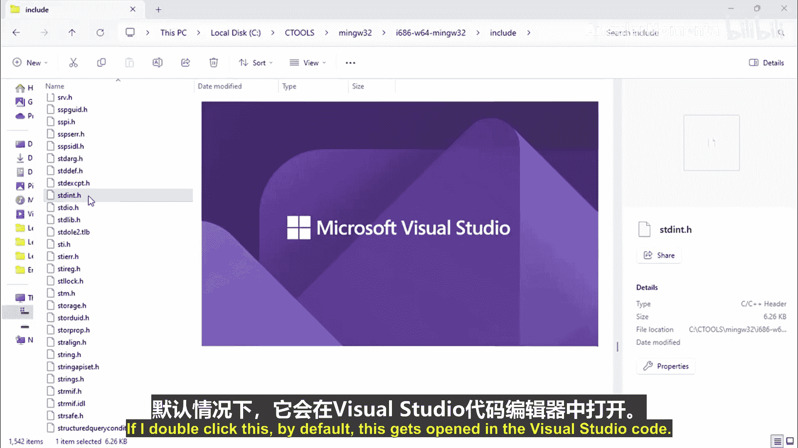
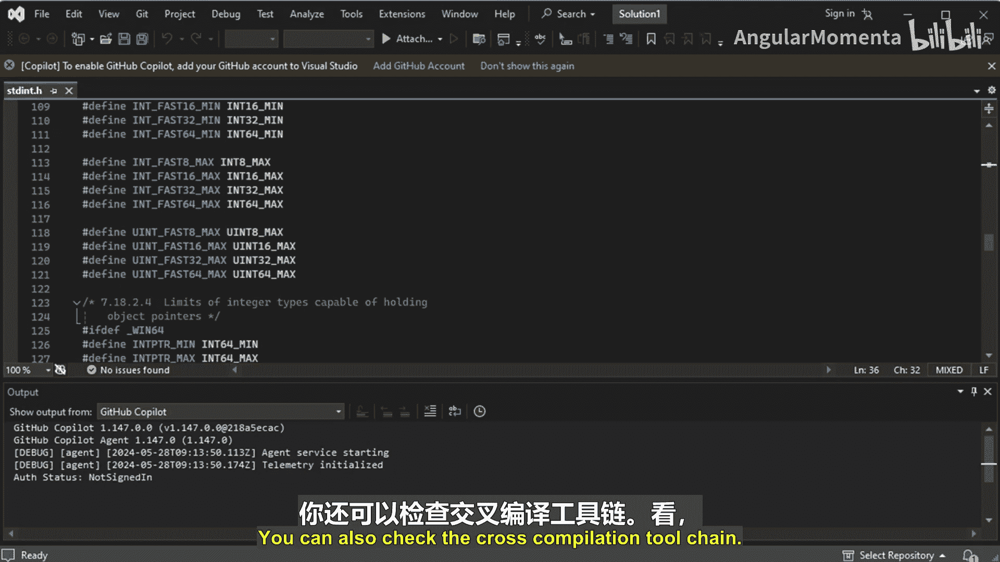
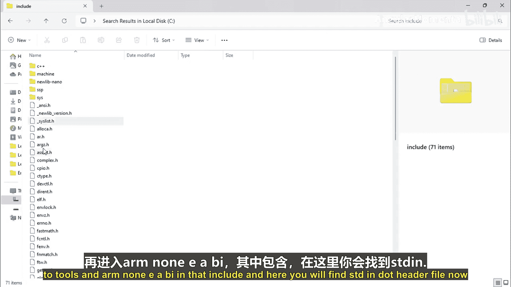
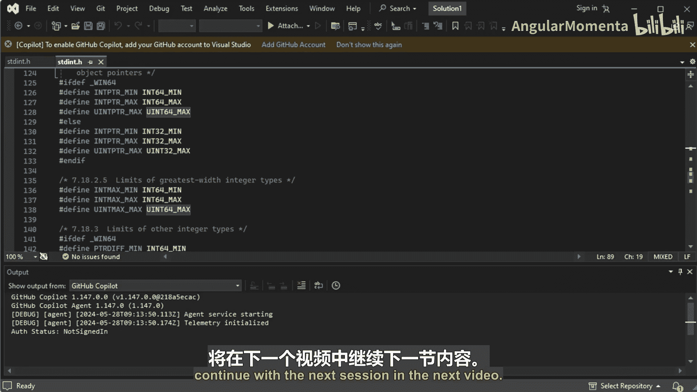

# 【EDUCBA】构建嵌入式系统 ｜ ARM Cortex (STM32) Fundamentals： Building Embedded Systems p19 02_01_02_理解 stdint.h -BV1KjcTzUEeY_p19-

Hey Ers， welcome back。 So in the last video we had started with understanding about the SDD It dot edge file over here we have I have given you here the examples of what different Eli names are available。

 All these allies data types names for the standard data types are managed in your STD It dot edge file Now let's understand how it is managed you don't need to worry about that that will be no resolved if you use the SDD in dot edge file if you want to you can open and check the SDD I edge also if you use in the same example instead of a normal end or unsigned end if you use here。

 you int 32 underscore T and then you define the variable count over here which always reserve 32 bits for the variable by using the suitable standard type Now this program will not give any error or become buggy if you use some different compiler asset if you want to locate the。

StDDI do edge or you know any standard library header file you will have to open the tool chain installation folder。

 I'll show you that。 How can you open it。Over here， in my case， it is under C tools。

 Mji W 32 in that include folderdom in that C plus plus in that 9。2。0。

 I have this standard lip dot head offi。 If I'll just show it to you， I'll open it in notad。

 I' am not going to change anything in this。 You can see here。You will have everything defined。

On my PC， this is on C driveri C tools in that Min GW 32 folder in that I 686 win 64 min GW 32 in that the include folder。

 you can locate this file over here， it is standard It dot edge if I double click this by default this gets opened in the visual Studio code。

You can just scroll down a bit， and you can see you have all these type defined。

 You have in 8 underscore T U win 8 underscore0 in 16 you win 1632， similarly。

 you have it for long as well。The way I have discussed similarly。

 you have it in the file defined as well。 Now， these are basically all to the standard data type names。

 Now， how is this Elis compiler dependent Now， different compilers issue different STD It dot edge file。

 This head of file content will not be same across different compilers and the bin folder usually contains all the binaries which are used during the code compileilation you can also check in cross compilation tool chain。

See， it is over here。 And if I just show you。Part of this， this is in your C， S T。

 then S M 32 cube I D E folder in that you go to the particular plugin。 I'll just show it to you。

By going back once you come here under SD T M 32， go to this。

 then in this go to tools and arm N E A B I in that include。

 and here you will find SD T D in dot header file Now you can see the content of this header file is different。

 So as discussed the header file content。

Every compiler has its own standard int dot heedophile。 That is there。

 So now I have shown you the difference of both the heophiles，1。

 which was there in min G W and other， which was there in the arm control。

 We'll also introduce you to some of the useful SD I N T dot H Eliies name。

 you apart from the one which I mentioned in 8 or U in 8。 you also have。

 you can check it over here as you in 8 underscore score Max。You went 16 underscore maxs。

 You have U 32 underscore max。 Uwing 64 underscore a max。

 This Uwing max defines the largest fixed width unsigned integer possible on the system。 Similarlyly。

 you have， if you just scroll a bit down。You also have your。Int Ptr andasco max。

Int max underscore minimum maximum。 know， this defines the largest fixed with signed integer possible on the system。

 Similarlyly， you have U int Pr underscore max and this defines the unsigned integer type that is。

 you know wide enough to store the value of a pointer So you can use any of these types as well。

 That's absolutely up to you which type you want to use it This are all defined under your standard int dot head file when you are coding for some unknown architecture like let's say Pic architecture or R architecture。

 you no need not to worry about what is the size of the pointer you can basically use this U in Pr underscore variable which can be used for the pointer variable type。

You don't have to worry about the sizes of the pointers which can be assigned。

 The standard int headerophile will take care of mapping that you that you not appropriate the pointer data type。

 So if you are unsure about the size of pointer than just use you in Pr underscore Let's say or max whatever which defines the unsign integer type that is wide enough to store the value of your point will start using all these things in the programs。

 then you know these things will become very much easier for you with that I'll just end this particular video over here about the standard in dot headerophil and will continue with the next session in the next video till then have an nice stay。

 Thank you。

