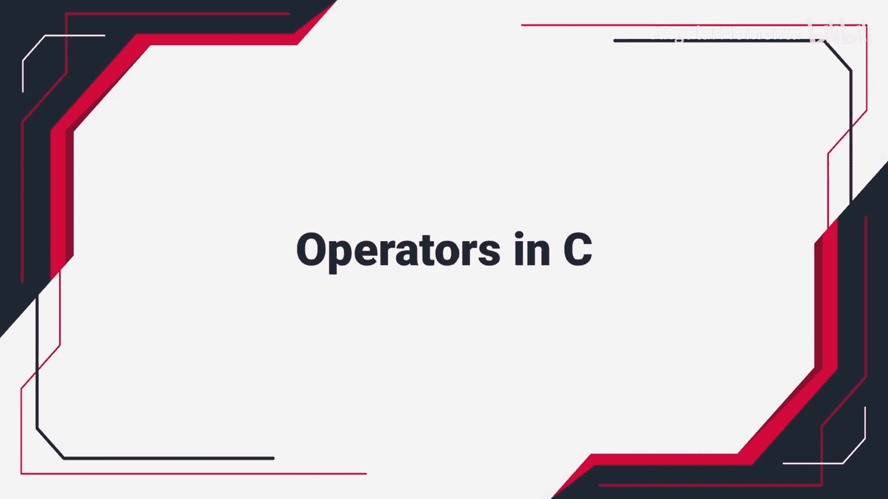
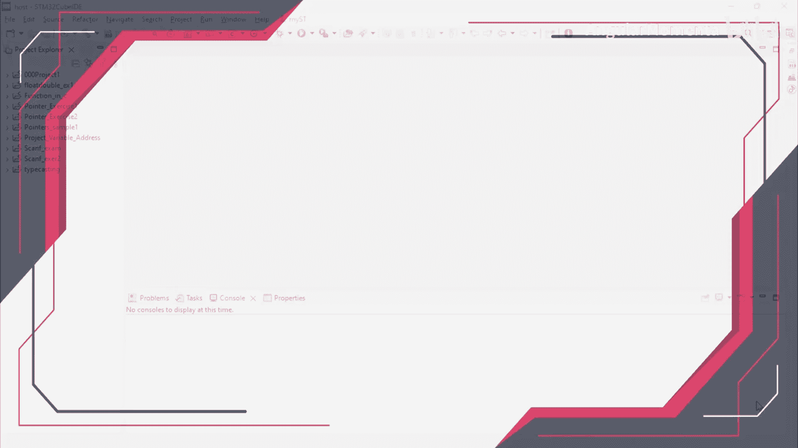
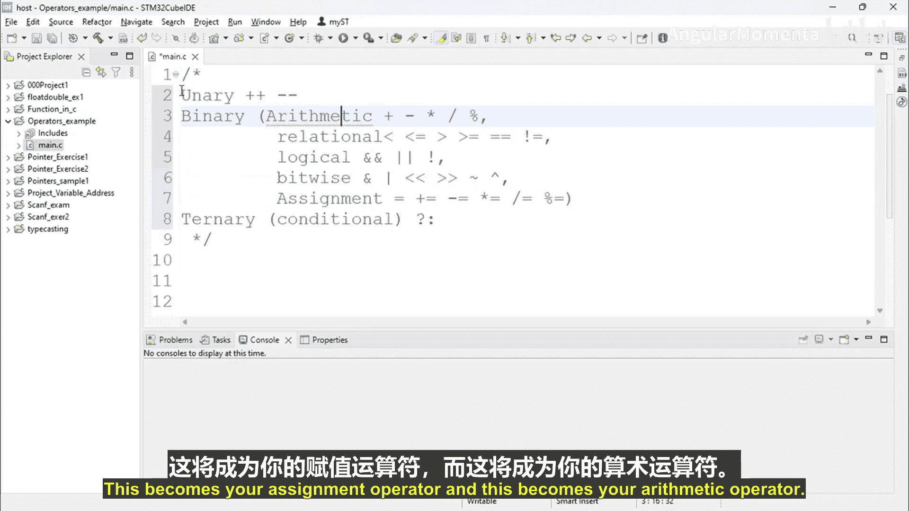
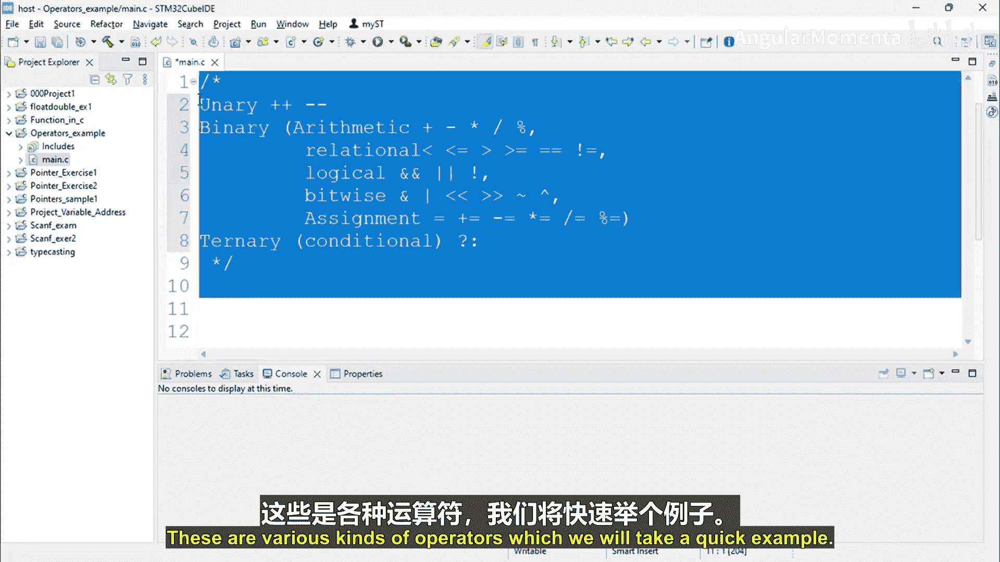
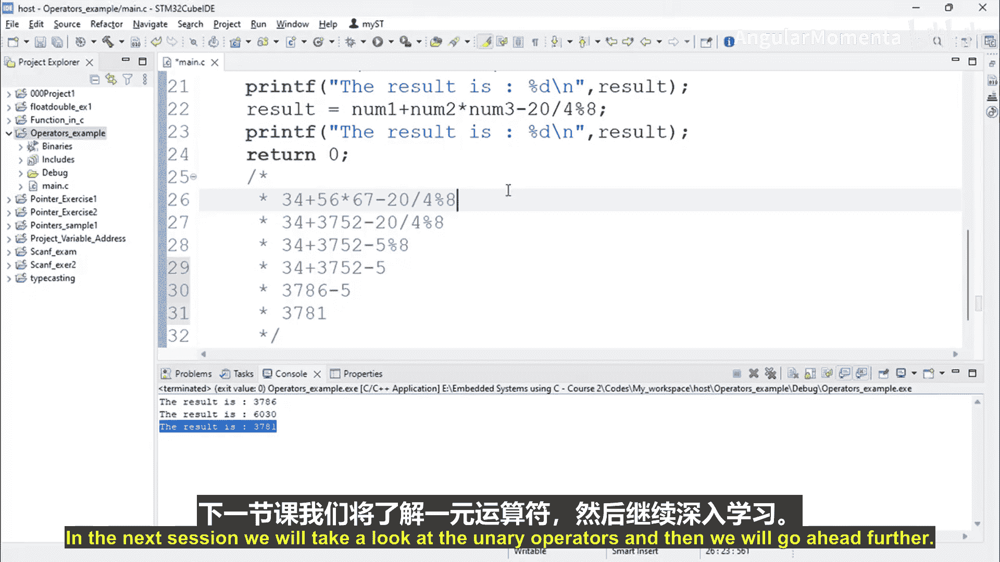
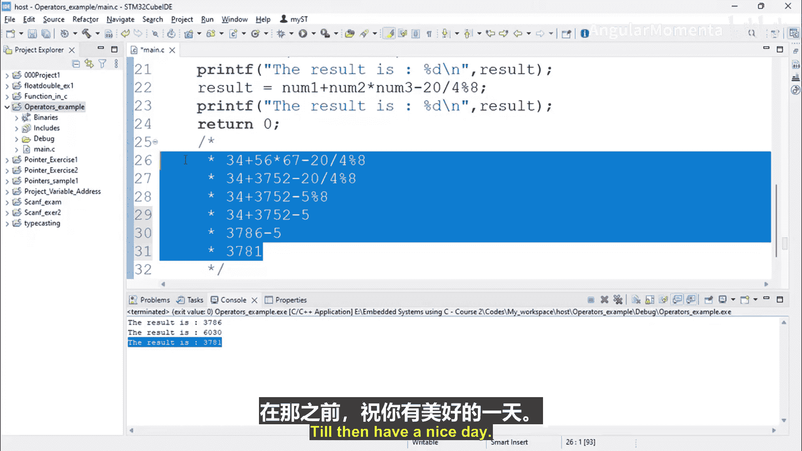

# 【EDUCBA】构建嵌入式系统 ｜ ARM Cortex (STM32) Fundamentals： Building Embedded Systems p20 02_02_01_C语言中的运算符 -BV1KjcTzUEeY_p20-

Hail earners， welcome back。 Now， in this particular video。

 we are going to discuss about operators in C。 Now， before that， what I'll do is I'll create here。😊。

New C， C， plus， plus project。I will give your name， as。😔，Operators。Example， Minji W Gcc， and next。

 and finish。And then in this， I will create a new。Source file， That is。Maan not see。

 And I would write everything here inside the comment。 Let's discuss about operators first。

 and let's quickly see some examples as well。 Opera is nothing but a symbol that tells the compiler to perform a certain mathematical or logical manipulations on the operator。

 You have various types of operators First， you have unary operators， you have binary operators。

 you also have turnernary operators in unary operators， you have plus plus than you have minus minus。

 than in the binary operators。 you have various types like This is further divided rather into。

Athmetic operators， you have relational operators。 you have logical operators。

 you have Biwise operators。 Also， you have。Assignment operator。

 all these are subtypes of your binary operators。 Inary。

 you have just one that is conditional operator。And example is question mark Col。 Now， in this。

 if I show you in arithmetic， you have plus， you have minus multiplication division and modulo。

 Similarlyly， if you go to relational。Now， let me just give it over here like that。In relational。

 you have basically less than， less than equal to more than， more than equal to。

Then you have double as equal to which is for equality。And you have not equal to。

 which is the negation operator。 Then you have logical。

 you have and you have R and you have the negation one。 Then in the bitweice operators。

 you have and operator。 you have or operator。 Then you have this bitwiseice left right operator。

You have the Tiled bit operator and the exponential operator。

Assignment operators basically start with the basic is equal to。

 Then you have plus is equal to you have minus is equal to Similarlyly multiply is equal to。

Divide is equal to。 And finally， modo is equal to What I'll do is I'll just put this over here like this。

 just for your understanding purpose。Let me put it all the binary operators over here。

All these are your binary operators。 This becomes your assignment operator。

 and this becomes your arithmetic operator。

These are various kinds of operators which we will take a quick example look over here as we know what is the basics of these operators。

 we don't have to go into detail about this as we have already done this in the basics course which is available quickly we'll start with exploring about these operators with quick examples as such。

Here， I am going to first write down。Hash include S TD， I O dot edge。Void main。

Or' rather we write down into main。😔，In bracket void。 And here we return 0 and。We create here。

 let's say， integer variables， nu one。Numb 2， number 3。Result now， over here。

 I give the values in the variable。 N2 is equal to some value。And number 3 is equal to some value。

Okay， then I say result is equal to。 Let's say I do hear Nan plus。Numb 2 minus nu3。 or rather。

 let's stick here multiplied by number 3。 and I try to use a printf the。Result is goal in。

 I want to print the value here and the value is of the variable result。

 Let me save this and quickly will the project and go ahead and run the CC plus plus application It gives me the value as 3。

7，8，6 Now exactly here you need to understand how the expression is you know evaluate。

 now you have to think from the of the compiler for that basically you need to understand how the compiler think about this particular expression。

 Okay now there is something known as operator precedeings。

 Now operator precedents define the rules that which operation will take place first and which operation will take place or will take the precedes over others。

 you can also use there。 let's say for example I want to do multiplication first I can give here parenthesis。

 which means I want to evaluate this first。 Now you can see here the result。Over here is 3，7，8，6。

 Now， let's say I do here one more thing。 I keep this same。 Okay， I just copy this。 come here below。

 And for this， I am doing multiplication first。 and then let's say I am trying to divide。Now。

 let me try and build this and run this again。Now， you can see here。 O， one sec。

Let me do it like this。Yes。Addition first， and then this。So let me also give your slash and。

Here that right。See here， both the results are different。By default， it does multiplication first。

 and then whatever is the value， it adds up the value with the value of number1 variable。

 whereas when I say I want to do the addition first， it does 34 plus 6，56。

 and then whatever is the addition， it multiplies that with the value 67 over here。 in that way。

 I can define the operator precedence what I want to take it first and what I want to do it later。

 Similarlyly， let's say I have here。 I have used plus multiplication I have， I'll also take here。

 Let's say。Subtraction， I'll also take here。 Let's say， division， and I'll also take here， let's say。

Moulus， I' am using here All the operator。 Let me do it one thing。

 I'll just copy this and paste it here and remove it from this。Now， if I。Try to build this。

 and I try to run this over here。 This will give me a total different result。 Now。

 to understand this， you need to understand the operator precedence always multiplication takes place foot。

 If Im using all the operators。 Okay， let me do it over here。 One thing。

 let me put this in the comments。 Okay， so my expression basically is 34。Plus，56。

 multiplied by67-20 divide by 4 modulus 8。 This is how my expression is。

Now what I'm going to do is I'm going to open calculator below。

And the fourth thing that takes place is basically multiplication。If I do 56 multiplied by 67。

 I get here 3，7，5，2， which means this in the next line is going to be 34 plus。3，7，5，2， then-20。

 divide by 4 moduluus 8。 That is what is going to happen。 Now， after the multiplication。

 the division takes place over here， this is going to happen。

 Let me write down the rest operator as it is。 And when the division occurs。

 I'm basically just going to show it to you here， if I do that， it comes to 5， then that moduluus 8。

 this is going to be my next set of operator。 Now， over here， after multiplication。

 you have division， then you have modulus over here， if I try to divide 5 moduluus 8。

 whatever will be the remainder that would appear over here。

I have just changed this to programmer calculated here since we would be also looking at the modulus。

 Now， if you try to do5 modulus 8 here， you get it as 5。now， when you have plus and minus both。

 it basically evaluates as from left to right。 So first addition would be done and then subtraction Ed value over here would be 34 plus 3。

75，2， which comes to 3，7，8，6。-5。 that will come to 37，6，1。 sorry，81。

 and that is what is the exact result that is coming over here。 In this way。

 your operator precedes actually work。 Again， remember， there is no need to， you know。

 remember how the operator precedents occur。 you can any time find it out from Google as well。

 you basically have all the operators which they have gled and you can check how the operator precedents happen。

 But if you want at times you want to that Edant has to be occurring first。

 then you want multiplication to happen。 then you want division to happen。

 Then basically you can give the parenthesesis wherever you want to change the precedents of the operator。

 This is how all your basic arithmetic operator' work in the next session。

 we will take a look at the unary operators and then we will go ahead further。

 Stay tuned for the next video till then have an nice stay。 Thank you。

