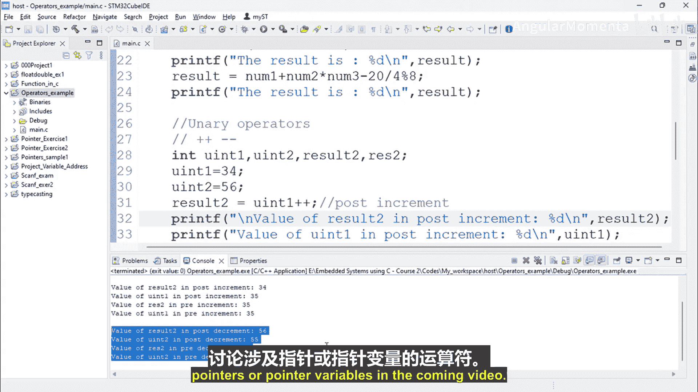

# 【EDUCBA】构建嵌入式系统 ｜ ARM Cortex (STM32) Fundamentals： Building Embedded Systems p21 02_02_02_C语言中的一元运算符 -BV1KjcTzUEeY_p21-

Hey Es， welcome back。 So in this particular video， we are going to explore about the unary operators in C will take an example and we'll take a look at it。

 Unary operator， Basically， you have two types of operators in that。

 you have plus plus and you have minus minus， So I'm just going to put here a comment， which is。😊。

Arithmatic operators， this is going to be unity。Operators okay and over here you will have operators like plus plus and minus minus Now over here again。

 there are two types of unary operators you can use it something like this I can say let me define here in say U in1 this is for unary in1 and let me take it U in2 and over here I am assigning the values let's say as 34 and U in2 as let's say 56 Now I can do it two things over here。

 let me take one more thing as result2。And let me make result2 is equal to say， U and one。Plus plus。

 so here I have used the plus plus operator after the operate。 now， this is known as post。😡。

Increment， there is another thing that is that you can basically check。

 Ill take one more variable as result R S 2， and here I am going to check plus plus Uent1。

Here I have used the operator before the opera， and this is known as pre increment。😡，Now。

 if I have to print the result， okay， so let me use a printf， say value in。Post increment。

Percentage D print the value of result 2， similarly。I want to print here。Value of。

Pre increment and the value of result。R yes2， let me save this。 Let me build the project and run it。

My mistake， let me take your a new line always and do it again。Value in post increment it becomes 34。

 the result2 value remains 34， which is the value of U went 1 why because when I do a post increment I am for saying assign the value of U win 1 to result 2 and then make the value of U win 1 plus plus so let me give it over here。

 say。Value of。Result to impose increment。Let me give it your value of。You in one in post increment。

 and I'll print。 You in one over here。Similarly。Let me print your value of。A is2 in pre increment。

 and。Value of。You a't。1。And pre increment。Let me build the project， and let me。Run this。

So you can check it over here。 The value of result 2 in post is 34 because first the value of U1 is assigned so 34 gets assigned to result 2 and then you1 becomes plus plus Now there is one more thing here I have already incremented so the value of this becomes 36 because the value of U 1 is again pre incremented here So what Ill do is Ill take here the value of。

You end2 for pre increment。Let me do it like this。Priend is here。 But what I'll do is， I will。

God this。Do it here。Then， I will do again。As signing of value。 and then I will do again。

 pre increment and print the value so that it makes you perfect。You into to one， sorry。Okay， U in2。

 you can ignore the warning。 That is okay。 We will use U in2 also later on。

So see in the first one when I'm doing a post increment the result2 is 34 value of Uent 1 becomes 35。

 but when I'm doing a pre increment it is first incrementing the value of you went 1 from 34 it is making it 35 and then 35 is getting stored in Rs2 so in this both the printf you will get the value as 35 so whenever you use a pre increment always the value would be incremented first and then the assignment will happen but when you use a post increment value will be assigned first and then the increment will happen。

Now let me take a look at this you went too as well okay。

 so what I'll do is I'll just copy all the statements。I'll put them below。

 and here I will make you into minus minus。So， let me use this here。And again。

 I will assign it to 56 here。The value of U N 2。U N2 is， again， using post。Dreement。This is。

3 decrement。Okay， and here also it is minus minus again for decrementing。

 you have post decrementing and you have pre decrementing post decrementing。

 the value would be assigned first and then the decrement will happen。

 whereas in the pre decrementing value would be decremented first and then the assignment will happen。

 So let us just quickly build this and check the output。 So I'll run this。And take a look at this。

 Now， the original value is 56 when I'm doing a post increment，56 is getting assigned to result 2。

 and the value of uent1 over here。 Okay， the value of Uent 2 would be 55。

 But whereas when I'm doing a pre decreementment。 the value is getting decremented first。

 this is becoming 55， and then that is getting assigned to your Rs 2 variable。

 I am just going to put here  one print F。Or rather。

 let me put it here itself when I am starting a new section。

 I am giving there a new printer statement。One more new line。

So that would just make it easily understandable。 These about the arithmetic operators。

 This is regarding the unary increment operator。 This is the unary decreement operator in that also post and pre That it about this unary operators Stay tuned for more such videos on operators wherein will discuss about the operators with pointers or pointer variables in the coming video till then have a nice day。

 Thank you。

