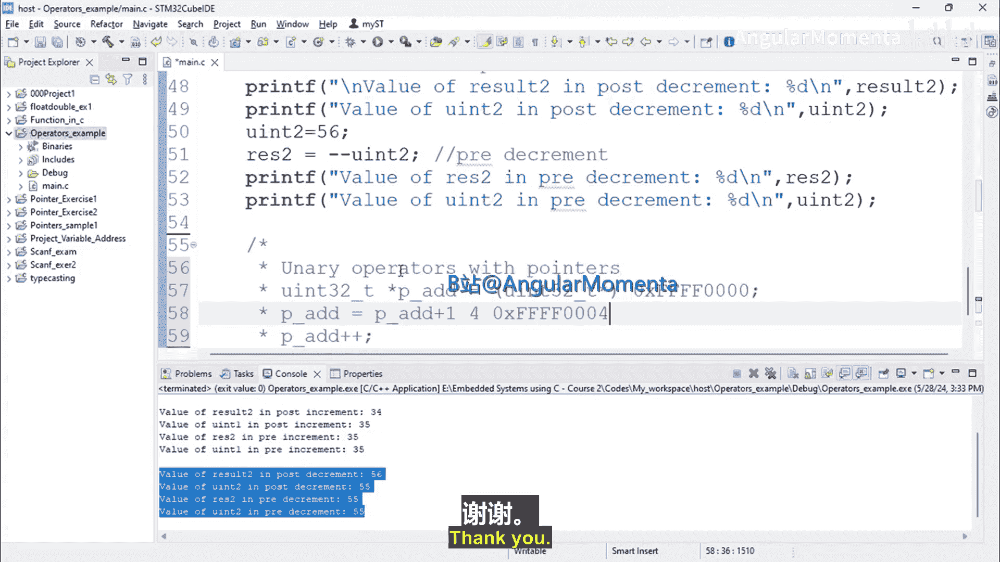

# 【EDUCBA】构建嵌入式系统 ｜ ARM Cortex (STM32) Fundamentals： Building Embedded Systems p22 02_02_03_指针一元运算符 -BV1KjcTzUEeY_p22-

Hey Eers， welcome back。 Now， let us discuss in this particular video about the unary operators with the point of variables。

 Let me just this over here。Fine。So。Let's discuss about thee。Unity operators with。

Points Now here there is a point of variable definition。 For example。

 let's say I am creating here U and 32 under score T。P underscore score address is equal to。

 I am defining here U N 32 underscore score T and typecasting it2。0 sum address A 0 x， F， F， F， F 0。

0，0，0。We have a point of variable definition and this basically initialized to a particular value and the point of variable is of type U and 32 underscore underscore score t asterisk。

 Now， let's say if I want to increment this point of variable by 1 if I say over here。

 say P and underscore score address is equal to P and underscore score address plus 1 Now this is using the arithmetic add operation I'm using here an plus operator。

 which is an arithmetic operator。 So if I try to increment this address by1。

 it actually gets incremented not by1 but by4， because it is of type U in 32 So that's why the final result over here would be say 0 x FFFF0004 not2 Now instead of doing this you can also use the unary increment operator on the pointer variable can do this you can basically say over here。

 say P and underscore score address plus plus this will all。

So make the same thing instead of writing here P underscore a is equal to P underscore a plus1。

 This statement is quite easy to understand and easy to operate as well。

 Both statements are going to give you the same result。

 it's nothing that if you use this it will be cremented by4 if you use this it would be incremented by one or2 no Both in both the cases it will be incremented by4 because that is what is the by default size of the U 32 that would be the final result over here。

 So when you do an increment operation or a decreement operation on the point of variables。

 the increment or decreement depends upon the pointer types。

 One is you can use the pointer variable as an with the decreement or the unary increment operator and when you do that arithmetic that is using the addition or the subtraction。

 it depends upon the point of variable type that was about understanding the unary increment and the unary decreement operators with point。

InThe next session well discuss about or in the next video we'll discuss about the relational operators in C。

 stay tuned then have a nice day， Thank you。😊。

