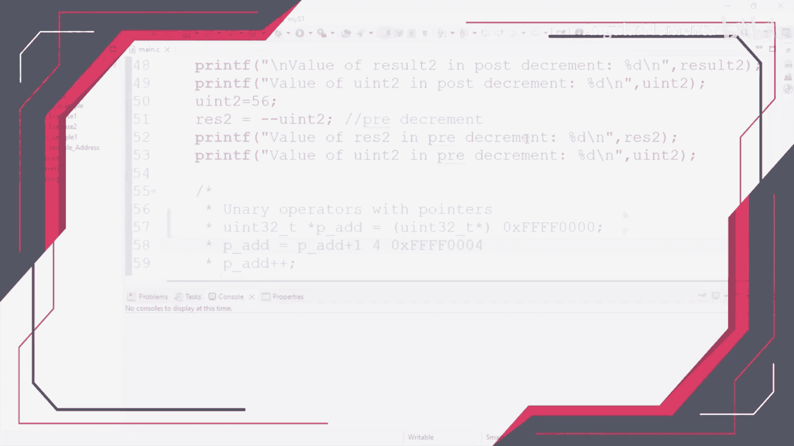
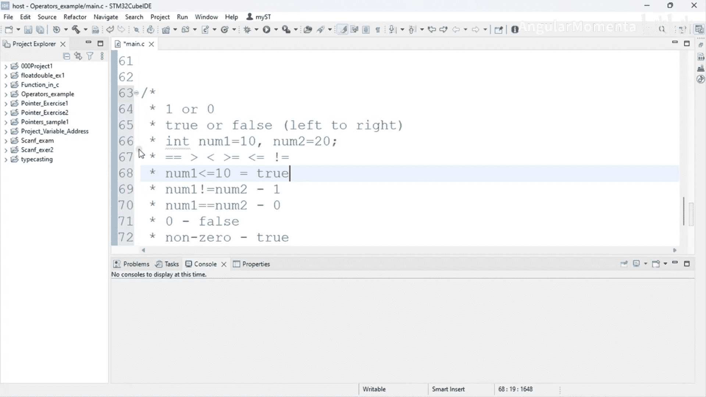

# 【EDUCBA】构建嵌入式系统 ｜ ARM Cortex (STM32) Fundamentals： Building Embedded Systems p23 02_02_04_C语言中的关系运算符 -BV1KjcTzUEeY_p23-

Hey learners， welcome back。 Now， in this particular video。

 we are going to explore the relational operators in C again。

 I am going to continue in the same project as well my project name which Im using over here is the operator example。

 Now a relational operators basically do some kind of evaluation on the operators and basically these operators are。

These relational operators return the value either in the format of 1 or 0。Now， here， one means true。

And0 means fault is true or false relation operators are basically also known as binary operators because they require at least two operators to operate on Now the relation operators are always evaluated from left to right。

There are certain relational operators available in C。

 We have already listed them above in the first introduction session to operators where we have done over here。

 the first thing that we have is the equal to operator Now this is the sign which is used for comparing two opera together this is this double is equal to and single is equal to is different this operator is for equal check then the next you have is greater than which will check if one operator is greater than the other next you have is less than next you have is greater than equal to less than equal to finally not equal to let's say if you have two variables and you want to check whether both the variables are equal then you will have to use this double equal to operator Similarlyly if you want to check whether one opera or one variable is more than the other variable use this more than opera Similarlyly。

 if you want to check。For less than you have this particular expression。

 if you want to check more than equal to basically a suppose you have a variable say int number1 int number2。

 the value of number1 I have assigned as 1 value of nu2 I have assigned as 20 I want to check if lets say number1 is greater or less than。

10 Now if I am using this the value of number1 is actually 10。

 if I am checking this if the value of number one is less than 10 this will give me the value as false because it is not less than 10 it is equal to 10。

 but if I use in this case less than or equal to 10 then I will get the value as true instead of false because it is less than or equal to 10 that will give me the value as true。

That is the difference if you use just less than or just greater than and with greater than equal to n less than equal to now this not equal to operator is basically negation operator we can say basically check if it is not equal to the particular expression。

 supposeuppose you do something like this say number1 is not equal to number2 Now this will give me the value as1 which is true because number1 value is 10 and number2 value is 20 and 10 is not equal to 20 the expression is going to evaluate it to true in this case Similarlyly if the same thing you use number1 double is equal to number2 in this example you are going to get the value as0 since actually number1 is not equal to number2 10 is not equal to 20。

 you would get the value there as false instead of true。C basically0 is false in C。

 you have to compare anything which is0 is false for C and anything which is non0 is true。Intuacy。

The expression using the relation operators evaluate to a value of either true or false relation operations are often used。

 you know， within if statements， we have various kind of file statements will use them later on as we see some practical demonstrations of it。

 Like in this case， I have given you a simple example If you want to check the values over here。

 you can you have to create the variables assign them certain values and then check whether what is the relation between both the operate will continue more on such sessions in the coming videos。

 state tuned till then have a nice day。 Thank you。

