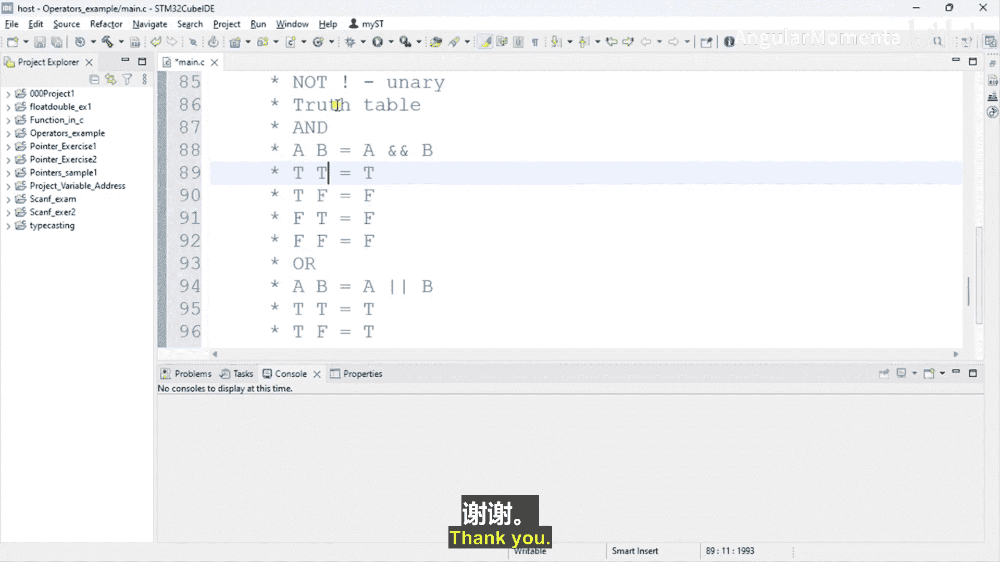

# 【EDUCBA】构建嵌入式系统 ｜ ARM Cortex (STM32) Fundamentals： Building Embedded Systems p24 02_02_05_C语言中的逻辑运算符 -BV1KjcTzUEeY_p24-

Hey learners， welcome back。 Now， in this particular video。

 we' are going to explore about the logical operators in C。

 I'm just going to name this as relational operators。 And now let us discuss about the。

Logical operators， basically， in C， you have three logical operators。

 One is and which is symbold as double m person。 Then you have a logical or。

 which is the two pipeline symbols。 and you have the n， which is the exclamation mark。 Now。

 you can perform the logical and or not。 Now， these all are binary except not not basically is。

Uary operator， whereas these both are your binary operators。

 as they will require two opera to operate on in this particular case， the logical。

 let us explore about the logical and operator first of all。

 I'll just go to write down below over here。 Now in order to perform logical and on the opera。

 the logical and basically produces the value， One， if both opera have nonzero values。

 If either opera is equal to 0， the result is going to be0。

 if the first logical and operator is equal to 0， let's say I am having here a。And B。

 if I say over here， this is this opera is equal to 1。

 this opera is equal to 0 now this and operator will produce the value one if both have a non0ro value。

 but if  one have a0 value I am going to get the value as 0 over here。

If either of the operator is equal to the result of the logical operator is going to be 0 in this particular case。

 let us take one particular example on this lets say I am having here， let's take this nu 1。

 I am going to assign here a value as minus 10 and say number 2 Im going to assign here a value as 20。

 I check here result is equal to say nu 1。And。Numb2。

In this particular case nu1 is also a non0ro value this is going returning the value1 in this case which is true again。

 nu2 is also a non0ro value so it is going to also return1 the entire value in Rs will be equal to 1。

 but in a particular case lets say this is not minus10。This is something0。 In this case。

 number1 returns a value 0， nu2 gives a value 1， but if any one of the opera is 0。

 the entire expression is going to give you the value as 0。

 Now there is something known as truth table。 I'll just explain it to you that over here。

Now through table， let us check for and first， let's take here operate as let's say A and B。

 if a is true B is true then。Let's do here， A and B。Is also going to be true if let's say a is true。

 but in case B is false then the expression is going to give you the result as false。

 supposeose a is false B is true still the entire expression is going to evaluate to false。

 but if both are false。Then also the entire expression is going to evaluate to true in this case。

 it will give you true only if both the given expressions or opera result to true。

 whereas if I give you a true table for or， let me write down。This。In this case。

 suppose a is equal to true。 B is also equal to true。 The result is going to be true。

 Suppose a is equal to true， but B is equal to false。

 still one of the opera is giving you the value true。 the entire or will give you the value as true。

 say A is false， B is true， even then you are going to get the value as true。

 only if both the opera result to false， then the value for or will become false。Similarly。

 if we check for n。Now， over here， we just have one operator since this operates only on one operator。

 this will be not。And this will be or。Over here， suppose a is equal to true。

 The result is going to be false。 suppose a returns false。 the result is going to be true。

 basically negating it。 whatever the value of operator is exactly opposite is what are going to get from the not operator these are three logical operators which you have which depends on this truth table so this truth table is not actually necessary for you to remember。

 but just to it that you understand what expression would evaluate depending on the value of operator we will see a practical demonstration of this in the next lesson from where we are going to start with the if conditions that makes your concept very much clear As of now we have understood about the basic operators that we have including the arithmetic operator。

 the assignment operator various relational operators we have also taken a look at unary operator and also now the logic。

Operators stay tuned for more such videos till then。 Have a nice day。 Thank you。

