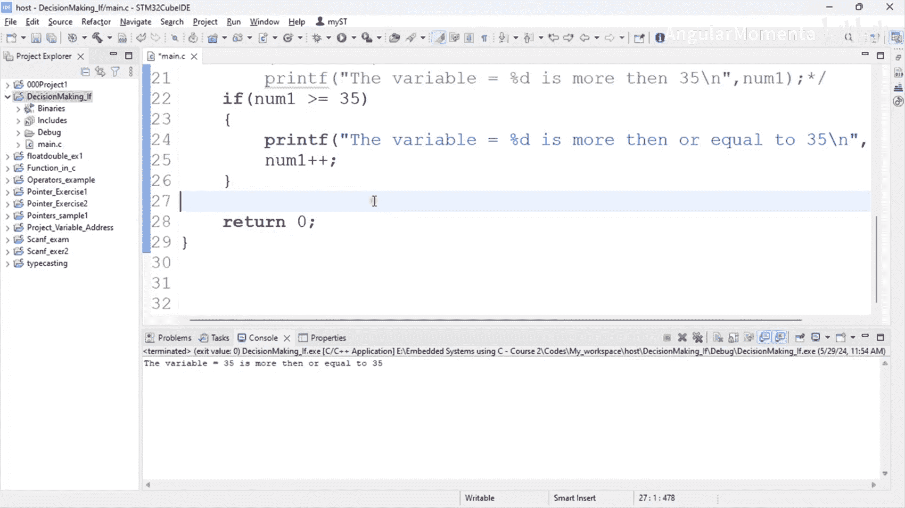

# 【EDUCBA】构建嵌入式系统 ｜ ARM Cortex (STM32) Fundamentals： Building Embedded Systems p25 02_03_01_if语句 -BV1KjcTzUEeY_p25-

Hey learners， welcome back。 Now， from this particular video。

 we'll start about understanding decision making and C using your if statements。

 What I'll do is I'll create a new project Now for this。

 Let me create a new C plus plus project and Min G W Gcc project name。

Decision making underscore underscore if。Finish， and now inside this， I will add a new source file。

 Let's see Min dot see。 And let's start discussing about。

Are decision making basically when you' are going to write some program， right。

 it is always necessary that you have to put some code which has to be executed only when some specific condition is satisfied。

 Now that means your program has to take some decisions based on some internal or external event conditions。

 For example， if a user presses a particular key then execute one set of statements or if the user doesn't press any key then execute some another set of statements。

 this can be achieved by using the decision making statements in C in embedded programming， well。

 let's take an example of let's say water level indication and control program。

 If let's say a sensor detects water level rising about the threshold。

 then the program executes the code to turn off the motor。

 Otherwise program doesn't turn off the motor in C。

 there are five ways to take decision making use of the below decision making statements first you have as if statements then。

you have if else statements。Then you have if else。If a ladder， we call it。

Then you have the conditional operators， you also have something known as switch case。

Statements we are going to explore all these in the coming videos now， coming to if statements。

 if basically as the word itself tell you， it will basically check for one particular condition if the condition is true the given block of statement will execute if not。

 then there is nothing which can handle over here， this will only execute if a particular block is given and the expression evaluate true true Now there is various ways in which you can write down this if statement。

 First is you can write down here say if you can write down some expression and if this evaluate to true you write down the statements and end it with the semicolon This is one way of writing it or another ways you can write down if expression open the curly braces write down multiple statements if you have them and close the co brace every statements will end with semicolon either you can use these particular。

W of writing it or if you just have a single statement you can directly use it like this it depends how do you want to evaluate it we call this as single statement execution and this as multiple statement execution I can just write down multiple statements over here and then I can execute it as it is。

Now， Ill show you an example of a single statement also and a multiple statement。 Also。

 let me first include the SDDI O dot H then。Let's create the main method。 This is going to return 0。

 and I'm going to create here。 Let's say an U andt。8。And as quo T variable as let's say number1。

 I'm going to assign here value as 34。 I'm going to use an if condition。 I want to check if nu1。

 I'm going to use your relational operator。 I'm going to check if it is more than 35。

 if it is more than 35。 this is a single statement。

 I am simply going to give here a printer saying the。Variable is equal to print here percent HD。Is。

More than 35， give you slash n， then print the value of number one and end it。

 Let me save this and let me quickly build the project。

Now since I have used UN8 I have to use the SDD in dot header file now I have built this it is successful。

 I am going to run this and check no output given because the value of number1 is not more than 35 if I make this let's say 36 I again build the project and I now go and run this I get the statement executed the variable is equal to 36 is more than 35 this was a simple if condition if statement now similarly let us suppose after executing this I want to also increment the value of number1 then in that case what I'll do is let me copy down the statement below and I would just comment out this statement and now I will open the curly bracket close it and inside this I will also do number1 plus plus now what I' am doing。

cuting here multiple statements inside one single FL， then I have to open a curly bracket。

 close a curly bracket and write down any number of statements that I want to execute。Now。

 if I save this。I go here。 I build the project。 I again run the project。

 I still get the value because it is still 35。 Now， if I make this 35， now，35 is more than 35。

 let us check out we are going to get here， the value as false。

 nothing would be executed since now if I wanted to execute， I have to use the operator。

 which is more than or equal to 35。 Then I can write down here more than or。Equal to。35。

 Let me build this now and let me run this now。 That is a difference。

 if you use more than or if you use more than or equal to operator with your operates。

 That is how the single， if statement works and the multiple if statement works in this particular case。

 I hope you have understood this， you can， in this case， also you can put the curly brackets。

 but that is not necessary since if you have just one single statement to execute。

 do not open and close the curly brackets， do not increase your lines of code lines of code to be if you have multiple lines to be executed。

 only then this curly brackets are necessary， not otherwise。

 if you have this particular statement you have multiple statement to execute in that。

 then you need to give it over here。 Just remember one thing， if you are using it like this。

 you should not give here or semicolon， because this is。Not a statement。

 It is basically if command that is executed。 It will check if this is true， will go inside it。

 Ex the statements and then end your F block。 That is how you will have to basically execute this particular statement and check out the particular output。

 I hope you are able to understand the particular example that we have done。

 This was a simple if statement。 We have not yet concluded with if else statement。

 Well go in one by one and will explore them in the coming videos。

 That's it about this particular video。 Stay tuned for most such video still then have a nice day。

 Thank you。

