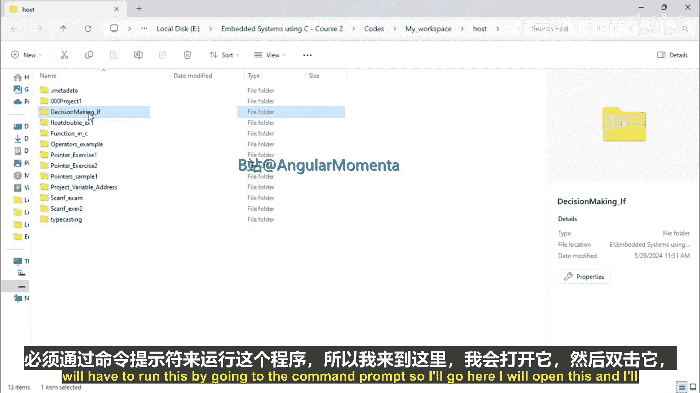
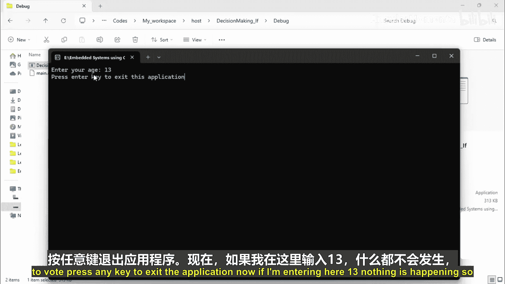
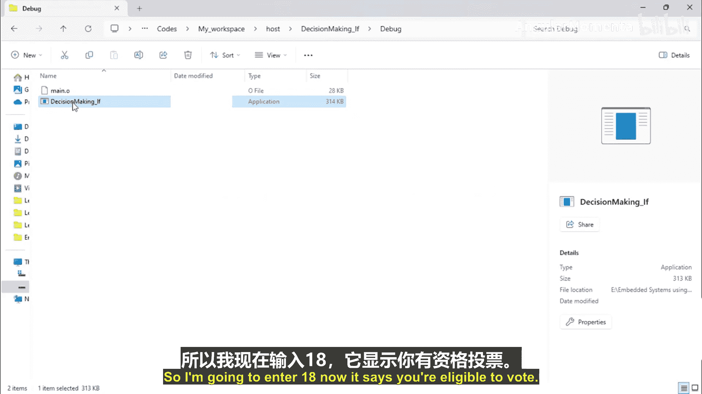
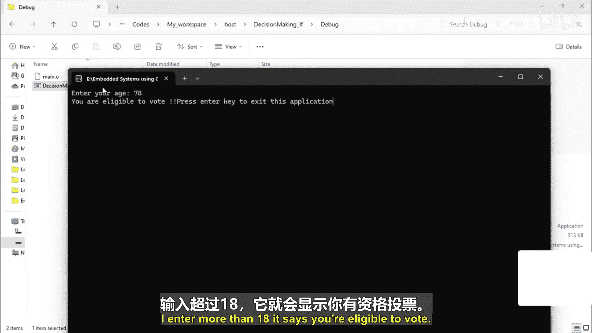
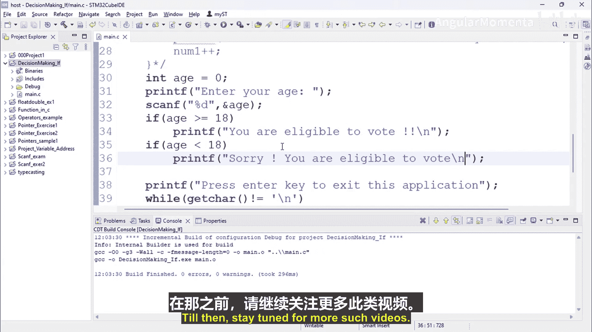

# 【EDUCBA】构建嵌入式系统 ｜ ARM Cortex (STM32) Fundamentals： Building Embedded Systems p26 02_03_02_if语句练习 -BV1KjcTzUEeY_p26-

Hey， Es， welcome back。 Now it's time to go ahead and do one exercise。

 What I'm going to do is I'm just going to comment all these。 Let us started from here。

 and I'm going to comment till this， this was just for your exploration purpose。

 Now we are going do in this particular video will write down a program which will take the user input as the age of the user and then you will decide whether the user can cast the vote or not。

 you have to print appropriate messages wherever it is。

 and the minimum H for casting vote is 18 years。 So you have to check if he more than 18 years only then is able to cast the vote。

 Let's go ahead and solve the particular exercise over here。

 we have taken here the main method It's already there。 now over here。We don't need this S T D int。

 We'll remove that。We are going to use here。First， let's say。

 just give your press enter key to exit this application and。Don't worry about this。

 This is just to keep the application hang till the user presses and Turkey。 Okay， so get care。

 not equal to。Slash and then。Just a command。 And then again， a。Get care here。

 First thing that we have to do here is we have to take a variable。 I'm going to take it as H。

 and I'm going to define initialize the value of H 20。 Now we have to ask the user to enter。

 So I'm going to use here a printf， say enter。Your age。Co in and let's make E S capital。

 Now we'll have to use a scan F statement。 Now since this is of type integer。

 we'll have to use percent H D to accept the value and store the value using and percent H once we have the value of H。

 we'll have to use the F statement and check the value of H if it is more than 18。

 or rather we can do it the other way around as well， I'm just going to print here a message， say。

You are eligible to vote。Let me put it here in capital。 If the age is more than 18。

 I have not used the curly brackets。 I have simply given here that the user is eligible to vote。

 if you want to check it the other way round， you can also check that if the age is less than 18。

 you can say sorry， you're not eligible to vote。 That is also possible。

 and you can put that inside a curly brackets as well。 Now， let us save this。

 Let me build the project and。This is not required。 Yes， and let me run this。 Now。

 what I'll do is we'll have to run this by going to the command room。 So I'll go here。😔。

I will open this。And。

I'll double click this。 It says enter your age。 I am entering here。 let's say 67。

 It says you're eligible to vote press Nikki to exit the application。 Now if I'm entering here 13。

 Nothing is happening。 so it has to give a particular message there as what can we do is we can check over here one more if condition if it is less than 18。

 it says sorry， you are not eligible to this is my other， if condition。

 which I am checking one is for if it is more than 18。

 one is if it is less than 18 Now for more then we can also do it like more than or equal because if it's 18 or more than that。

 he can vote， if it is less than 18， he cannot now let's build the project again and let's not run from there。

 I will run it from here。 So Im going enter 18。 now it says you're eligible to vote。

I'm going to enter here， let's say， 14， it's say， sorry， you are not eligible to vote。

 I enter more than 18。 It says you are eligible to vote。

When all the three cases， my statement is executing。

 what I'm going to do is just put here a slash And at the end to put the new statement on a new line。

 we have。Execcuted the application successfully， and we are going to get the value as well over here。

 This is how we can use the if statement and we can evaluate the particular expression if it is true or false depending on that。

 then we are basically giving the appropriate message to the user。

 This is how we can use the if statement and we'll explore more about this f and else as well in the coming video till then stay tuned for most such videos Have a nice day。

 Thank you。😊。

