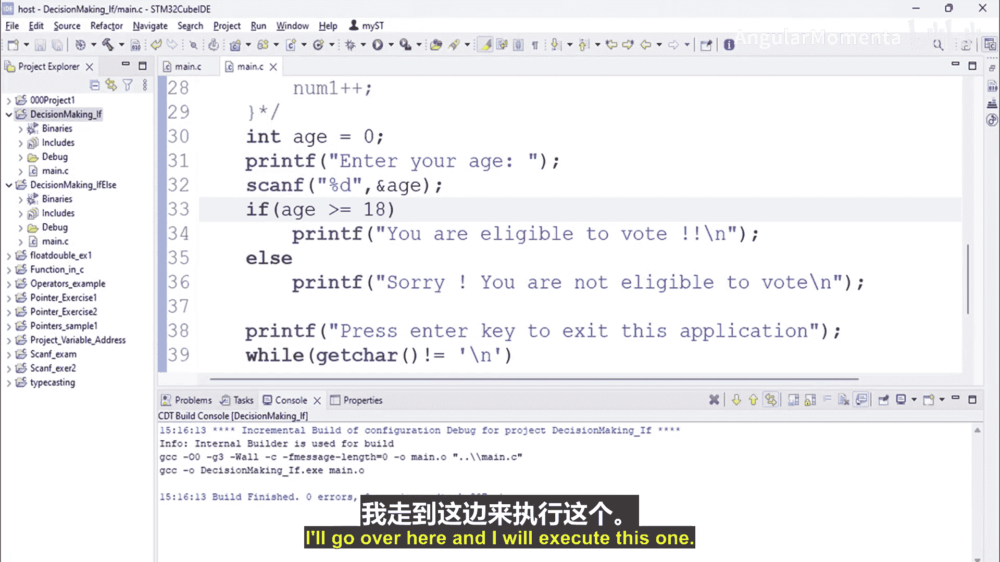
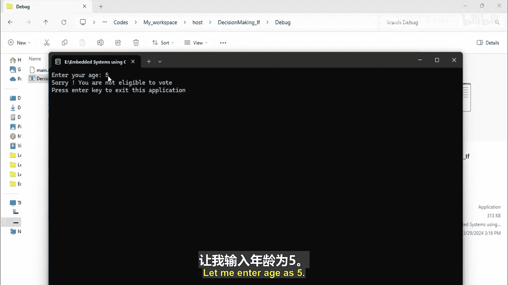
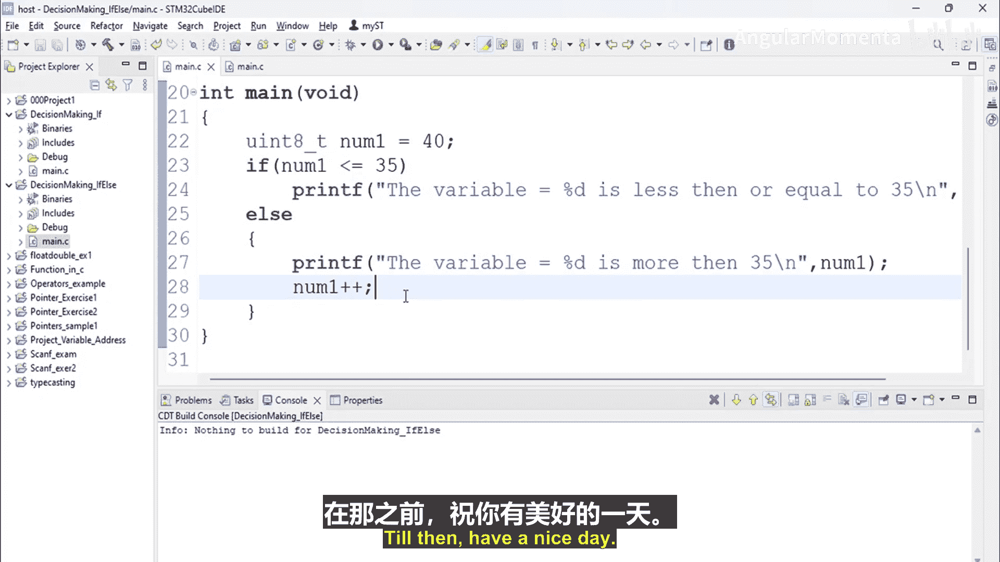

# 【EDUCBA】构建嵌入式系统 ｜ ARM Cortex (STM32) Fundamentals： Building Embedded Systems p27 02_03_03_if 与 else -BV1KjcTzUEeY_p27-

Hail earners， welcome back。 Now， in this particular video。

 we'll understand about the if else' statement。 What I'll do is let me create a new project。

 I'll name it as decision making， if else。And。Let me add a new。Source file。

 Let's start creating over here。Now， the basic syntax of an if else' statement is you have here if you can have any expression now here also we have two things。

 One is a single statement， one is a multiple statement so let's first look out single statement if expression here I will give statement1 else I have statement 2。

 this is my single statement execution， If I have multiple statement execution。

 so I have the expression， I open the curly brackets and here I write down statement 1 similarly statement 2。

 then in the else's block also I can have multiple statement。

I can have statement 1 and statement 2 over here。So this becomes my multiple statement execution。

Similar to if we have in A and else。 Now， what is the execution pattern of this。

 Suppose we have given here one expression。 So if this expression returns the value true statements given after the if statement will execute。

If this expression returns the value falses statement given over in the L part would execute。

 which means if the expression is true， execute these statement。 If it is false。

 execute the statements given in else part。 Hence we have if and else。

 remember in the earlier example， we had given two if conditions。

 One was if the age was more than 18， and the other was if the age was less than equal to 18。

 we don't have to do it like that， if we use if and elses statement。

 Let us do the same example over here。 What I'll do is I will just copy this。Over here。

Let me take it from me。And let me include the S T D in， also。S T D， Iio dot h， and。

Let me remove the comment part。Now， this statement， what I want to do is I can just put here。

And else but。In the F part， I am saying if the value of number1 is more than 35 print the variable value of variable is more than 35 else I want to print the variable is more than or equal to 35 because it is not one second this is less than 35 here I am going to print as。

Less than 35。Less than or equal to less than or。Equal to 35， and this is more than 35。

If I save this and I try to execute this particular project。

It gives me variable is less than or equal to 35。 Suppose I make the value of this essay 40。

I build this again， and I checked the output。 It says variable is equal to 40 is more than 35。

 So this if part has been executed。 If this executes your if part S will not be checked only if your if part is coming to false。

 then the else part will execute。 remember that now in the earlier if also program。

 which we have done over here as well， we have checked if age is more than equal to 18。 Now。

 instead of this， what can we do is we can just write down else。

 which means if H is not more than equal to 18， then go to else and print sorry。

 you are not eligible fine， let me say if this and let me also execute this and show you the output。

 Okay， now for this， I'll go over here and I will execute this one。

Now let me enter the age as 18。 It says you are eligible to vote。 Let me enter age as 5。

 sorry you are not eligible to vote Know need to give multiple if we can do it using if and else but so I have modified it over here as well。

 and we have checked one example over here using the multiple statements as well in the next video。

 we will do one particular sample exercise on if and else willll write on a program which will accept two numbers from the user until print which is the greatest number between the two if both the numbers are equal。

 you will have to print both numbers are equal， we'll do this sample exercise in the upcoming video till then have a nice day。

 Thank you。

