# 【EDUCBA】构建嵌入式系统 ｜ ARM Cortex (STM32) Fundamentals： Building Embedded Systems p28 02_03_04_if与else练习实现 -BV1KjcTzUEeY_p28-

Hey， Erers， welcome back。 Now， let's complete our exercise in this particular video。

 What I'll do is I will be into my， if else block。 and let me just comment out this part。From this。

 I will just copy down。These statements over here。 This is just to keep the repeating loop over here。

 First thing that we will do is we will have to accept two variables from the user。 First of all。

 we'll have to create those variables。 Let us take here in32 and quo T variables。

 as let's say number1， number2。 Okay， before that Yes， you have included the SD D I N D。Now。

 we will use a printer。 We will say， enter thee。Forct number。Now， let us give here。In bracket。

 that the number has to be in teacher。This is a prompt which will be displayed to the user in this scanf will include percentage D。

And will store the value in Non。 Now， similar to this， we will accept thee。Second number。

And we restore store that value in variable。 num 2。 Now we have both the variables created。 Now。

 the first thing that we have to do is we have to check if the value of nu1 is equal to the value of nu2。

Now， this will basically check for equality。 First。

 we are basically checking if both the numbers are equal。 If the numbers are equal。

 we'll have to print there an appropriate message here， I'm giving a printf。 I'm going to say here。

Numbles is odd。Eal。Now， if this is not true， I am giving here an else spot I' am opening the curly brackets。

 and inside this， I will now check for if number1 is less than nu2。I'm giving for less them。

 so which means。Okay， one second。 this， if is closing here。 This is the L spot。

 and this is the F part。 correct， over here， I'm first checking if the value of number is less than number2。

 I am printing here。 Let's print in percentage D。 The value of the number is。Bigger。

 and here I'm going to print the value， which is the bigger number。 No two， obviously。 Now。

 if this is not true， I am giving here another L spot。 And in this L part。

 we don't have to check anything。 We have to simply say number is bigger is number one。

 that will become your else spot directly。 Now I'm going to save this， and I'm going to。

Built my project， and。This is my Fel。 So I'll go here。 I'll open this。

 I'll go in the debug and let me execute this。 I'm entering the first number in teacher general。

 Let's enter an integer number。 and let's enter equal numbers first。 It says numbers are equal。 fine。

 I am going to again， execute this。 Let me enter。

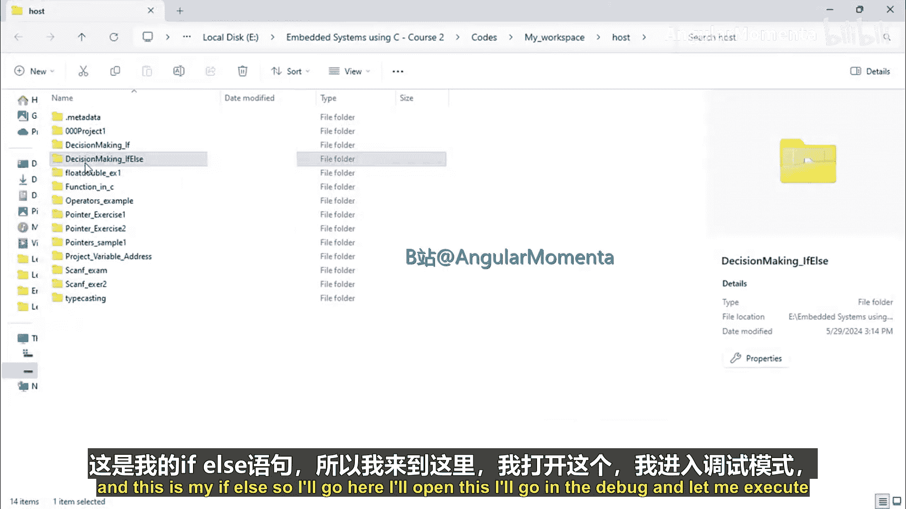

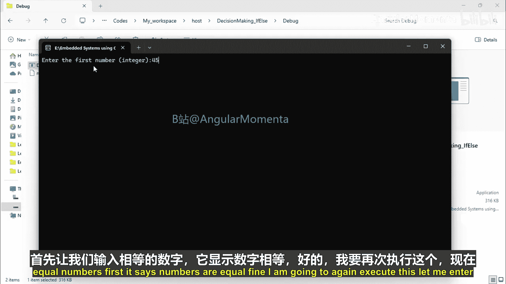

2 different numbers。 Now here it says 56 is bigger。 Now， let me enter the bigger number first。

 and the smaller number later。 So it says 67 is bigger。 The application is currently working fine。

 What if I try to enter here a number， which is in deims， you see。

 my application has gone into some bug， it is not running proper， as a good programmer。

 you have to always take care that our application continues to execute。

 even if a user tries to enter some invalid value。 So you basically have to handle all these errors or what kind of bugs might come when the program is running at the time of coding itself。

 We need to basically take care about it。 Now， let us try and check out how can we basically make the things proper。

 And even if the user enters some kind of invalid input。

 even then the application should not end abruptly。

 let us try and get rid of this particular error over here。

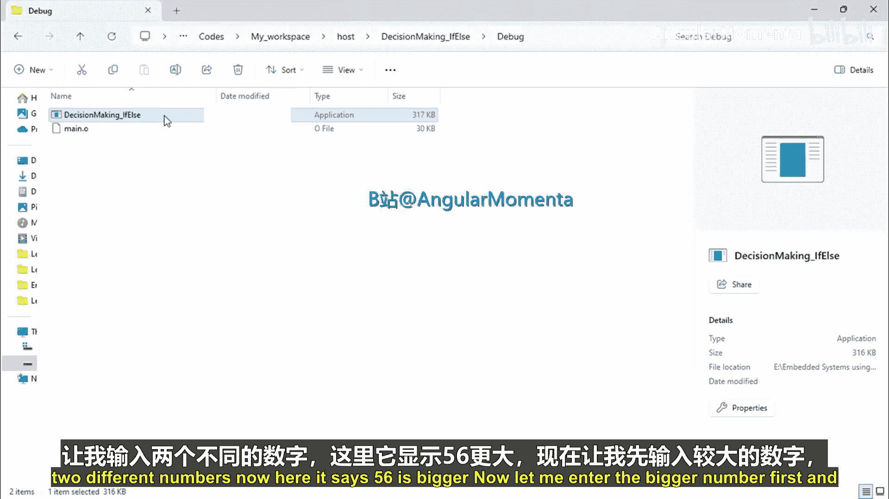

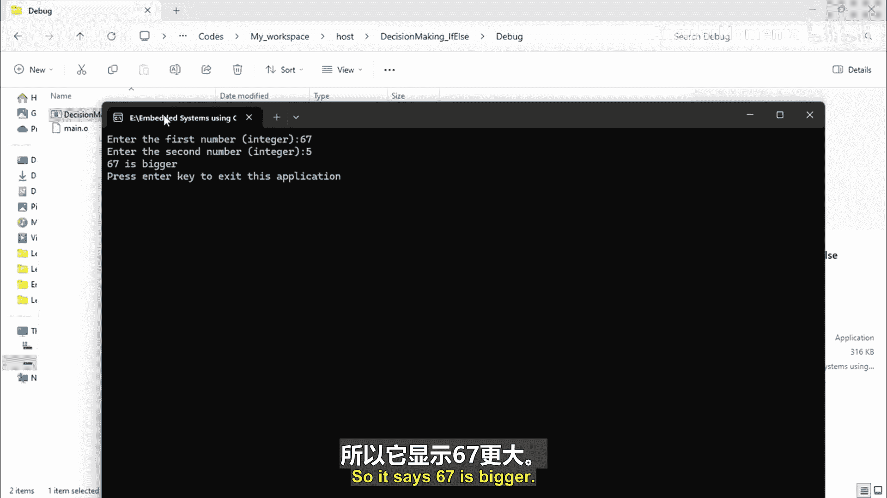

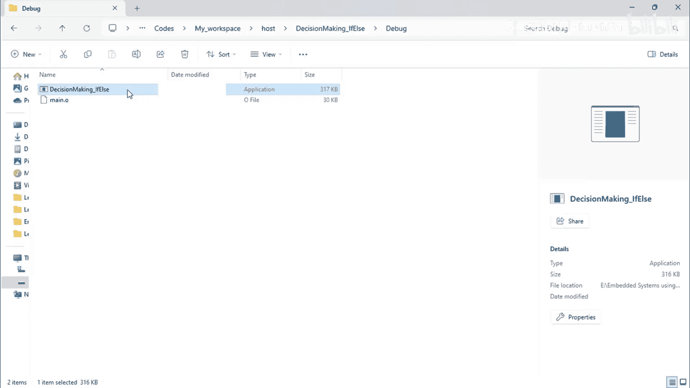

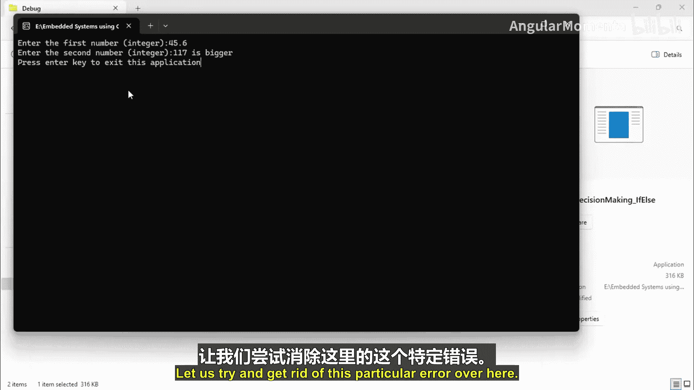

What we'll do is。Instead of int。I am going to take your flow。

 Now it doesn't mean I want to change my program。 I basically want to check for integer values only I am going to stick with checking or accepting the values in integer format。

 but I am creating a variables of type float when I create the variables of type flow while accepting I am doing here percentage F then。

😡，After the variables are accepted， I am going to create here n 32 and does score t 2 different variables。

 let's say n1 and n2。 Im going to say n1 is equal to number 1。 Im going to say n2 is equal to nu2。

 So basically I am converting the values of float 2。😊，In teachers。

 because we are going to stay with a program that is asking us to check for integer values。

 It is not asking us to check for any float values。

 We are storing only the integer part of this float numbers or the real numbers N N1 and N2 then over here when we are trying to execute it Now while I am checking here。

 I have to check with N1 N2 because I have changed my variables there to let me check over here like this。

 and let me also print the values of N1 N2 only along with that what I am going to do is I am going to give user a particular warning。

 That is I am going to check here after transfer the numbers。 I will check here F N1 is。

Say not equal to。Numb1， I want to warn the user that he has not entered integer values。

 I am going to only compare the integer part of it After this。

 let me open this and let me give a printed statement here， saying warning。😡，See。Comparing only。

Indiger buts。Close the statement there。 Now， here， there could be another one as well。

 so I can use here the logical operator also， which is my logical operator or。

It could be n1 is not equal to number1， or it could be N 2， which is not equal to number 2。

 It could be any of these。 If any of these occurs， then I want to give a warning to the user that he is trying to enter a real number and。

We are only going to compare the integer part of it。 Now I have saved this。

 Let me build the project and let me go back here and execute this。

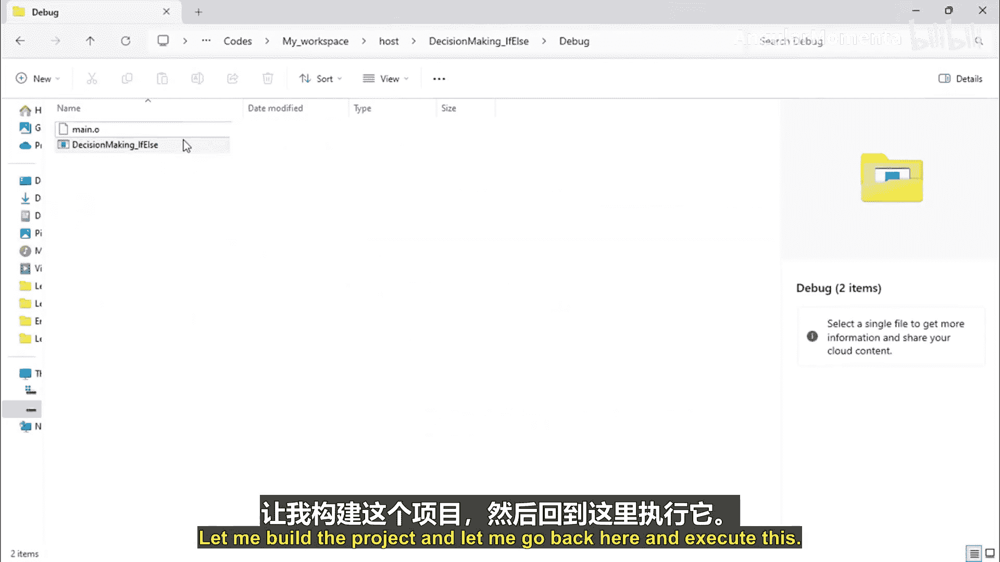

Now， let me first check with normal inte。 I enter 34，56。 It is given 56 is bigger。

 So it's executing fine。 If I try to enter some。

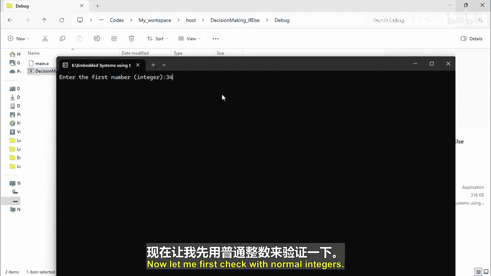

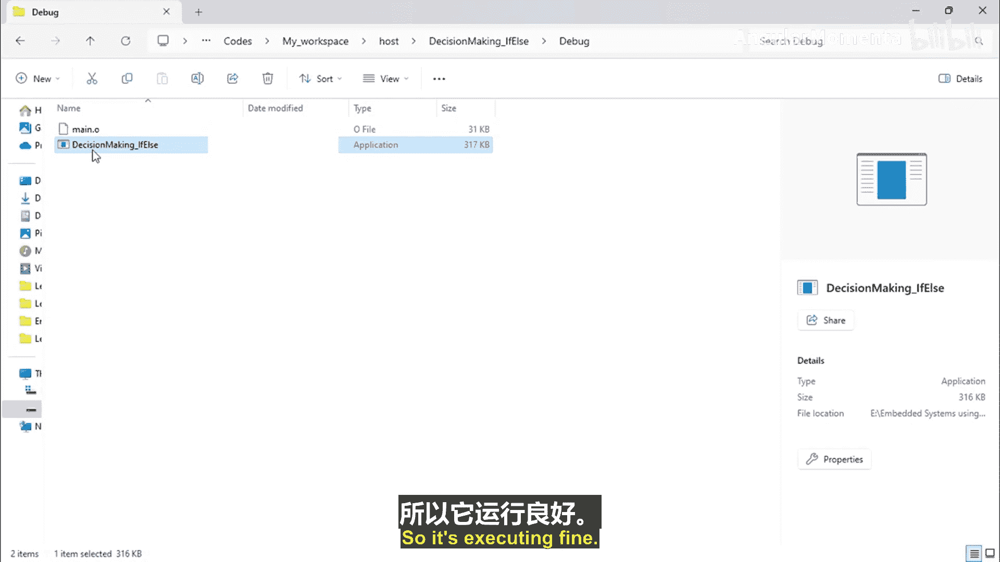

Float value。 See it。 It accepts it proceeds further。 It doesn't end the program there。

 It gives me a warning that comparing only integer parts and only it's comparing 45 with 56 or 56 is bigger in this case。

 Now， another bug that might come。 if I enter a character value。

 because we are accepting it in the float format。 We are not accepting that into a character format。

 This is where， again， you would find the application is abruptly ending it over there。

 How would you try and get rid of this particular thing， Let's try and solve this error as well。

 And then we will complete our example or this sample creation。

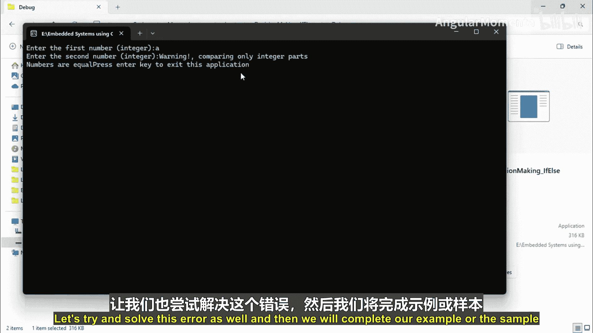

Now we'll have to check if the user have entered there any character value to solve this issue。

 we'll have to understand the return value of scanf Now when we are scanning。

 there is some return value that is being returned by the scanf statement say we had something like scanf percentage F and we are having number2 to read a particular number2 read a real number we are giving so you should always remember that scanf basically returns total number of inputs which are scan successfully from the standard in in this above scanf statement actually it returns one if the scanf was successful because there is one item to be scan this is the particular type like a percentage F where we are accepting the real number in this particular case if this scanf is unsuccessful it will return0 when you enter a character for the above statement over here the scanf will give you a value as written indicating that it has reached end of the file of the input string。

0 just indicates that scanf has fade。So you have to catch that return value of the scanf and then proceed further them。

 You cannot type a particular character because you enter a character。

 your scanf is not able to scan because it is not in the float format。

 before this scanf I am going to give here an if。😡，Put in bracket。This particular。Scan if statement。

 Now here， I am not going to end this with a semicolon。 I'm going to open an if statement。

 I'm going to say printf， say。Invalid input。Exhiiting。And I am going to， let's say。

 return here 1 or you can return 0 as well。 Now， the same thing I am going to repeat for。

This particular scan if as well， this is only to scan in number 2。

So I'm going to repeat the same process over here now。Even this part over here。

 let us put this into a particular method。 Let me create here。Save void。User input。Open the bracket。

 Put this over here。 I will declare。The function prototype over here。And this particular function。

 I am going to call it now because after I print this invalid input also。

 I want it to hold on the screen till the user enters a particular value。

 Hence I have added that particular code inside a separate function。

 and then I am calling that function over here。Looks great。 Let me save this。

 Let me go to build project， void user input。Vyd。This is the。Okay。Let me build this again。

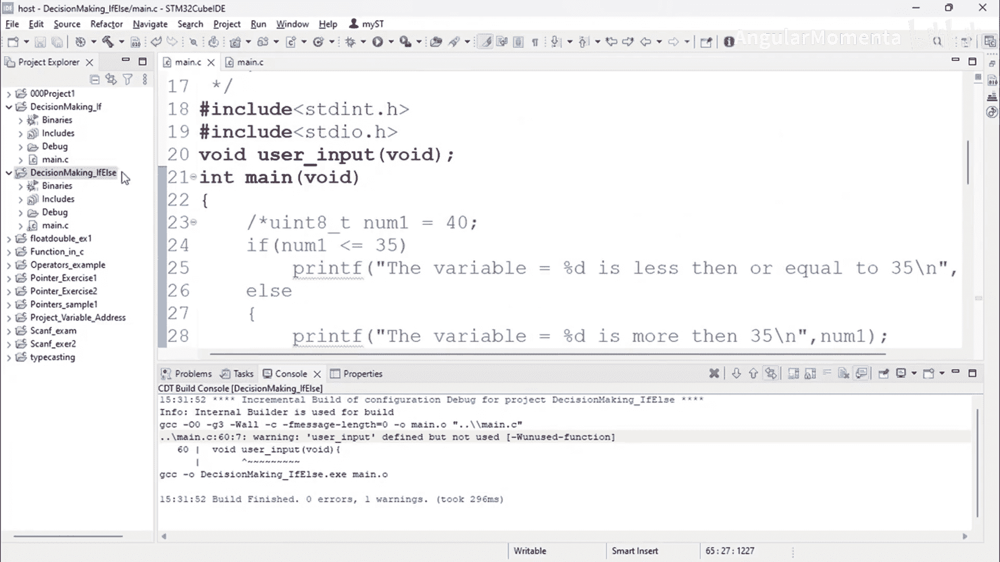

Let me execute this and let me try and enter a character。 It is not just a moment。

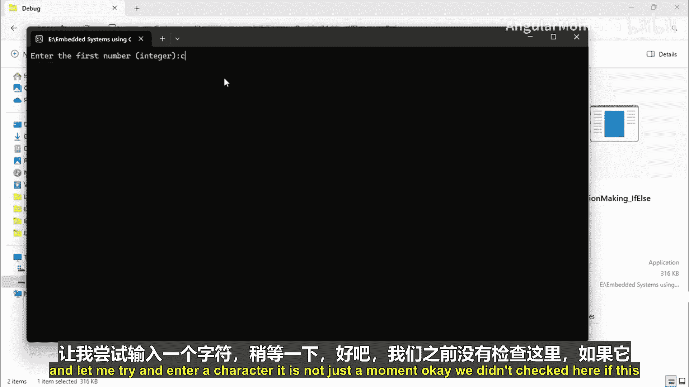

Okay， we didn't checked here。 If this is is equal to 0， then go inside this。 If it is equal to 0。

 which means the value is invalid， If it is equal to one， which means the value is valid。

 We have not checked that。 So let me build this again。

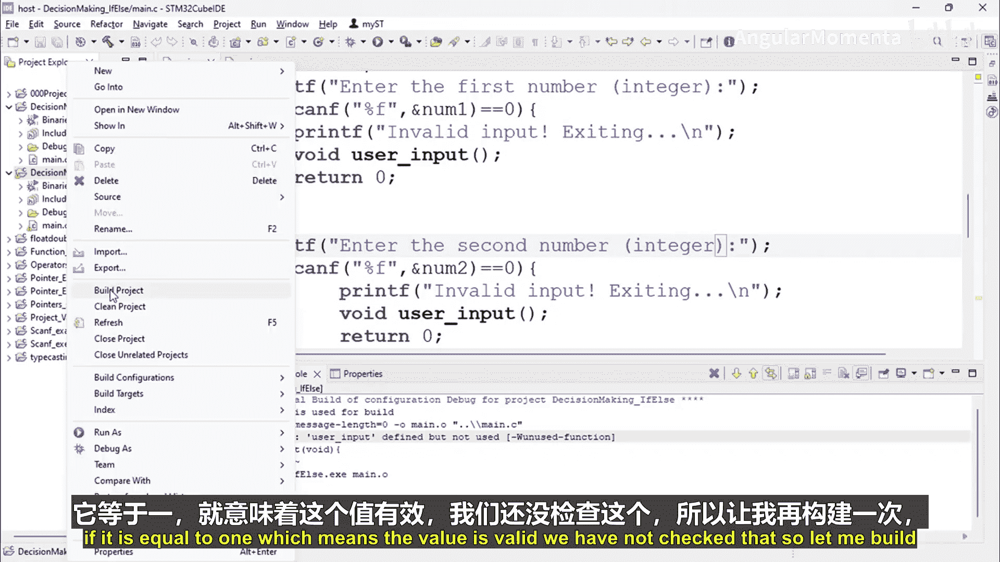

And let me。Run this。 and enter a character。

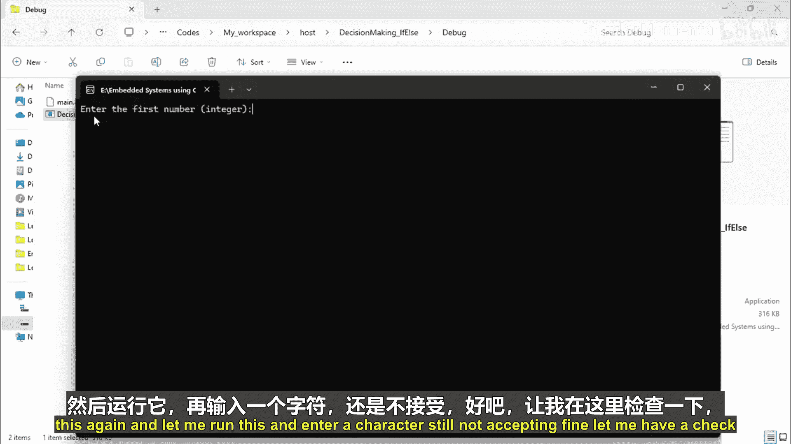

Still not accepting fine。 Let me have a tech check over here。 Now， it's on to check for Scf here。

One silly mistake。This function has to be after domain， not inside main。

Just copy pasted that outside， and。Now， we'll run this directly from here。This is getting executed。

We have to just call the function here， do not use void。

 because that is what is there in the function definition we don't need to call it while we are executing。

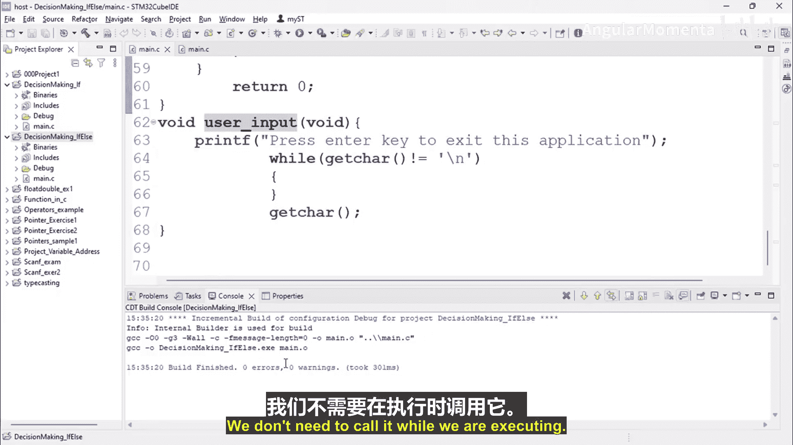

Now， see if I enter a character， it says invalid input exiting it。 I enter any key and the。

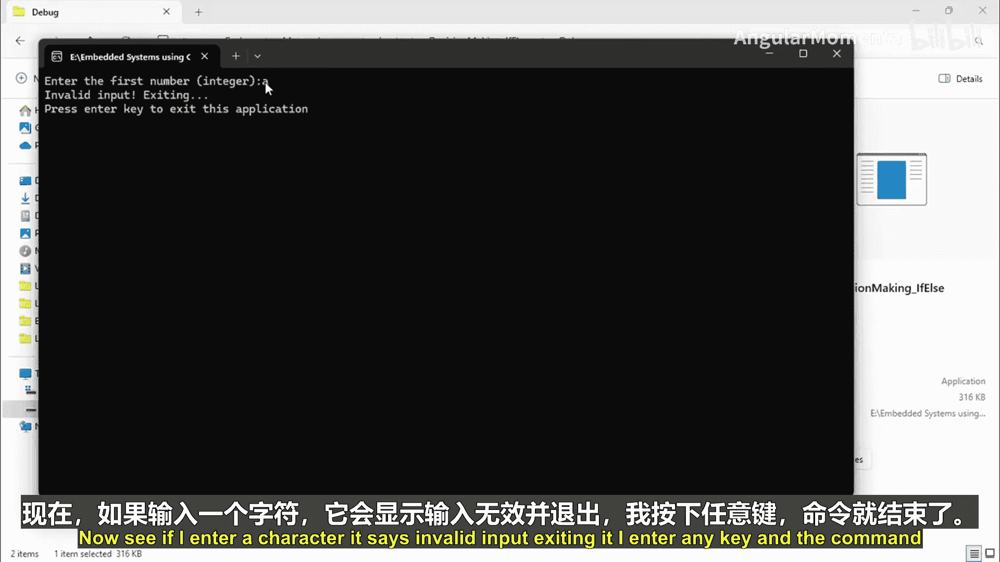

Command ends。 I enter any float values there。Now， even for that， I will have to give over here。

Execute this over here， as well。If everything is fine， I want to call this function here。

Let me again， build the project， and。

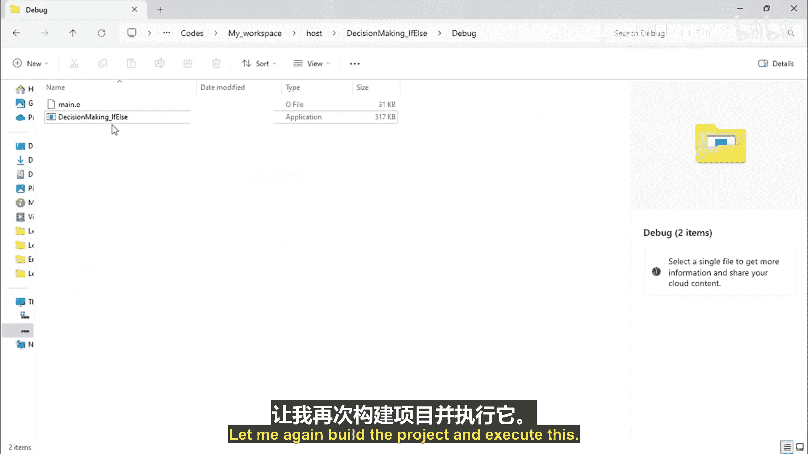

Execute this。Yes。This is working fine。 Let me check within teacher values。

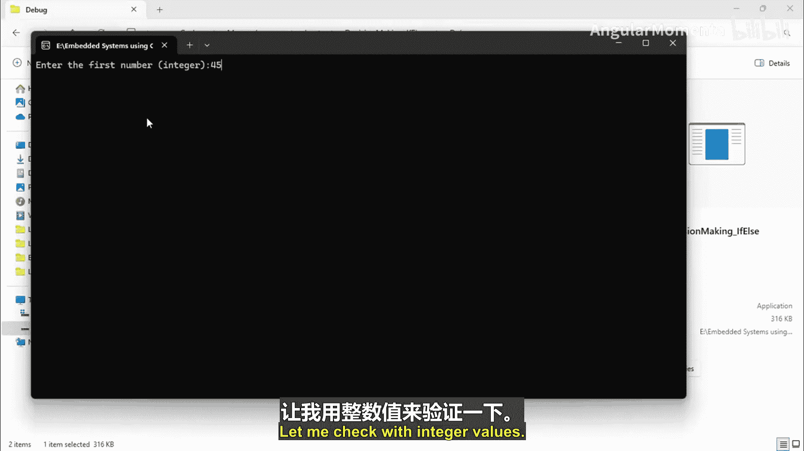

Okay， let's enter equal。 It says number are equal。 Let's enter。

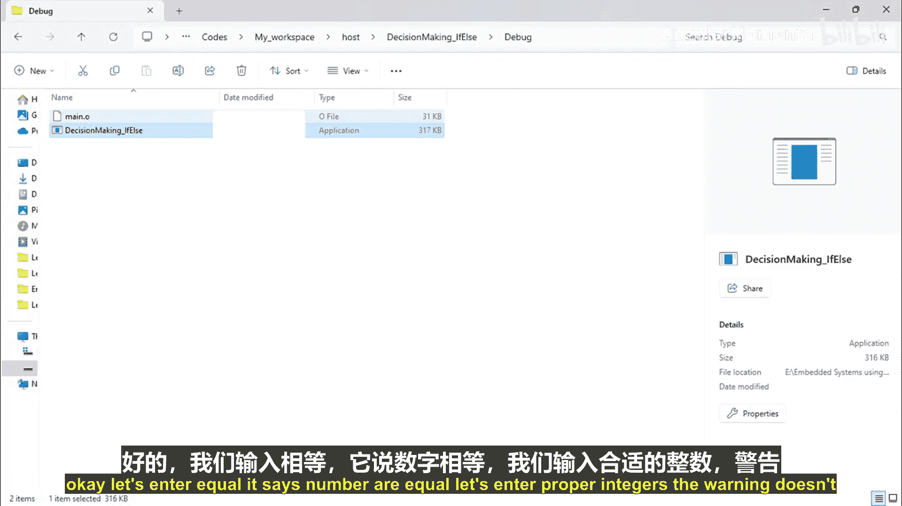

Proper intes。 The warning doesn't come。

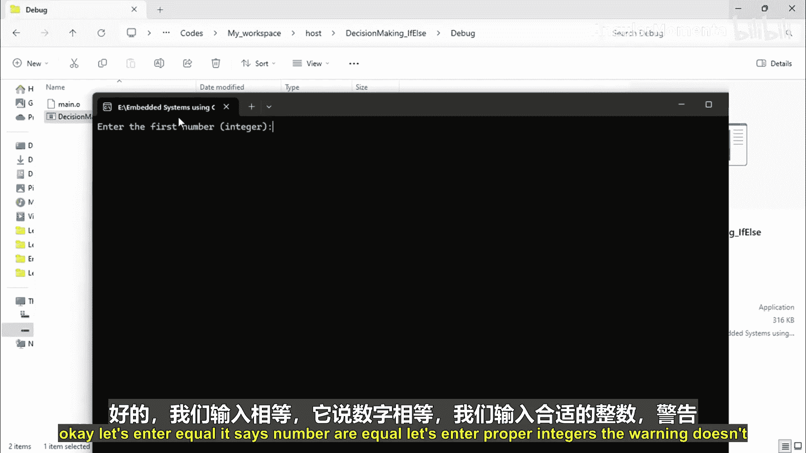

Everything is working fine， as of now。Even if we enter characters now， the program is not ending。

 It is handling the errors that user might do while entering the input。 Now。

 our particular program is completed and will continue with more such examples in the coming of videos still then have a nice day。

 Thank you。

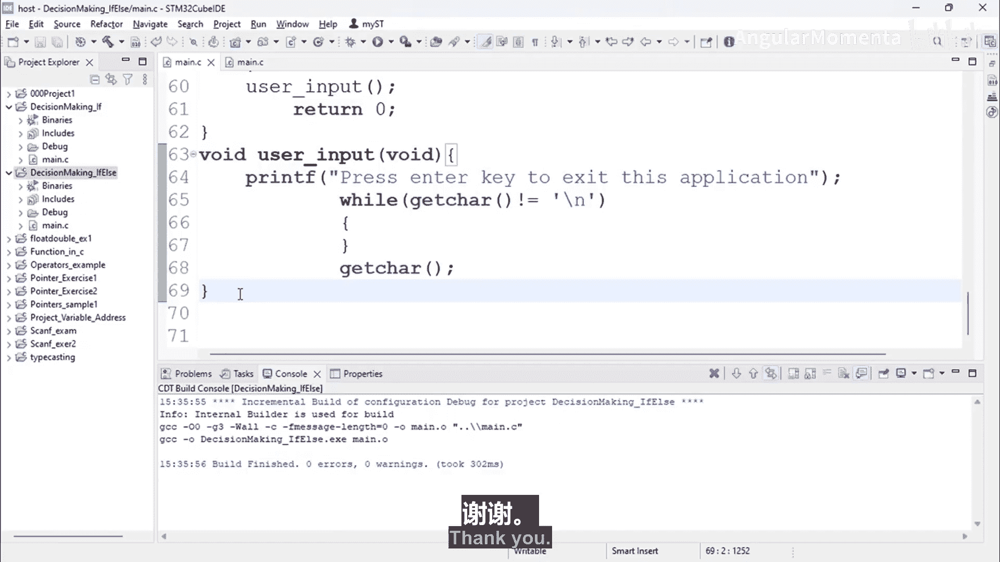