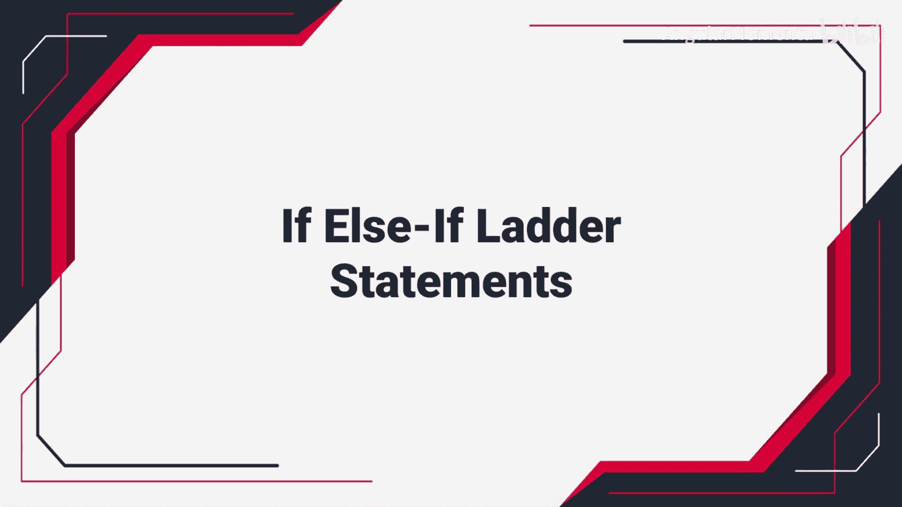
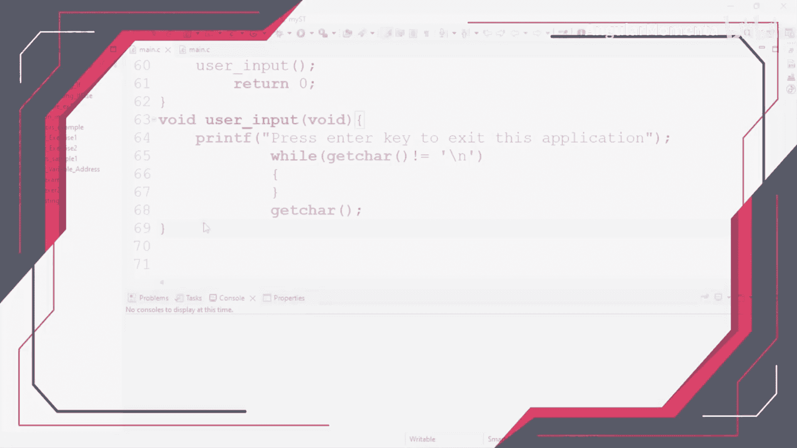
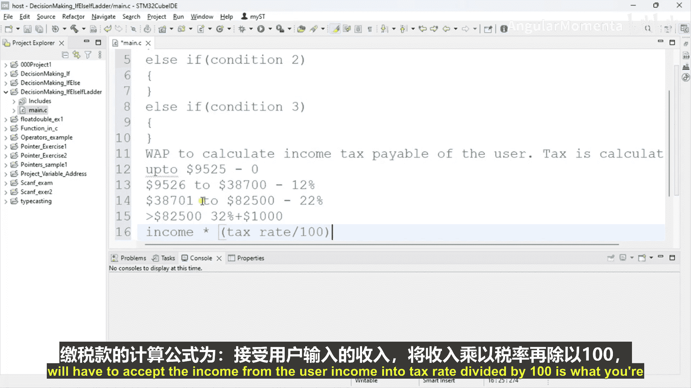
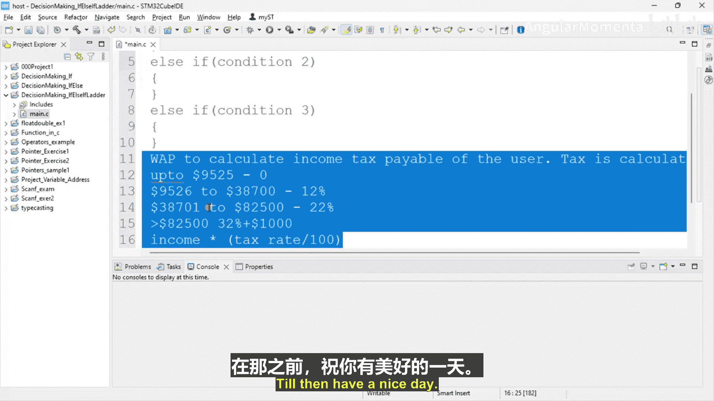

# 【EDUCBA】构建嵌入式系统 ｜ ARM Cortex (STM32) Fundamentals： Building Embedded Systems p29 02_03_05_if-else-if阶梯语句 -BV1KjcTzUEeY_p29-

Heil learners， welcome back。 Now， in this particular video。

 we are going to explore about the F Elsev Lao。 I will create here a new C C plus plus project。

And I'm going to name this as。😔，Decision making。If。Elsa。Lettter。And inside this。

 I will create a new source file， which is。Main dotsy。不。Now。

 let us quickly understand about the if Els La force。Now。

 here we have the expression inside if we have open close brackets。

 If this expression comes out to true， this block will get executed。 Now。

 if I have to check multiple statements， for example， here I have given one particular condition。

 let me give here， say。Yeah。Condition 1， then I have Els。Here I have condition， too。Similarly。

 I have El。 I have condition 3。I want to check for multiple conditions in that case using this if Elsive ladder is really helpful。

 if this condition is true， the statements given inside this bracket would execute if this is false the second Elsif condition would be checked if this is true statements given under this would execute if this is false the third Elsive ladder would be checked and if that comes to true the statements given under would execute。

This is the execution order of your if Els ladder。 Now we'll do one practical demonstration of this as well。

 which will make your concepts very much clear about how the if Els La operates。

 We create one particular program and we will try to use this if Els ladder there and check for the particular values。

 Our exercise is something like this。 We have to write a program to。Calculate the income tax。

Paable of。😔，The user now there is a method to calculate tax taxes。Calculated as， if it is up to。

 let's say dollar。9，5，2，5。It is0， no tax。Then second condition is from dollar 9，5，2，6。2。Dollar。

 let's say，38，700。 There is a 12% tax。Then from dollar 38，7，0，1。2， let's say Do 82。500。

 you have 22% tax。 anything which is more than dollar 82，5，0，1。Or 500。

 you can say more than 500 is starting from 5，0，1。 You have 32% plus。Dollar，1000。

These are the four different conditions which need to be checked over the value that the user inputs and the formula for tax payable is you will have to accept the income from the user income into tax rate。

Divided by 00 is what you're supposed to Cal。 Let's start with completing this particular exercise for Eels ladderder in the next video till then。

 Have a nice day。 Thank you。

