# 【EDUCBA】构建嵌入式系统 ｜ ARM Cortex (STM32) Fundamentals： Building Embedded Systems p30 02_03_06_if else if 阶梯练习解决方案 -BV1KjcTzUEeY_p30-

Hey Ers， welcome back now let's complete this exercise for if Elsie Lalader in this particular video。

 what I'll do is Ill just go back to my Fs mean and I will just copy down this method。

Put it over here。 And I need to put the。In thought。Prototype， then I have inter mean。

And this return 0。I have this particular。Myethod and don't forget to use hash and include S TD。

 I O dot edge and。Hash include。SDD into dot edge。 Now， let's start with creation of。The variables。

 first。Inside this， Ill first of all， use U int 64 and as score T， the variable as income。

 Similarlyly， U int 64 and as score T， the variable as tax。 Now， I also have one double。Let's say。

 temp。Income variable。Now， I have to accept the value of income from the user。

 So I have to give you aren saying enter your。Income。And I use a scanf statement here。

 and I scan if using LF percentage LF and I store it inside the variable temp underscore code。

Income now we have to calculate the value for income。 We already know what is the formula for that。

 right。The first thing that we would do is， will。Inside income， we will store。In you and。

64 andasco T L convert and I store the value of temp income。Check。Now， after that。

 I have to force check if。Income。Is less than equal to。9，5，2，5。I open the bracket。

 I put the value of taxes as 0。 That is what we are supposed to do This one。 If it is 9，5，2。

5 up to 9，5，2，5， it is 0。 If it is less than equal to 9，5，25， the value of tax is equal to 0。

 Now I have to check another condition。 I'll use the FLC ladder here。

 and here I'll check if income is more than let's say 9，5，2，5。

 This is one condition I use here another condition。

 let me open one more bracket here and the next condition will check if income is less than equal to 38。

Is it 700， yes。If it is this， then I have to calculate the tax， which is。12%。

 While write down tax is equal to。The value of income multiplied by 0。12。 That is 12%。

 Then let me go in for next else if here also Ill take double bracket because I have two conditions。

 One is the value of income is more than 38，700， and I am using because both the conditions have to be true。

 then the value of income is less than equal to 8 to500。If this comes to true。

 then the value of tax becomes income multiplied by 0。22。That is what we need to calculate is 22%。

And then we have another the last one that iselsive Now this is just a single condition I' am not using multiple brackets if income comes to more than 8 to 500 in that case the value of tax is going to be income into 0。

32 plus tax will be equal to tax plus 1000 you can check that condition here it is 32% plus 1000 we calculated 32% here。

 then the value comes tax then initial value of tax plus 1000 is what we need to calculate that。

You can also write this as。Tax。Plus is equal to 1000。

 even this statement will also work instead of this one that depends how do you want to write it now once you have calculated。

 I want to print the value of tax I am giving you tax payable colon。

 I want to print it in percentage I 64 you， I give a new line and I print here the value of tax。

Ended with a semicolon。Now， let us run this。 I am going to build the project Su。 I go to properties。

 I open up this and I go in debug， and I double click this。 Now we' check one by one。

We'll check it one by one。 Let me enter your first value as 9，5，2，4。

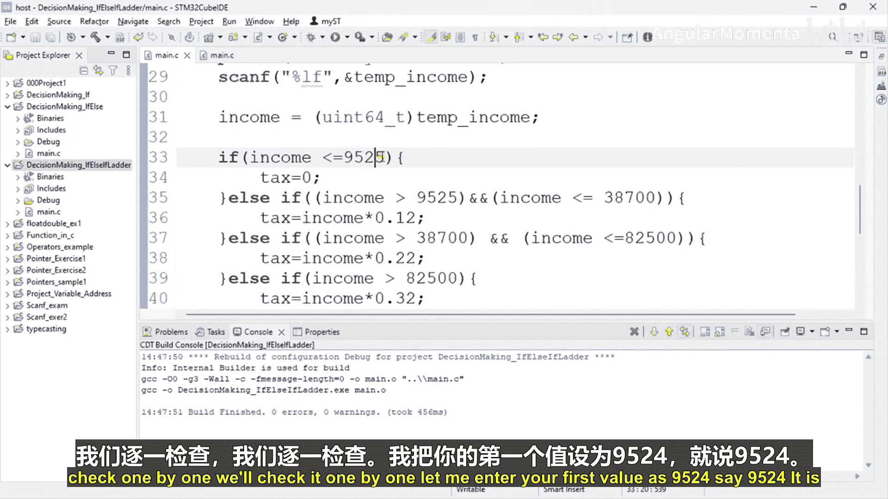

Say，9，5，2，4。

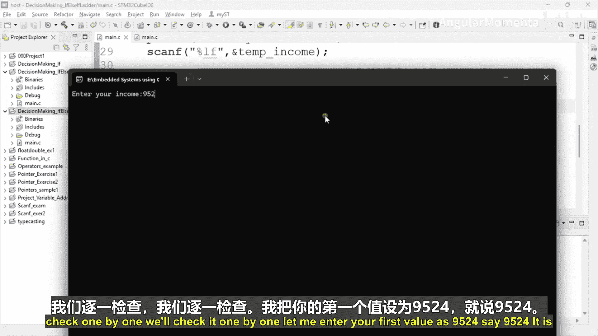

It is not holding because we have not used or we have not called this user input method anywhere。

 After we print， I am going to call this method here and let me build this。

 Let me go back here and execute9，52，4， Tax payable 0。

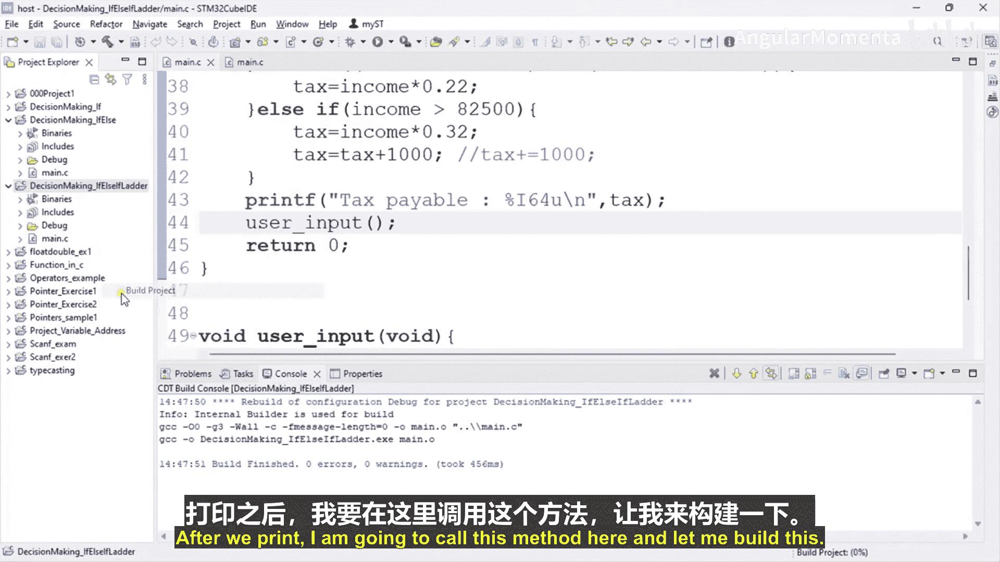

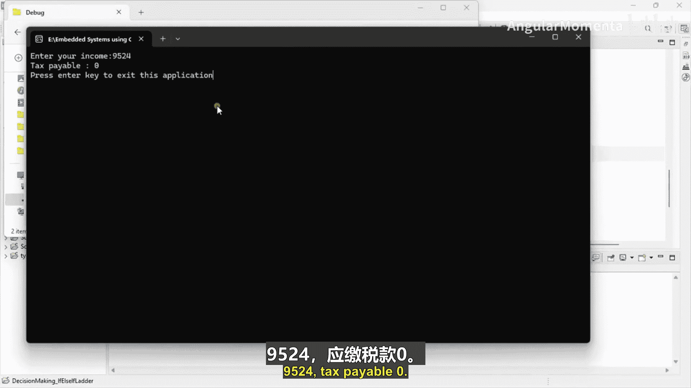

Now， let us check for the next condition， Ient something like 40000， let's say。

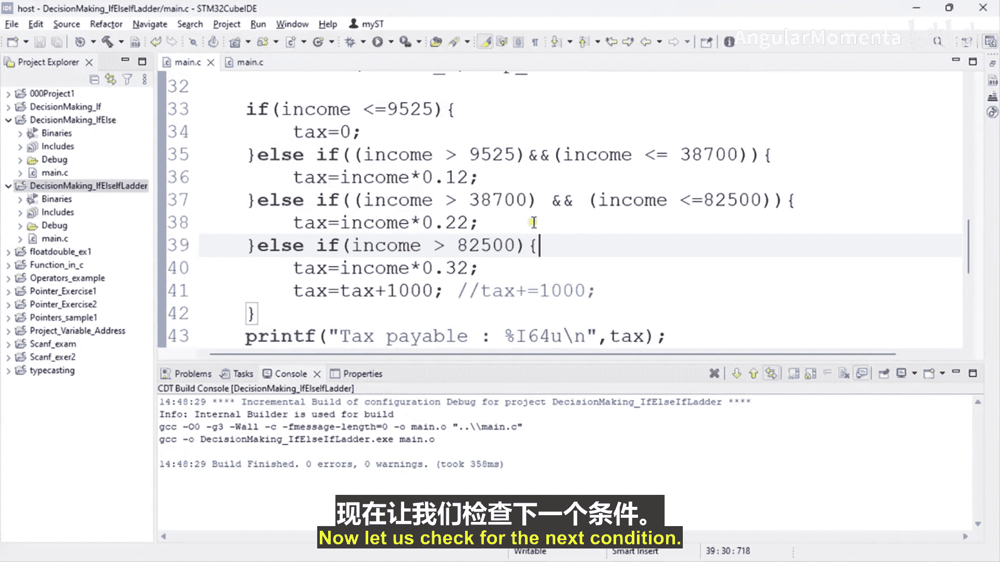

And it is giving me tax payable as 8800， which will be 12%。 Now， next。

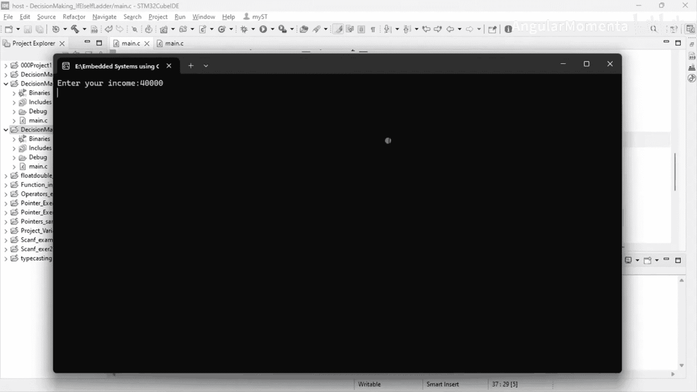

I again， execute this。 I check。 Let's say I entered it as 85000。

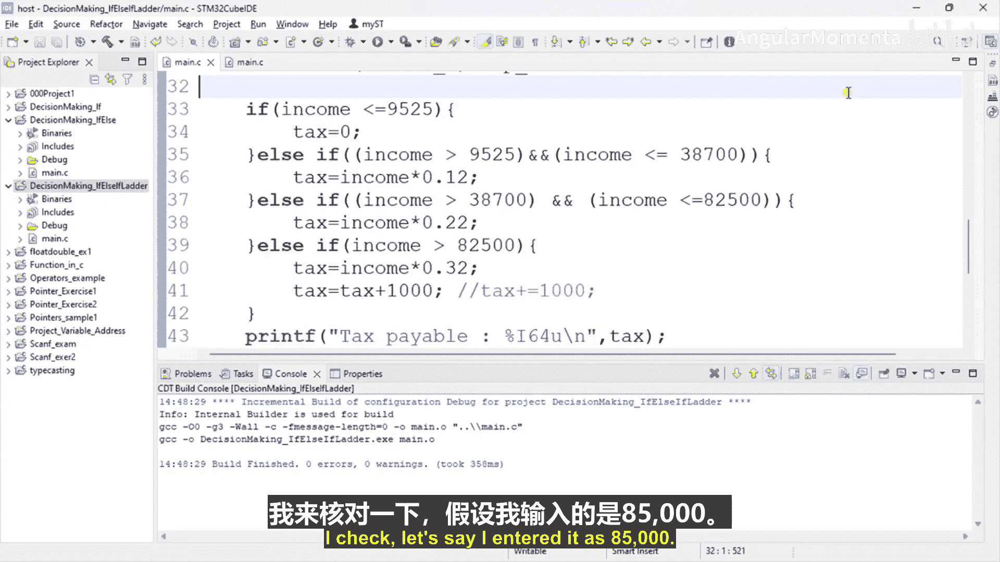

It gives me tax payable as this。

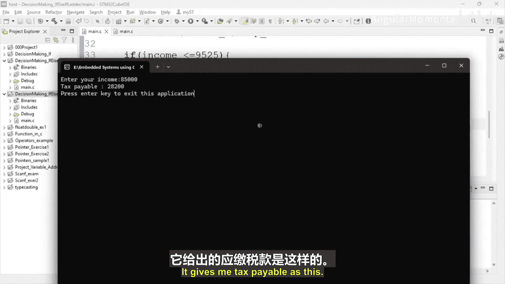

Now， let us also check one more thing over here。😡。

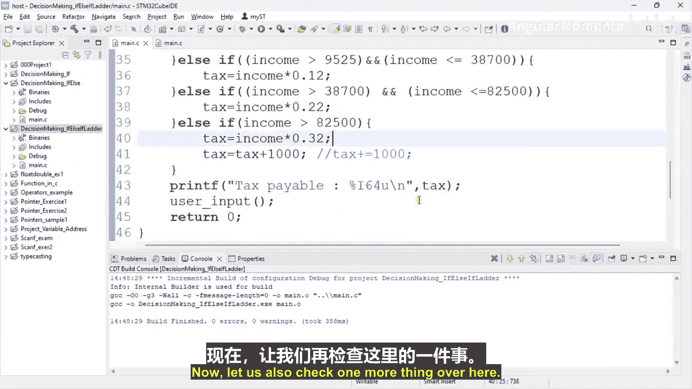

I enter something like this。It's giving me an abrupt value， which means it is going into buck。

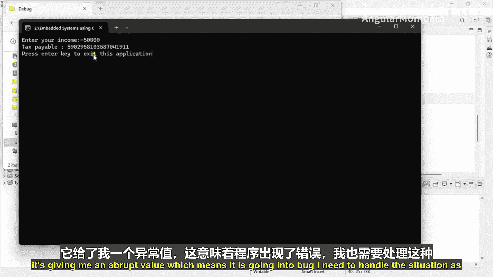

I need to handle the situation as well， because the user also can enter a value which is negative。

 it might be because of some mistake it is he is not entering it purposefully。

 but maybe because of mistake he might enter that once I have accepted the value of income in the temp income variable what I'll do is Ill check here if the value of temp income is less than 0。

 I want to open the bracket， give her a printer saying。Income。Cannot be。Negative。And。After this。

 I again call this user input and also the return statement。 I saved it。

 I have built the project again。Let me execute this and let me enter here something。 Now。

 it is not ending Aruppls， giving me a proper message。 And then my application is ending。

 in this way， you can handle your if El ladder。 And this is how we have executed our exc successfully。

 Stay tuned for more such videos till then， have a nice day。 Thank you。

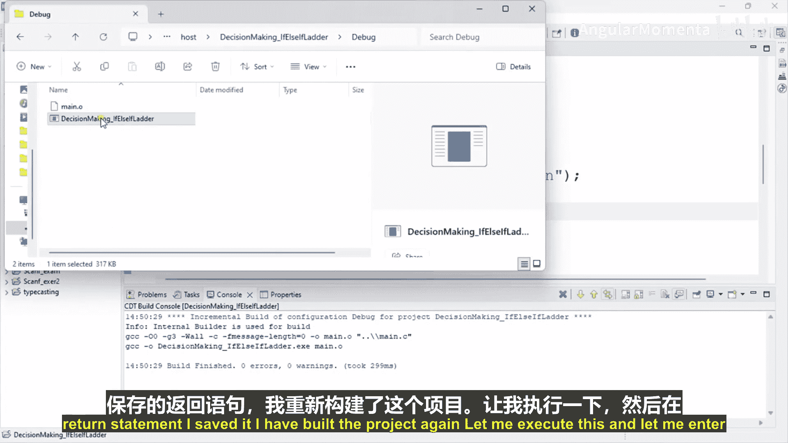

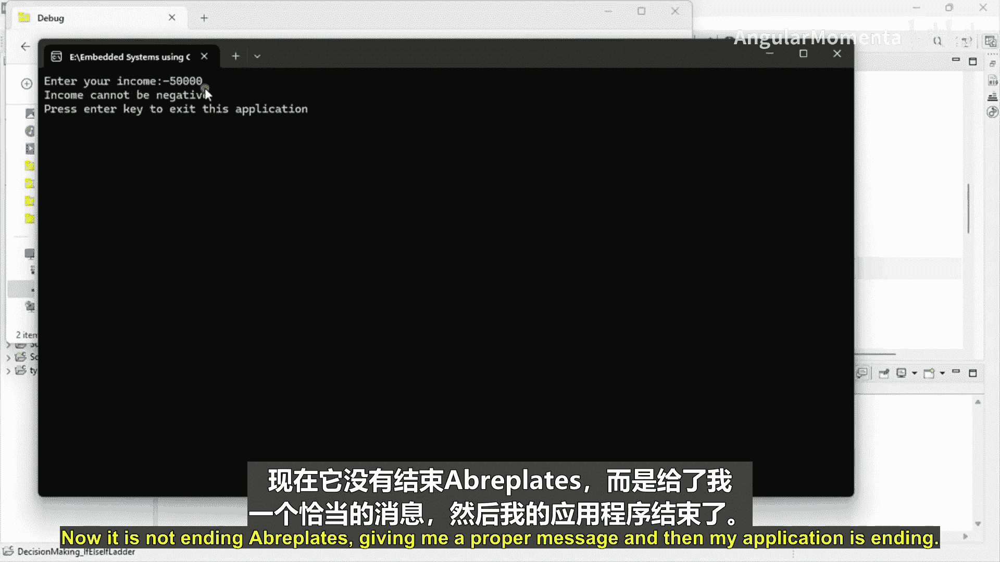

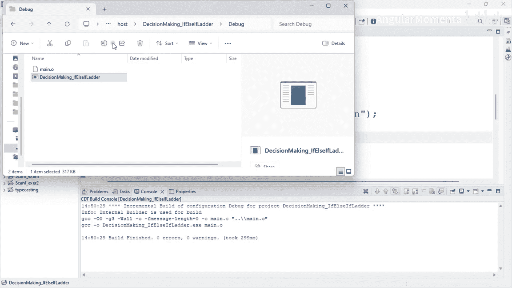