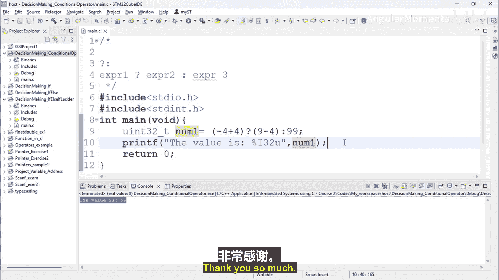

# 【EDUCBA】构建嵌入式系统 ｜ ARM Cortex (STM32) Fundamentals： Building Embedded Systems p31 02_04_01_条件运算符 -BV1KjcTzUEeY_p31-

Hey Ho， welcome back。 Now， in this particular video。

 we'll discuss on the decision making statements and we'll explore about the conditional operators。

 which is also a ternary operator in C， which is used for the conditional evaluation。

 What I'll do is let me create here a new project and'll create your CC plus plus project。

 and I'll give it a name as decision making。😊，Conditional。Operator。Next， and finish。

And let me add in here a new source file， which is main dot C。

 Then let's continue over here and understand about conditional operators。

 conditional operator is a turnernary operator， the operator symbol is question mark colon。

 It's a turnernary operator because it basically operates on three opera。

 Let us explore the syntax of the conditional operator。 The syntax is similar to this。

 We have expression1， we have question mark， we have expression 2 call in we have expression 3。

 This becomes your first operator。 This becomes your second operator。 This becomes your third opera。

 The conditional operator is of collectively three opera， First opera。

 which may be a value or which may be an expression。

 It may be also a C statement like a function call or something。

 first operator followed by your question mark， and the second operator is followed by a。

Co in and after that comes the third operator。 Now。

 let's understand the evaluation of the conditional operator with an exam。

 What I'll do is let me create here and main。 Let me use a return statement。 Let me also use。And。

Now over here， Im using， let's say U int 32 and does quo T is equal to。 Im giving5 plus 4。

 I am giving here a question mark， say 9 minus4 colon 99 and I want to print the value of percentage U int 32。

 I'll print here value is percentage percentage I 64 U and the value of let me give it a name here say number1 I print here the value number。

 This is my variable。 I am trying to evaluate a conditional operator over here by using three opera。

 number one operator number2 opera and number 3 opera。

 let us try and understand how it is going to work the expression over here is like this Opera 1 is 5 plus 4 Opera2 is your 9 minus-4。

 and then you have double colon 99 over here when we execute this What。Happenss5 plus 4 becomes 9。

 which is true。 If， this opera becomes true， then this particular expression would be evaluated。

Or executed， we can say。 And the result of the expression will be saved in this variable。

 In this case， if the evaluation of the expression becomes false。

 then the opera will be executed and the result would be again saved into number1。 In this case。

 it would be 9-4， which is 5 should be saved over here。 Let us check that I have saved this。

 I am going to build this one second This is 32， and Yes， let me run this， see the value is 5。

 because this executed。 This is my conditional expression。5 plus 4 becomes 9。

 So anything which is nonze comes to true。 This comes to true。 Then this expression is evaluated。

 The value of this expression is stored inside number1。 Suppose over here。

 I give something like this。 Let's say given-5 plus 4。 again。

 I try to build the project and I try to run the project one second。And。Say，-4。Busful。

The value has to come to 0。See， now the value 99 is safe because this expression now becomes 0。

0 means it is false， right， It is not evaluated to true it is evaluated to false。

 So when it is evaluated to false， the value after colon would be the value inside the expression。

 which means if this expression gives you the value true。

Result of the value in the variable would be this after the value after the question mark。

 if this expression gives you the value falses， then the value in number1 would be the value after colon。

That is basics of your conditional operator， how it is evaluated。 The This opera is evaluated first。

 If the result is true， then this will be the final result。 If this opera comes to false。

 the final result will be the value after colon。Got it。

 That was about understanding your conditional operators。

 You can also use this to replace FL statement sometimes。

 but that depends on you know what kind of program it is and how do you want to execute that particular program We'll continue more on such videos in the upcoming sessions that sit from this particular video Stay tuned Thank you so much。

