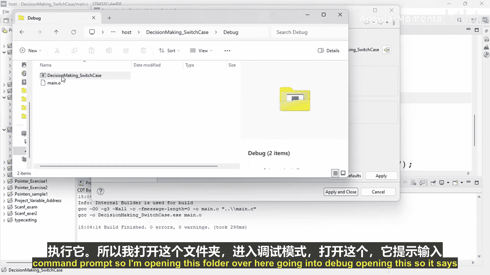
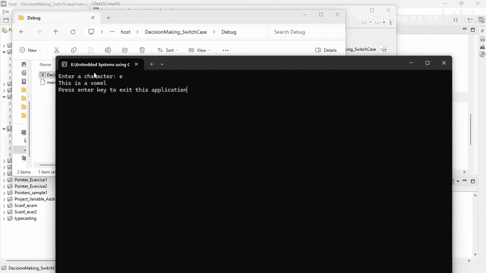
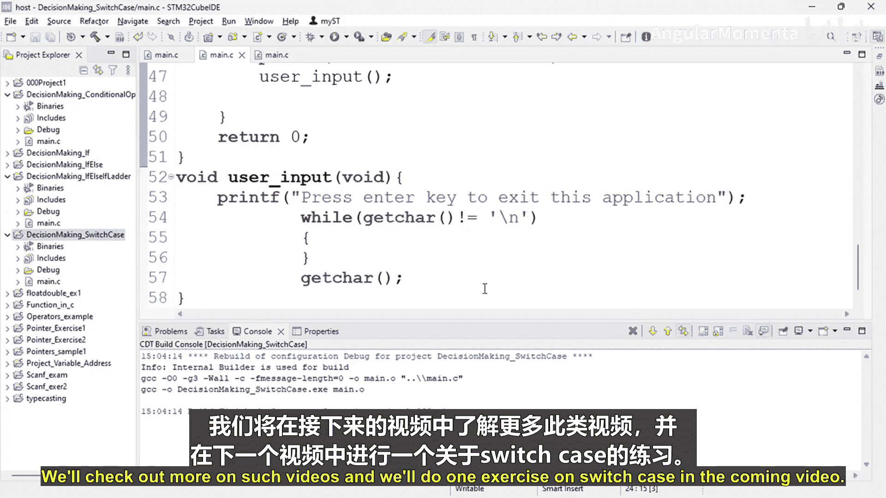

# 【EDUCBA】构建嵌入式系统 ｜ ARM Cortex (STM32) Fundamentals： Building Embedded Systems p32 02_04_02_C语言中的switch case语句 -BV1KjcTzUEeY_p32-

Hey owners， welcome back In this particular video。 we are going to take a look at switch case statements in C programming。

 I will first all， create a new project and let me name it as。😊，Decision making。Switch case， Menji W。

And。Let me add here a new source file。Main dot C。 Now let us first understand the syntax of switch case。

 you basically have switch。 you have the expression inside this and inside the open closed bracket。

 you have various case， you have certain values。 If this case value matches。

 then you have certain statements that execute Similarlyly after every case you need to break the case statement。

 you can have a multiple of case statements over here。With different values case label。

 it can be used over here。 you can have any kind of an integer value as well you can have even a character value which you want to check it。

 You can check out one particular program that will help us to understand about this which case in a better way。

 let's say over here。I am。Having hash include。S TDio dot edge。And I have inter mean。In which I have。

A return statement。 I have a character C H variable。 I use a printf I say， enter a。Chater。And。

I use a scanf。Poinency in the variable C H。And then， I ran off。Switch case for C H and inside this。

 I check if it is woels， so wels are basically A E I O U， so I check if it is case A。I print here。

This is a woel。What I can do is I can check it over here for multiple cases as well so I can check your case a。

一。A。哦。You。And I can， finally。Break this over here。Or I can have an else case。Or this is not else。

 It is。Default in this case。Default， basically， I am giving your printf。C。This is not。

Woil something like an ill spot。That none of the above are true。 Then it goes to the default one。

 and it prints this particular value。 Now， again， what I'll do is I'll just take out this particular program。

In the switch case， as well。And。Let me define this over here。And also。Let me call it here。

Hell aspect it。All right， let me save it。 Let me build the project， and。

Let me execute it through the command room。 So I am opening this folder over here。Going into debuk。

 opening this。 So it says enter a character。 Let's say I enter a wobble。 It says this is a woel。

 Next time I enter a character which is not a wovel。 It says this is not a wobble。

I can enter a。 I can enter E。 I'll get the same thing。 A E， I， O， U。

 Everything will be applied in a similar manner since I have used multiple case statements。 Now。

 if after every case， you have to give a different plaintiff， you can give it individually as well。

 Let's say I want to give here。 something like this。 I say this is。

Wwell。一。🤢，So I can give it like this and。You use it。 So let me just copy this here， as well。I。

O and you。While print here， this is vow A， this is vow E。i。哦。And you。

So now I'm giving individual print statements for each w so then I can use it like this。

 but if I want to give a general print statement for checking multiple values for this particular expression I can do it the earlier way as I have done that So that's up to you How do you want to execute it and how do you want to go ahead about it So that was about your switch case statements how it basically executes we'll check out more on such videos and will do one exercise on switch case in the coming video till then have a nice day Thank you。

😊。

