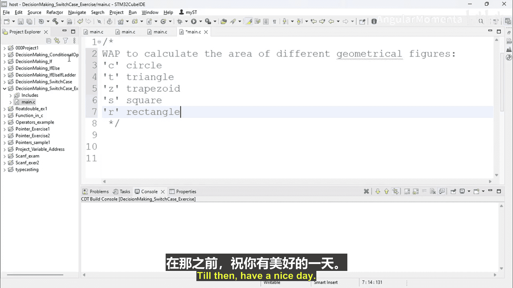

# 【EDUCBA】构建嵌入式系统 ｜ ARM Cortex (STM32) Fundamentals： Building Embedded Systems p33 02_04_03_switch case 练习 -BV1KjcTzUEeY_p33-

Hey， Hos， welcome back。 Now， let us do an exercise on switch case。

 I am going to create here a new C plus plus project。 and let me name it as。Decision making。

Switch case。Exercise， and let me create a new source file。Main dotsey。Now。

 let's understand the exercise first。 we are supposed to write a program to。Calculate the area of。

Different。Gmetrical。Figures， there are various geotal figures。

 which are something like if it is circle， then calculate the area of circle。

 similarly for triangle for。Trabzooid。Then。Square。And rectangle， basically。

 the programme should ask the user to enter a code for which user wants to find out area。

 Let's say he can enter something like T for triangle， say Z for trapzooid， then。S for square， see。

A for rectangle and C for circle， something like this。 And then you know。

 depending on value the user have entered the area has to be calculated。

 we would need to have those variables if it is triangle than we need to accept the information more information about the user about。

 let's say the base and the height， and then calculate if it's circle。

 well have to accept the value for radius， Similarlyly， let's say if it is z， which is for trapoid。

 then you will have to ask for base1 base2 height and then you have to calculate the area if it is square you will have to calculate the length of the particular value。

 if it's rectangle， you would need the length and the width of it， depending on the input。

 then you have to accept further value from the user and then calculate the value of area and display it to the user let us。

Go ahead and do that。 Even in this case， you have to also say that user doesn't enter any negative value。

 Let's say for radius， if the user enters -1， then we have to print like radius cannot be negative。

 Even error handling part has to be taken care of。 Let's go ahead and implement this particular exercise in the next video till then have a nice day。

 Thank you。

