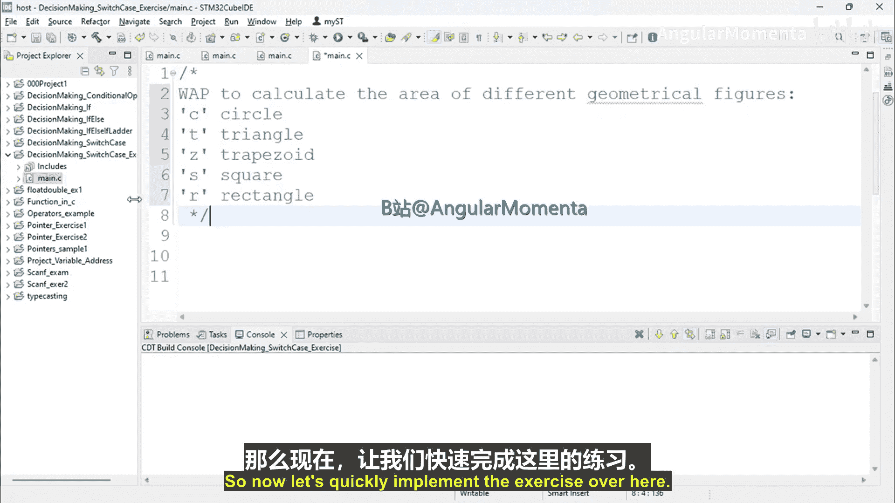
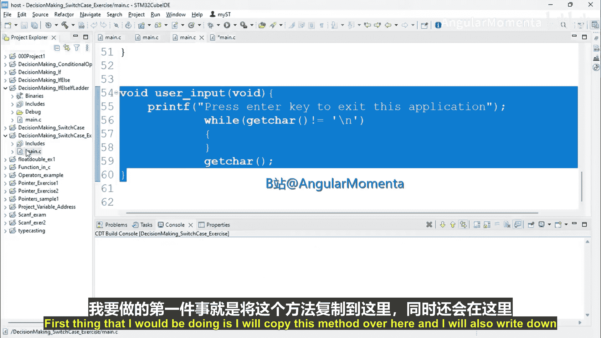
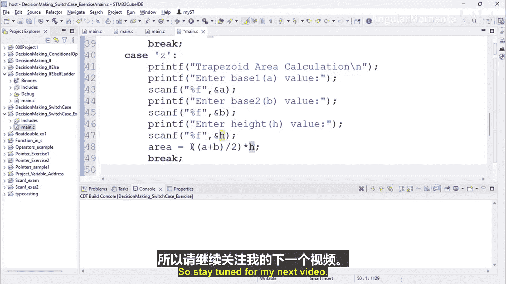

# 【EDUCBA】构建嵌入式系统 ｜ ARM Cortex (STM32) Fundamentals： Building Embedded Systems p34 02_04_04_Switch Case 练习解答 第1部分 -BV1KjcTzUEeY_p34-

Hey Ho， welcome back。 So now let's quickly implement the exercise over here。

 First thing that I would be doing is I will copy this method。

Over here。And I will also write down the。Methd prototype here then I will have end main and this is going to return the value 0 and I'll have all my statements over here。

 I will also call this user input method over here so that we don't forget to call it at a later stage Also I would have SDgriio do edge to be included inside main will also include for one more。

Head of file， which is T D in dot edge。 And let's create a variable and 8 underscore T。

 Let's say code。 I want to print F here as。Let's say， area。Calculation program。

 And I give a lot of print statements here， say for circle。Im saying you have to enter C。

 then give slash N I copy this。Then I give another message， which is for triangle。

You have to enter T， let's say。Next is my。Trarap so。 And for this， you have to enter Z。

And just align everything properly。 Then I have square， and for square it is S。

 then I have rectangle， and for that it is R。 Then I finally say here in print enter the code here。

And I accept the value using scanf percentage。 C， I stored the value in the variable code。

 I can now use a switch case for code。 I can say here， switch the value of code。

 and I can check with if it is C， T Z S R respectively。 Let's first start with case。 if it is C。Then。

I want to give a printiff， say。Circle area。Calculation and。I want to now accept radius。

 so I say enter radius。A value。 and I use a scanner。Now， first of all。

 let us create all the variables here， so I'll create here， let's say float。I'll create radius。

Sa B edge。Then。I am creating float。😔，Area as well here。And。Now here when Im scan。

 I'm doing a scan F I will do it for percentage F， store it in R， not radius。

 okay because we have a variable created as R。So I have the value of radius over here then I have already the area variable created here I am doing 3。

1415 multiplied by r into R and then I finally break it then my next case if it is lets say t if it is3 t then I have to accept here I have first print say triangle area calculation and I will accept here。

Enter base value。Then I will do a scan if youre。I will store in percentage F the value of base。

 then I will accept the value of height。And I will store that in et。

 we have a variable that is etched。Once we have both the variables with us。

 the next thing is we are supposed to calculate the area， which is equal to。A plus。Now。

 this is for triangles。 it is B into or base into height。Divided by 2， that is the value of area。

Then we break the statement。Then we check if it is case， Z。If it is it。

Let me just copy paste everything over here。Im printing here。We are calculating。

Trepsoid area calculation， I want to accept the base value。I will create one more variable here。

 which is。AI want to accept base 1， base 2 and height。It will give here base1。

 let's say the value in a， I store the value in a， then I enter here。Value of base 2， which is in B。

 Then I enter the value of height， which is in h， and then I calculate area and this area is going to be a plus。

B。This， divided by 2。Entirely into height。That is the area which Im going to calculate。

 here it is double bracket。 This entirely is one expression， this entirely is one expression。

 and then you multiply it by height， and then you break it and now we'll continue the rest of the remaining topic and the next video。

 so stay tuned for my next video till then have a nice day。 Thank you。

