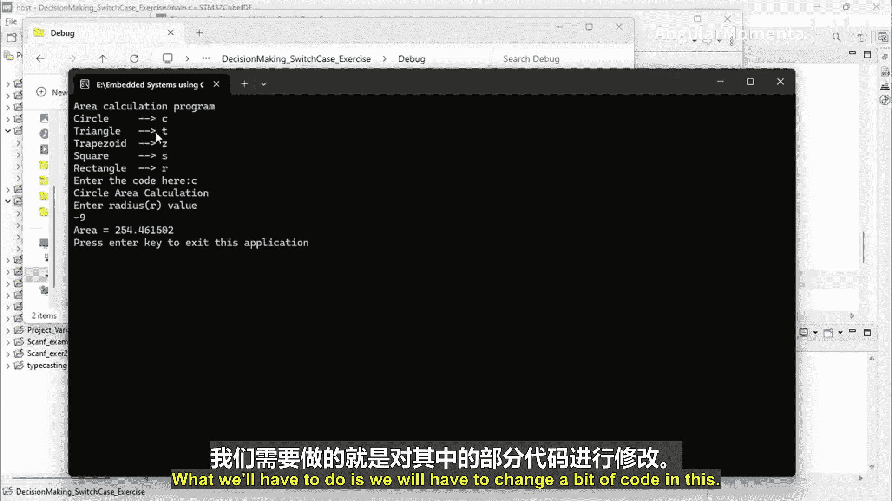
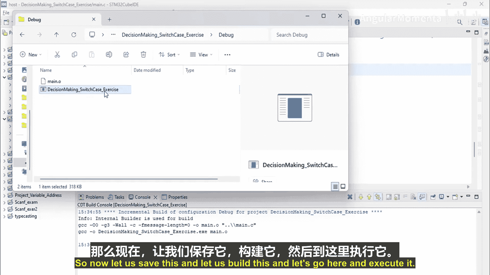
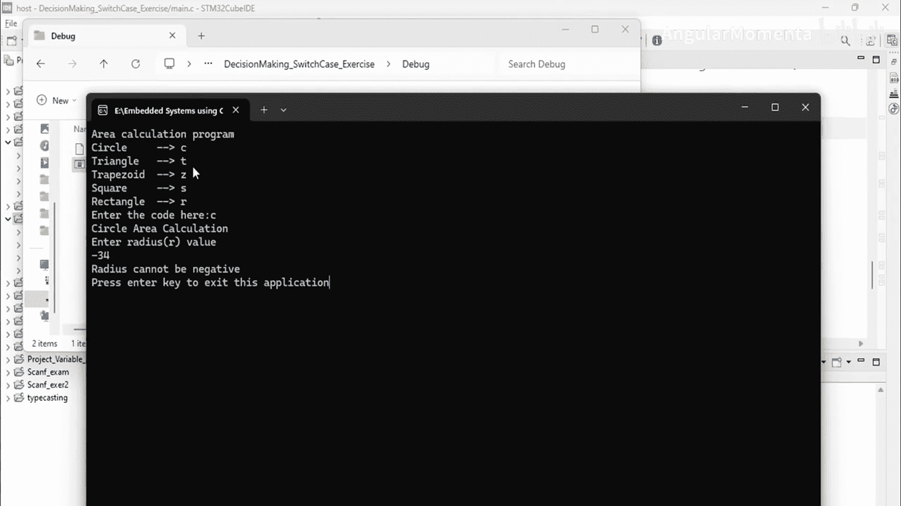
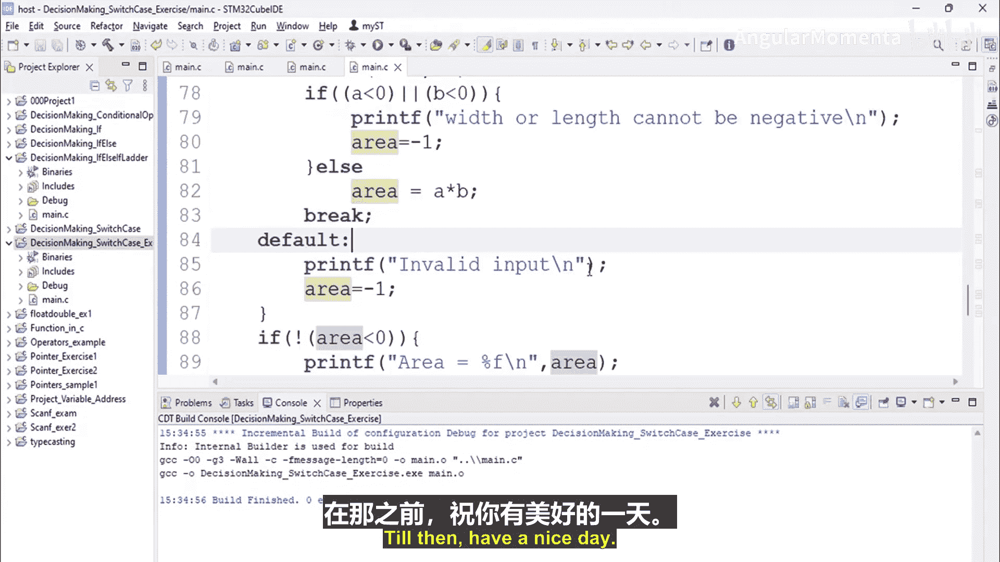

# 【EDUCBA】构建嵌入式系统 ｜ ARM Cortex (STM32) Fundamentals： Building Embedded Systems p35 02_04_05_switch case练习解答 第二部分 -BV1KjcTzUEeY_p35-

Wellil owners welcome back So now let's discuss our next topic in this particular session from where we have left in the earlier video so I'll continue it from the same then if you have K as S which is for square now again let me copy everything paste it here this is for square area calculation we have to enter side value let's take it an a only so we don't require all these things then area is simply going to be。

A into a。And then you break it。After this， we are left with case。R， which is for radius。

 for rectangle。Again， for rectangle， let me。Copy the statements。Below， this is for。

Rectangle area calculation Now here we have to accept the。Weth and the height。

 So I don't require base 1 base2。 So I'm going to accept this in a and the value of not height， but。

Lth。And this is going to go into another variable， which is L。 so let me take here one more variable。

 which is L。And then。I take it in a。 I take this in L， and I do here。The calculation。4our area。Okay。

 let's not take it A here， we'll use B itself W and B will take the variables says A and B only and then simply we'll do here a multiplied by B Now we will use a default case over here and the default we are just going to print here and print f invalid。

Andput。And we make the value of area S。-1。End of the switch case here。

Okay now we have called this method here， but before that I want to also check if area is less than0。

 if area is less than0， then we don't want to execute anything other than that。

 if the value of area is not less than 0 then we want to print the value of area there。

Here I can check using if a negation operator I am giving area less than 0。

 then I am saying printf area is equal to n percentage F the value of area variable and then we give here wait for user input and now let's go ahead and check this so I build the project。

I go in the properties。 I open up this。 I go in debug。

And I run this。 So I want to accept it。 let's say for triangle。 I enter T。 I enter the base value。

 I enter the height value area of triangle is this。 I check it for one more， let's say for。

Traabzooid。 So I enter Z base value， base2 value， height value。 That's the area for trapsoil。

 I except here。 let's say for C， I enter something which is a negative number。

 It still gives me the value of area， which is wrong。Because the value of area should。

It is just a moment what we'll have to do is we will have to change a bit of code in this。

When we come to here for area calculation， after we accept the value。

 we will have to check using an if condition if the value of r is less than0， if it is。

 well have to give a print to the user saying。Raddius cannot be negative， and。

Will assign sign area is equal to minus1。Then here we give L and then we'll calculate area over here in the Ls part。

So if it is not negative， we are supposed to calculate the value for area， otherwise， no。

So now in the similar way， well have to check it。For all。

 so once we accept the values over here again we will put an f condition this time there will be multiple because we are accepting two value。

 so if the value of b is less than 0 now here I can use or the value of h is less than 0。

 then I want to print here。Seeing。Bsor。Height cannot be negative。Ands。

You calculate the value of area。 This is done for the triangle。Now， similarly。

 we'll have to work on trapoid as well。Let me go here。 Let me check if。

Now here there will be multiple condition first is for base 1 then for base 2 then for height。

 So if a is less than0 or。The value of b is less than 0， one more condition。

 value of h is less than 0。Then。You give your arenice， saying。Base or。Height cannot be negative。

 and you give your area is equal to -1。 Then else part calculate the area over here。 Similarly。

 let us do it over here。 if the value of a is less than 0。

We are giving her a same print of statement， saying。Side cannot be negative。E calculate area。

Then for this， again， we will give if。Here there are two conditions。

 so if a is less than 0 or b is less than 0。Open the bracket。Give your apprenice。Specifying。

Where it all。Length cannot be negative else calculate the value of area。

So now let us save this and let us build this and。Let's go here and execute it。 So now I enter。

 let's say， for rectangle。

I enter minus 20 and 20。 it says width length cannot be negative area cannot be calculated so similarly I check it。

 let's say for circle I enter radius as minus-34 and now this is handling it properly。

So this will work for all the given aspects。😊，So now this code or this exercise is complete。

 stay tuned for most such videos till then have a nice team， Thank you。

