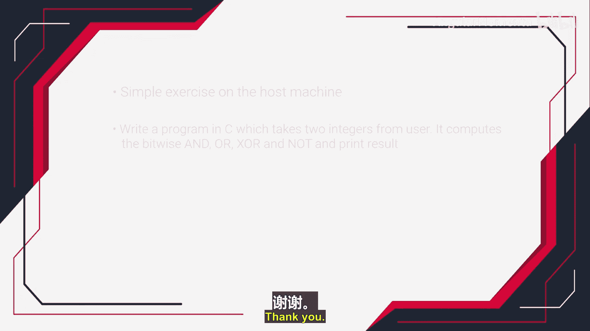

# 【EDUCBA】构建嵌入式系统 ｜ ARM Cortex (STM32) Fundamentals： Building Embedded Systems p36 03_01_01_C语言中的位运算符 -BV1KjcTzUEeY_p36-

。Heil honor， welcome back。 Now， in this particular video。

 we will explore about the bitwise operators in C。 Now。

 Biwise operators are heavily used in your embedded system programming。

 because most of the time in the embedded system programming we end up you know manipulating the memory addresses。

 Similarlyly， the content of the peripheral registers。

 even the status registers and much more in this cases。

 bitwise operators are used and it is one of the important topic in your embedded C programming。

 So let us explore all the bitwise operators in C that are available。

 now there are six types of bitwise operators available one is your bitwise。

 and then the next you have is pipeline symbol， which is your bitwise or then you have。

The bitwise left shift。 You have the。Bitwise right shift。

 you also have a negation operator known as bitwise n or negation and exclamation。

 or we also call it as bitwise X or let us explore these one by one。 First of all。

 let's understand the difference between logical operator and a bitwise operator。 Now， for example。

 if you use something like double m person， this becomes your logical and operator and a single becomes your bitwise and operator。

 If you want to take an example， let's say for this I am having a variable A。

 which is equal to 40 and let's say B， which is equal to 30。 This case， a is basically true。

 and B is also true。 the exact value of a and B are not considered the only thing that matters is whether the operators are 0 and non0。

 Now， since both the operators are non0， the result of this expression is going to be1。

 which is true now how。About this operation， suppose I say something like this。

 If I say C is equal to A ammp person B， this becomes one。

 but if I say C is equal to a am person B single m person B。 What would be the value over here。

 Now let us explore this。 how it basically works Now in this case。

 what happens is we do an and operation bit by bit。

 that is why it is called as a bitwise operation here。

 the actual the binary format of let's say a number for T， I assume I am giving here say I 00，1，0，1。

0，0，0。 and we give here single m person B and the binary format for 30 I'm giving here a 0，0，0，1，1，1。

1，0 this is the binary format that's available。 Now when I say a M person B is nothing but you have to perform an and operation bit by bit。

 basically over here when。We are doing bit by bit。 It is doing0，0。

 The value over here that will come is0 similarly when it is0 and one again。

 the value that' is going to be coming over here is0 Now this is going to be again0 and1 so the value here is also going to be 0 here。

 when both the values are1 the value would be equal to one rest all values would be equal to0 in this case Finally C is going to be like this for you this is the bitwise operation that means bitwise operation you do an operation like and or etc cea。

 bit by bit。 Now， similarly let us take an example with or this we have done using n if we do the same operation using the R operator not this but I use here a single Now a logical or basically is either of it is true。

 the value is going to be true over here if I am using for bitwise。This particular case。

 let us do it bit by bit and understand it Now here， both are0。 so this is also going to be 0。

 Now this is0 and1。 So at least one of the operation is having the value1 here this won't be0 but this would be one Similarlyly over here as well this both are one。

 so the value is going to be1 again here similarly like this when only both are0。

 the value would be0 over here， if you use the or operator that is if youre using the bitwise or operator over here。

 Similarlyly， if you take the bitwise not operator now not is something like unary operator。

 So because it needs just one operator， we don't need both the operator there if I say here a I am taking the same example here。

 let me copy this I' am using here negation a C is equal to I'm saying negation a。

 what would be the value of C in this case if this is0， this would be1 if this is 0。

Nextex bit iss1 if the third bit is1 is going to be0 like this this would be the data for negation operator or not bitwise operator Now let us explore the X or operator now there is no logical X or operator there is only a bitwise X or operator this is basically a symbol that you have to use and the symbol that is used is the exponential map if I say over here C is equal to a exponential B basically C a X or B you have a truth table of X or also if I show you the truth table let's take here input as a B and here I am doing。

A X or B， if a0， b is 0， this would also be 0。 if a 0， b is 1。This would be one。If a is1。B is 0。

 this would still be one。If。A is1， B is 1。 This is going to turn to0， not1。

 That is basically your X or， and that is the only difference that is there。

 If you consider the same example that we are doing it over here。

 let me write down over here for X or。😡，Let me use the symbol here。 if you take it like this。

 if it is 0 and 0， what is the value， it is 0， So this is correct， Even this is correct。

 If it is 1 or 0， the value is going to be 1，1 or0，0 or 1 is going to be 1 where it is 1 and 1。

 the value is not going to be1， but it's going to be 0 over here。😡，Similarly， if it is 10，10。

 value with 1 and both0s， value is 0。 So this would be your value in the case。

 if it is a X or B that is how all your Xor or all your bitwise operator work。

 So we'll take up examples and will understand the applicability of bitwise operations Also in the embeddedbed C programs most of the time you would be doing testing the bits setting the bits and clearing the bits and you know toggling with the bits because let's you have to like your L is connected with one of the pen of the macrocontroller port。

 So if you want to turn on the L， then you're going to set some bit and if you want to turn it off the LED。

 then you want to going to clear some bits， you want to analyze the status registry of the peripheral。

 then you will be using this testing of bits。 So in all those cases。

 we will be using the bitwise operators and when we do some exercises will explore them。

 So let's go step by step。And first let's do one simple exercise on the host machine after that we'll move on to the target well create a program which would lets sit write a program and C which takes to integers from user it computes the bitwise and or Xor and not and it also prints the results well complete this exercise in the next video till then have a nice day Thank you。

