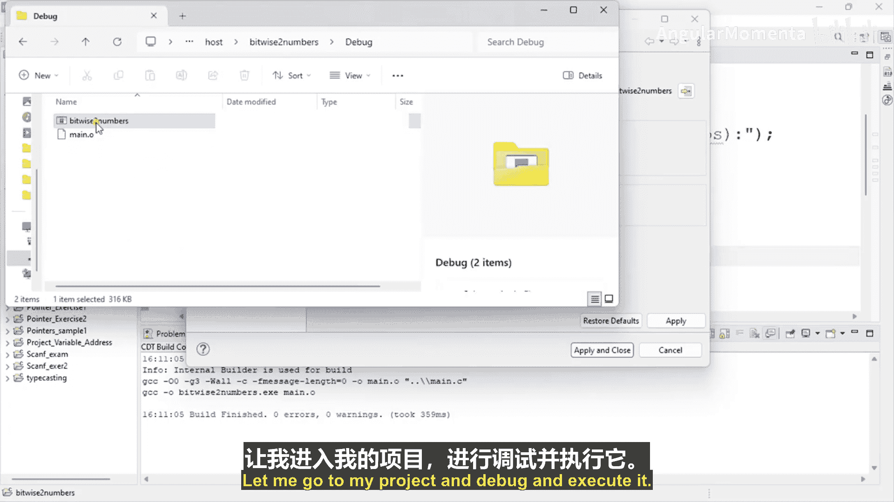
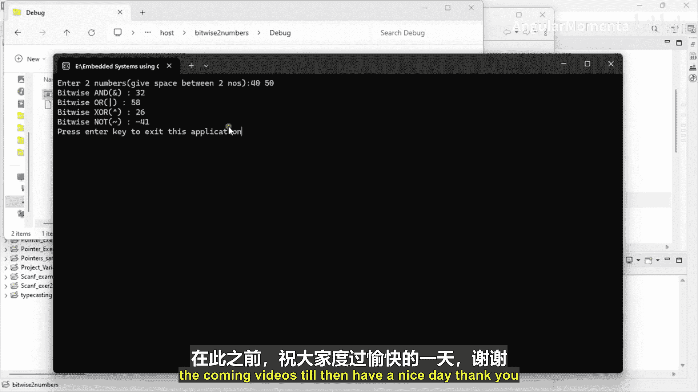

# 【EDUCBA】构建嵌入式系统 ｜ ARM Cortex (STM32) Fundamentals： Building Embedded Systems p37 03_01_02_按位与和按位或 -BV1KjcTzUEeY_p37-

Hey earn， welcome back。 Now， let's implement the exercise。

 First thing I want to do is I to create a new project I would be creating here， let's say。But wise。

2 numbers。And。Let me add in this a new source file， which is main dot C。

The first thing we would be doing is， let's conclude as to the end dot edge。Also， S T D， Iod dot and。

I will go back to my ladder program。 Let me copy this。😔，Come here。Yeah。Put down at yours。

 then write down my mean。😔，And。The return statement then will start with end 32 and score t will take variables as number 1 and number2。

 we will enter a printer we say。Just。Enter to numbers。

 I'm going to give here a message say give space。😔，Between two numbers。Yeah。Like this。

And then I will use only one scanf I'll put percentage D percentage D。

 and then I pour number1 and pour nu2。 Now， let me also call this particular method。

 let me call it here and keep it ready。 Simply after this， I am going to do。Printf， saying。Bitwise。

 and。In the bracket。Colon percentage D slash N I want to print here numbermvan and numbertu。 Now。

 let me copy this below。This is the next I want to print as bitwise or。This is the symbol。

 And I just want to use here or like this。 Let me give you space to make it more clear Then this becomes。

My。Xor。Yeah。This is the symbol and Xor。 And then I have not， which is the till design。

 Not as only on one opera。 I don't require numb two in this case。 It would be like this。

 Let us save this and let us execute this。😔，Let me go to my project。And debu and execute。

 I enter two numbers， let's say enter 40 and 50。 bitwe and comes to 32， bitwe or comes to 58。

 bitwe X or comes to 26 and bitwe nor for 41 becomes for 40，41。

 That is how your bitwe operator works。

Now， we'll work on more on this bit wise operators in the coming video still then have a nice day。

 Thank you。

