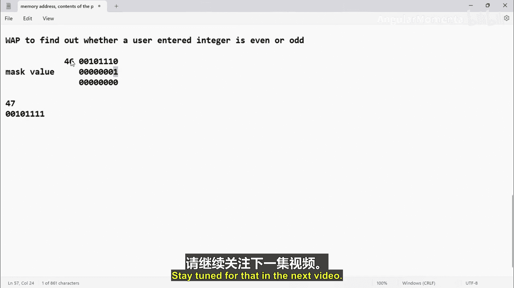

# 【EDUCBA】构建嵌入式系统 ｜ ARM Cortex (STM32) Fundamentals： Building Embedded Systems p38 03_01_03_位运算符的位测试适用性 -BV1KjcTzUEeY_p38-

Hey earns， welcome back。 Now， let me create here a new project。

 or rather before creating a new project， let us continue in this。

 And then while creating the program， I would create a new project。 So I would just keep this open。

 We have completed this in the earlier video。 Now the applicability of your。

Bitwise operations in in the Embit C program， most of the time we will be testing off bits would be done using and then setting off your bits would be done using or clearing of bits would be done using negation and and toggling of bits would be done using exponential or X or we say will'll understand this by doing an exercise。

 What we'll do is we'll write a program to find out。Whether user have entered an integer。

 which is even or odd， we have to print an appropriate message on the console。

 We have to use testing of bit logic for doing this to find out whether a number is even or or there are many logic which you can build。

 but we will be using a testing of bits logic and how this works is really simple。

 Let's consider here a number， let's say an integer number 46 for example，46。

 if you write it in the binary form， you will get something like 0，0，10，1，1，1，0。

 Now this number is even here it's an even number， this particular LSB is 0 over here。

 but if it is an odd number， the value over here would be1 not 0。 let's take an example， say 47。

 the binary for this is 00，10，1，1，11。 This indicates that this number。

No0 is one which means it is an odd number when it is0， it means it is an even number。

 otherwise it is an odd number。 That's why by checking or you know by testing the least significant bit of a number we can find out whether a number is even or or Now this is the base logic that we have understood right now and we would want to test a bit on this If a number is even or odd in this particular case it is LSP for us and how to do that we will use a particular technique that is called as bit masking bit masking is technique in programming which is used to test or modify the states of the bit for a given data over here we use bit masking with the mask value we want to create a mask value here we have to decide what should be the mask value and we have to then take a mask value and do a bitwise operation with the given data to get the out Now let's analyze how this。

 Now let's say we take。Particular input put number， which is written in the binary format。

 I have considered this 46， which is a binary format is displayed over here。

 Now we'll divide this number into two areas。 One is this area。

1 is this particular area here and the second is this area over here we call this let's say as area 1 we call this as let's say area in this particular number。

 the area1 is of no interest for us because our goal is to test a bit which falls under area2 our goal is to find out a number is even or or that's why we care only about this LSB value that is coming over here area1 is of no interest to us in this particular exam。

 So that's the reason why mask value is 0 for that area we use a mask value 0 when we do bitwise and with a particular number in this case we want to test this particular bit Now for area 2 we take here a mask value I just put it over here。

 I take here a。askV and we mask it using 0，0，0，0，0，0，0。 And here we make it 1。

 This is my masking value over here entirely it is 0。

 but the LSB value becomes one in my mask value wherein my original LSB value is 0。

 I want to test this particular bit itself。 outputput of this is going to be 0 because data is mask with one to test the LSP of data outputput of this entire thing is going to be。

0 like this。 If the output is0， I can conclude that the number is even if the number is odd。

 then this position will be1 over here。 and even this position would be1 over here。

 Then if both the positions are1 over here。 I will get the data mask value also as one which will make it as that this is a odd number not an even number。

 This is how the mask value is important for us to find it out by using this technique we can test any bit position you want here I'm checking the bit position1。

 That's why all the bits are0。 and I make only this bit position last one as1。

 I'm actually just testing the bit position with the first bit value there。

 Now let's try to solve a problem finding out whether a number is even or or this is the basic logic which I have explained it to you now we can take any number over there。

 we can mask it with the particular value and then check the mask value with the original value。

What it is and then print appropriate result there。

 the mask value we will be taking over here as one whenever we check it for the equality Now let's try and do the do this exercise and then we will see what is the entire output that is coming。

Stay tuned for that in the next video till then。 Have a nice day。 Thank you。

