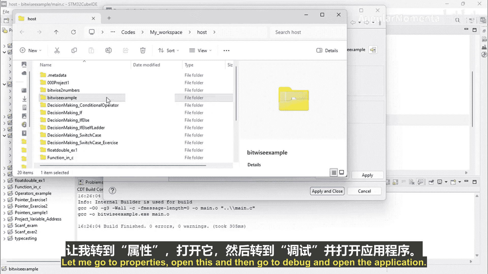
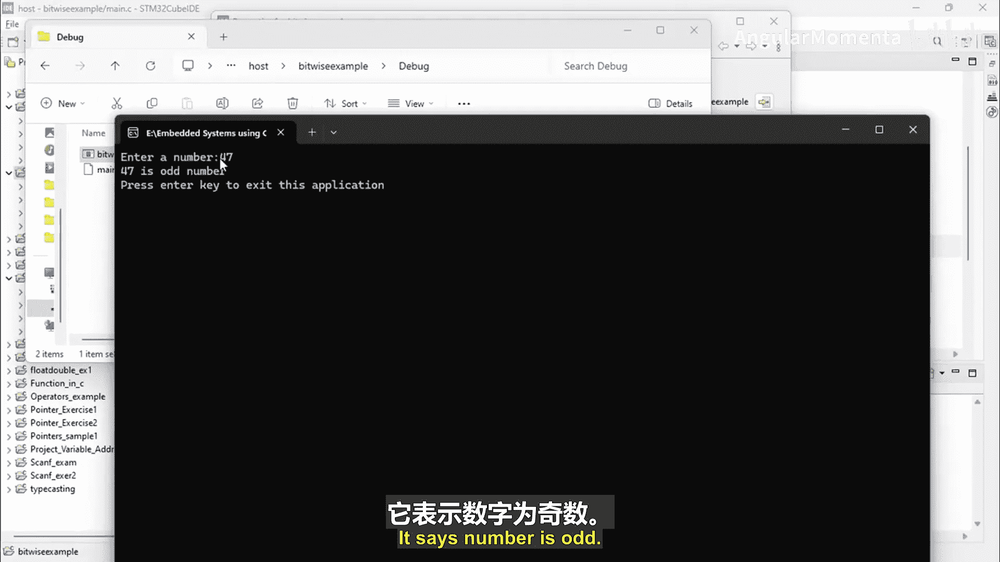
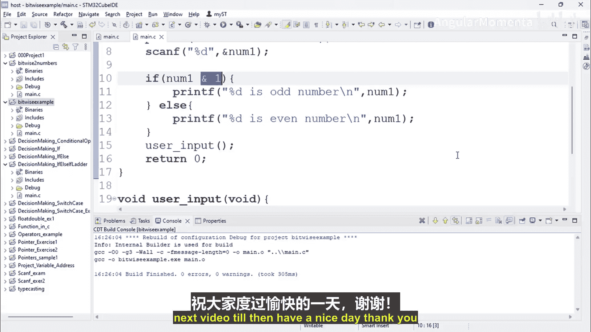

# 【EDUCBA】构建嵌入式系统 ｜ ARM Cortex (STM32) Fundamentals： Building Embedded Systems p39 03_01_04_利用位测试判断奇偶性 -BV1KjcTzUEeY_p39-

Hey， Eus， welcome back。 Now， let's write on a program to find out even or odd I'll go back to my IE。

 Now， let me create here a new project。 let me name it C managed built。 I am creating here。

 let's say bitwise example and finish， let me add here a new source file， main dot C。And。

Let's work on this。 The first thing that we would be doing is， as usual， let us copy this。And。

Let us also include the names spa， the files， S TDI O dot H。 Then we also include。

The SDD in dot edge， Then we create your inter and。We have a return 0。

 Then we create here end 32 under quo0。 We take a variable here。We use a printf。

 we say enter a number to the user， and then we use a scanf percentage D store the value in number1。

 Now， once we have the number with us， well have to use if Now I'm checking here number1。

 I told you we have to mask it with one I'm using here but twice and and putting there one I'm using here print F percentage D is odd number print the value of number one as well。

 then if not this， I'm going into L Pri here is even number and then don't forget to give your user input。

 let me just close all the main methods。 and let me build the project let me go to properties open this and then go to Dbug and open the application。

 I enter a number It says number is even I again try it。 I enter a number。

number is odd。 So it's working properly as expected。 Just remember to mask the particular value here。

 Now， the next days will create a program which will set let's say we'll make the bit bit state to1 the fourth and the seventh bit position of a given number and then we will print the particular result in the next particular video well complete this particular exercise。

 we'll make the bit state1 for the fourth and the fifth of7 bit position of the given entire number。

 This we have to first take a number， write the binary format and then we'll try to make the fourth and seventh bit position to one of that number and then recalculate the value what it could be and then write it at the program to compare the calculation。

 So see you in the next video till then have a nice day。 Thank you。

