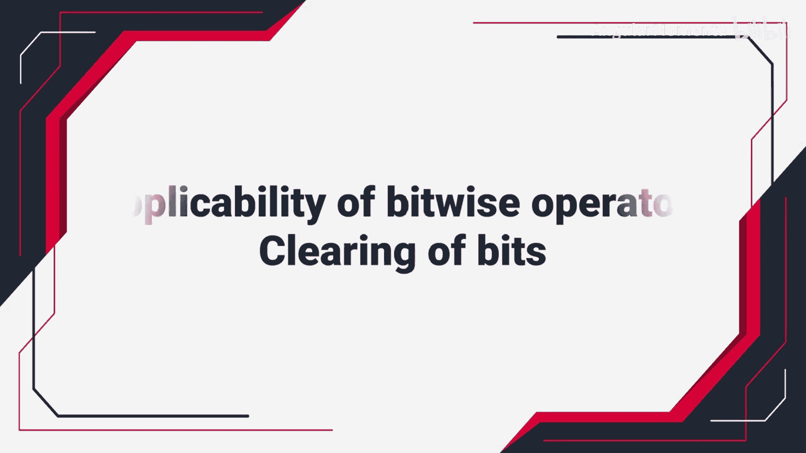
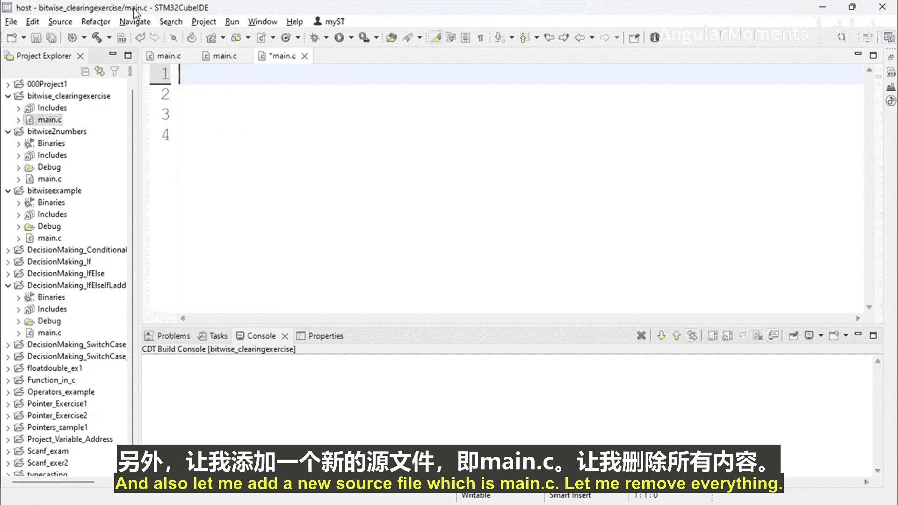
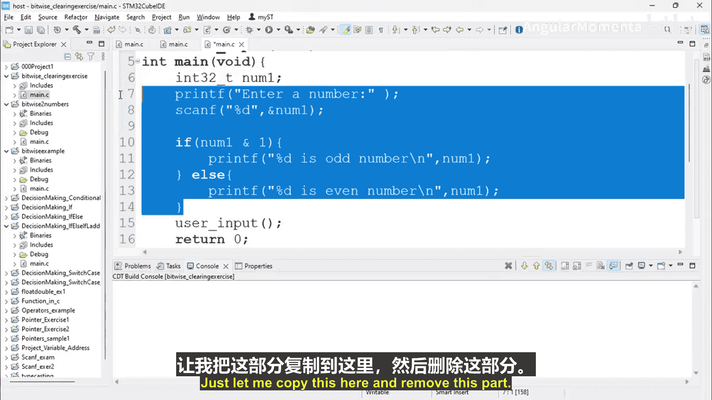
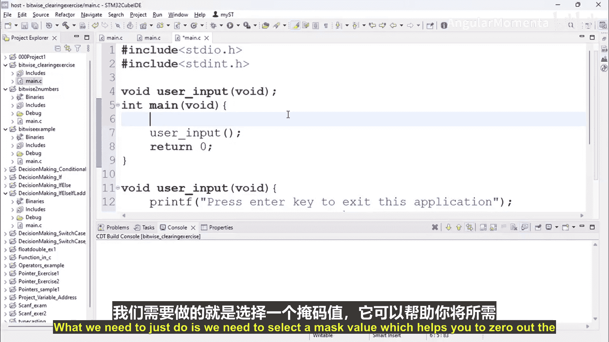
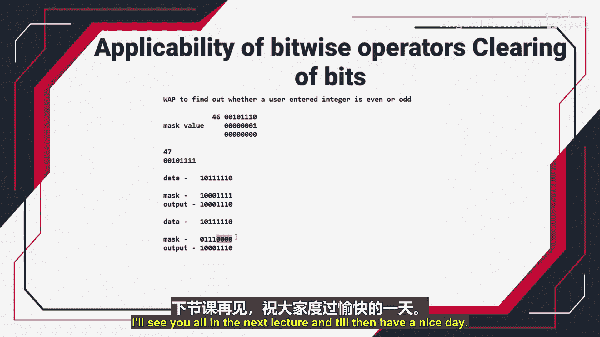

# 【EDUCBA】构建嵌入式系统 ｜ ARM Cortex (STM32) Fundamentals： Building Embedded Systems p40 03_02_01_位运算符清除位的适用性 -BV1KjcTzUEeY_p40-

Hey earn， welcome back。 So now let's do an exercise for clearing of bits。

 I'll create a new C plus plus project and let me name it as bit wise。Clearing。Exercise。

 let me give it a bit and thus score。It is min G W， and finish。And also。

 let me add a new source file， which is main dot C。All right。Let me remove everything。

Just。Let me copy this here。😔，And。什么。

This spot。Now， everything is ready for me to use。 Let's understand first about clearing off bits。

 We'll have to write a program to clear， which means clear means basically reset。

 We'll have to reset a bit state to 0， We'll have to write a program to clear the fourth。

 fifth and sixth bit position of the given number and then print the result， First of all。

 which bitwise operation do you use to basically clear a given position of data。

 Do you use an and or do you use an or any idea on this， Now， in this case。

 certainly we cannot use bitwise or， Because that is used to set。

You will have to use bitwise and operator and bitwise and is used to test as well as Cl。 Now。

 let's see。 how can we do that， The goal for us is to make the bit state 4。

5 and 6 positions should be also able careful that the bit position from 0 to 3 should not be affected。

 and also， the bit position 7 should not be affected。

 What we need to just do is we need to select a mask value， which helps you  to。

0 out the required portion。 Let's take an example。 Let's say my data value is here 1，0。

1，1，1，1，1，0。 And I am using a mask value for this as say1。 I want this to be， say 0，0，0。

This has to remain， as it is my output。Would be。1，0，0。0， then。1，1，1，0。

Over here we'll have to keep this portion of the mask values as 0 and these bit positions of the given data。

 Now， those should not be affected。 All right， we can basically mask those data portion with one over here then In this case。

 the mask value can be turned out on something like0 x8F It's just observe the output just see the portion which is0 portion over here that is available。

 the takeaway from this particular video is the bitwise and is basically used to test and clear both there is one more method you can use to clear the bits。

 Now this was using and the another method is you can actually do is you can mask the value should be one for the unaffected data portion。

 which is you can put it I'll just copy this down below here as well。

 and this position I can mask it to one and keep this to0 is。Methd 1。

 then your this position and this position remains unaffected。

 Now another method that you have is second method。

 which you have is keep the mask value as one and rest keep it0 so I may have it like this And now again the output would be same you can use it mask value you can negate it use the X or first negate it using bitwise not mask value first and then perform a bit twice and it depends which method you want to follow and you want to transform the bit value over there。

 this would be a much simpler one as you can just negate the values。

 make it one over here and then you can just go there and mask it using the and operator the mask value for you can negate that and when you negate the final output is also going to be the0 once over here because this will be again same value。

 which is going to be negating over here in this。Mask example in this case。

 you want to zero out the fourth， fifth and the sixth position。 This is your zero position。

 This is your first。 This is your second。 This is your third。 This becomes your fourth。

 fifth and 67 and 0 to3 has to be unaffect which means the three bit positions immediately I can guess the number with what it can be。

 This has to remain unaffected and this fourth has to remain unaffected and then I have to use the bitwise and or X or an and to shuffle that and make it either0 using method 1 or make it 111 using the method。

 you can basically clear out that and then you can use it that will give you a number and after that you can just negate that number so the whole thing will give you the number which you want to have after the bitwise transformationist。

We'll basically learn the bitwise shift operators as well。

 which now help you out to toggle this kind of bitwise operations that happen。

 I'll see you all in the next lecture Until then have a nice day。 Thank you。😊。

