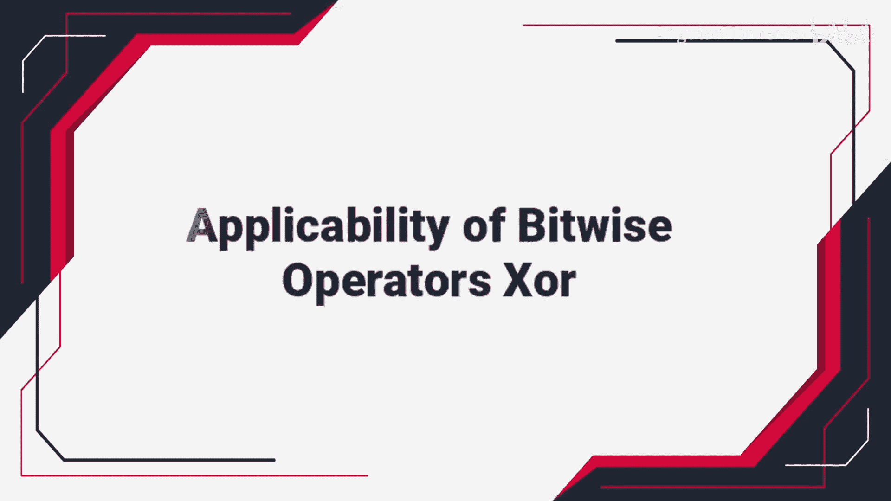
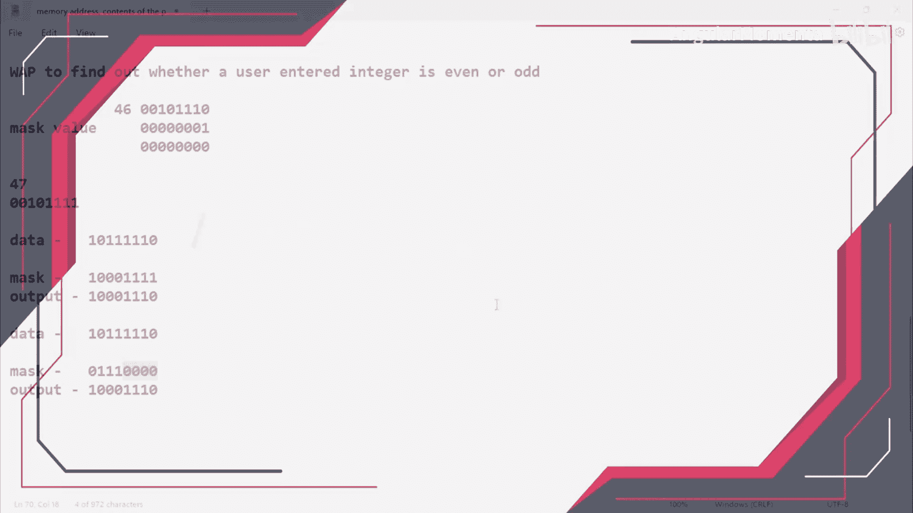
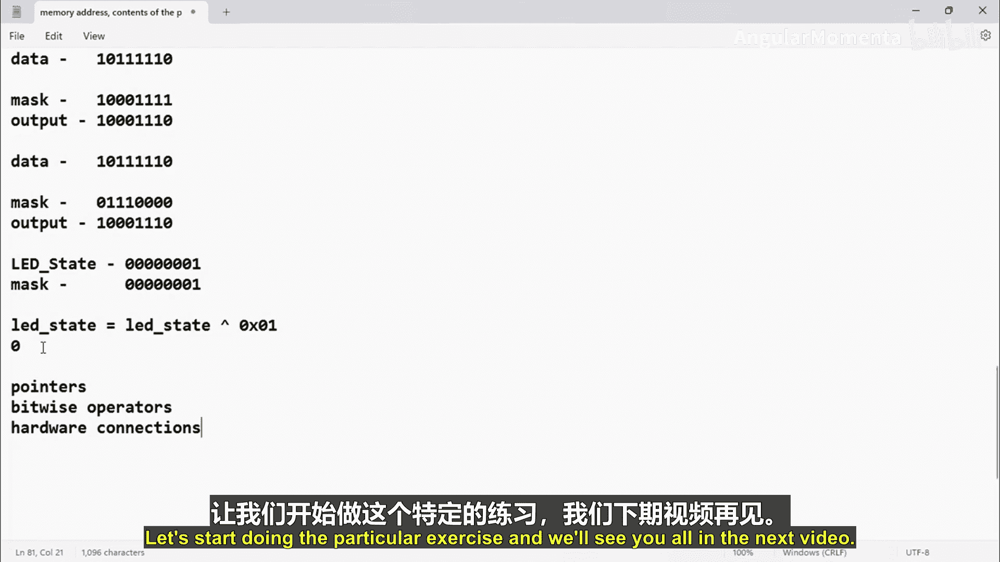

# 【EDUCBA】构建嵌入式系统 ｜ ARM Cortex (STM32) Fundamentals： Building Embedded Systems p41 03_02_02_异或位运算符的适用性 -BV1KjcTzUEeY_p41-

He learners， welcome back In this particular session， Let's understand the X or operator。

 which you can use to toggle for bits。 Over here， we will take an example for L state。

 Let's say I'm having an LED state。Everything is 0。1。If I use a mask。Which will make it， too。0，0，0，0。

0，0，0，0。 That is making a toggle of it。 If I use a mask here for one the output that I will get for the next one。

 I can use an output toggle。 Then I can use the X or operator like that X or operator needs two operate。

 Let's say you have operate one and operate to the result of this will be 0 when both the opera are equal when they are not equal。

 The result is going to be 1。 This is the basics of the truth table for your bitwise X or。 Now。

 you can use this particular feature to toggle the bits or toggle the data。

 Let's say here we have LED state which is equal to L state with1。

 Let's assume that L E state is equal to0，0 exponential one or x or1。

 your opera are different if I use over here， say L E D。State is equal to LED。State。

I use here x or says 0 x。0，1。 If this LED state is1， I'm using1 x or 1 that will be equal to 0。

 so you can use this feature of x to toggle the LED or like when you use a particular code for macrocontroller program。

 So otherwise you will have to write a program something which says like you go in a while loop continuously toggle the LED and then you may have to do it something like if L is equal to0。

 then you will have to make it one， if it is equal to1， you will have to make it0 using those。

 you will have to change the state of LEDs as such instead of writing all this codes。

 you can just replace one line of code that is L X or is equal to one。

 which is actually used for toggling you can use all these operators to write a program on your target board now will perform example over here。

 this particular program will do it on the target board for this exc you will need knowledge of first thing is。

Pointers which you have already covered， or you should be able to easily do the particular exercise。

 You should also know about the Biwise operators， Obitwise operations that happens。

 and you should also know about the。Hardware connections。Which are there for your particular port。

 we are working with a macrocon and we are working with external component that is LED。

 We have to know the hardware connections from the next video onward we'll start covering all these things。

 Let's start doing the particular exercise and we'll see you all in the next video till then have a nice day。

 Thank you。

