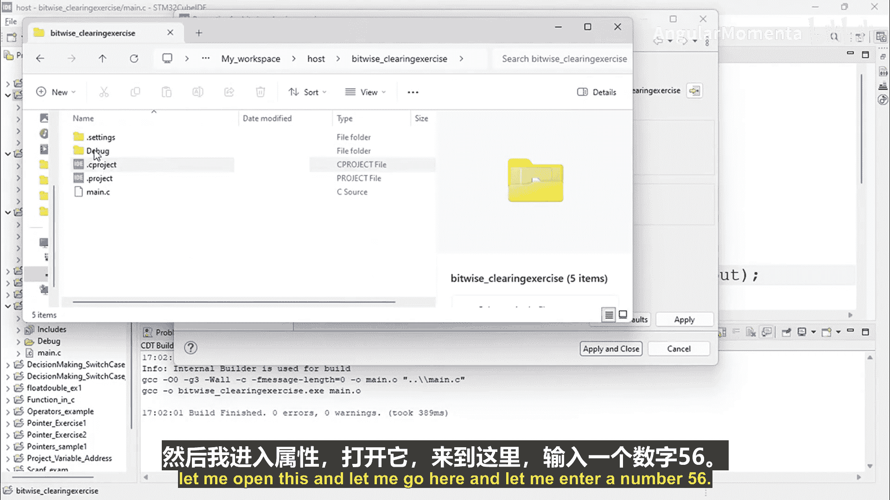
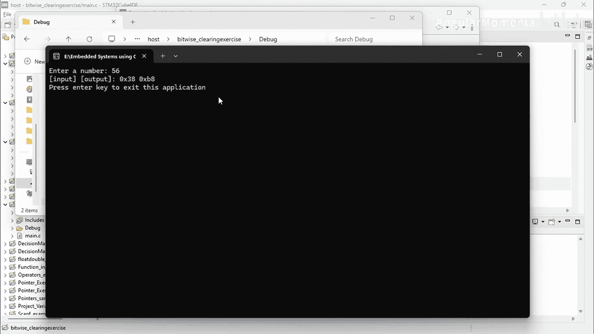

# 【EDUCBA】构建嵌入式系统 ｜ ARM Cortex (STM32) Fundamentals： Building Embedded Systems p42 03_02_03_位运算符的比特位设置适用性 -BV1KjcTzUEeY_p42-

Now let's do the exercise and the exercise that we are supposed to do is write a program。To set。

 or we can say， make。The bit stay to one， only for fourth。And 7。B position offer。

Given number and printer。Result， we should not affect any other bit position。

 We should only keep that in mind。 Now， let's analyze how can we set this particular bit。 Now。

 let's take an example of our data over here。Let's say I have here data like 0，0，1，1，1，1，1，0。

 and for this we have to use a mask value。 Im going to use a mask value， which is， let's say 1，0，0，1。

0，0，0，0 in this particular case。 what do we want is we just want to change the fourth and the seventh position。

 you can take it over here， the fourth position is this is 0。 This is 1，2，3。

 the fourth position fourth position over here， we are going to change it。

 and the seventh position over here。 we are going to change it for this we have to use a mask value for the fourth and 7 bits which are set after that。

 well have to decide whether you want to use bitwise and operator or bitwise or operator。 Now。

 let us second an example what happens if you use bitwise and and bitwise or let me just make here。

 let's say bitwise and Im going to use this mask position And now if I try to find out the output here。

This will 0，1 will make it0。 This both will be 0。 This will be 1。And rest would be 0，0，0，0。

 Similarlyly， if I use。The same thing。 But I use a bitwise or operator over here。 Then in this case。

 the output will be 0 or 1 will be 1。 Both zeros will be 0，1 and 0 would be1。1 and1 would be one。

 Even this would be one。 This would be one。 This would be one。

 This is the result that you would be getting if you use bitwise and operator and bit or operator。

 We actually messed up a lot of bits over here。 It clearly shows that you cannot use an and operator that is bitwise and in this particular requirement。

 That's why the bitwise and operator is to test it is not to set any value。

 In this case will have to use bitwise or bitwise and in this case is not correct bitwise or will give you the perfect output that is expected。

 only over here if you check0，1，2，3，4 fourth position。And7 position。

 This is what you are supposed to change。 restest everything should remain as it is the takeaway from this particular video is bitwise and is used to test。

 It is not used to set and bitwise or will be used to set。 It is not used to test。 Now。

 let's do this exercise。 I will actually be inputting a number。 And after that。

 Ill actually be creating an output by using a bitwise X or with a mask value In this case。

 well be using a mask value as 0 x 90。 And I can just print the number in the Ximl value there。

 Let me just go to my I D over here。 Let me take an in 30 to1 score T。

Say number one and let me take an output variable。Let me take a printf， I say。In double quotes。

Enter a number。And。I use a scanf percentage D， store it in number one。And then。In the output。

Im using N。X or0， x，90。I am simply printing over here， giving here input。Printing your output。Gin。

I want to print in the X format。 Im going to use your0 x percent x， then0 x。P syntax。

 give a new line。 I want to print the value of numbern， and I want to print the value of output。

 Let me just build this。And let me go to properties。 Let me open this， and。

Let me go here and let me enter a number 56。 After entering a number。

 this is what is the result I am getting。 Now， let's use this and we'll perform other part of the coding till then have a nice day。

 Thank you。

