# 【EDUCBA】构建嵌入式系统 ｜ ARM Cortex (STM32) Fundamentals： Building Embedded Systems p43 03_03_01_编码点亮LED -BV1KjcTzUEeY_p43-

Hail owners， welcome back。 So in this particular video， we will start doing our exercise。 Now。

 this exercise will not that straightforward for this。

 we have to explore various hardware connections。 First of all， let's begin with understanding the。

Hardware connection， let's understand how the external hardware， you know that is used in our case。

 that is the LED which is connected to the macro controller。

 So for this we'll have to refer to the schematics of the board if you have to view the schematics。

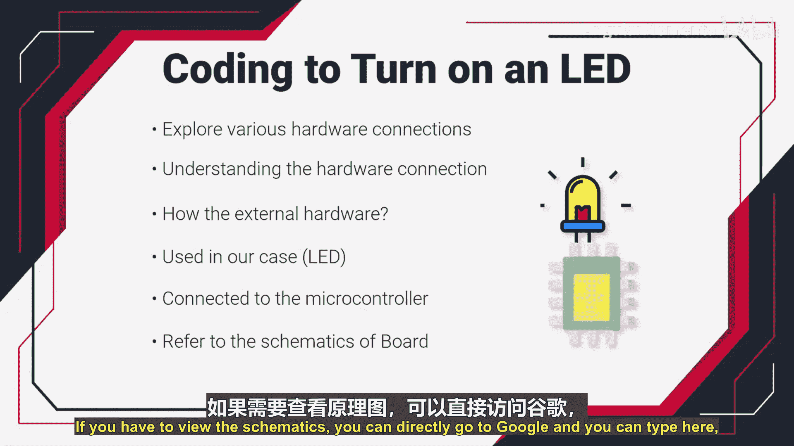

You can directly go to Google and you can type here， you want to download the。

Schematic of your board name， which is STM 32。If。🤢，4，0，7 g。Disc 1。Just click here。

 you will get this particular link， click on the link and it would get downloaded。

 So if you go here and you open this。

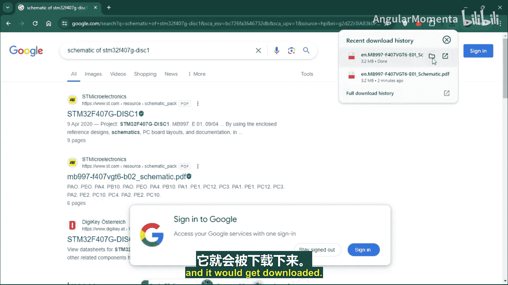

This is your schematic file。 Let me open it again。You can just scroll down so let's understand this particular file now we have downloaded this。

 I will be attaching this file in the resources section you can just download it from resources and you can directly view it in case you are using a different board then you will have to download the schematic for that particular board in our case we have downloaded the schematic and now over here well have to search for LED I am just scrolling down a bit and here it is。

I can find this。 I am having here LED， So you just browse to this particular document。

 which for LEDs， you will find the LEDs over here。 L 4，3，5，6， and it is LED green。 It is LED orange。

 It is red and blue。 This is the part number。 you can say it is part number of LED green。

 similarly for LED orange， red and blue as well。On the board you can identify the Ls by these part numbers or these names you can see these part numbers should be mentioned on the board as well to check that you will need to download the user manual let's open the user manual again I am going to Google I am typing my board name and user manual I get the user manual here I am just downloading that and it is done let me open the user manual over here and inside this user manual you will have to check the。

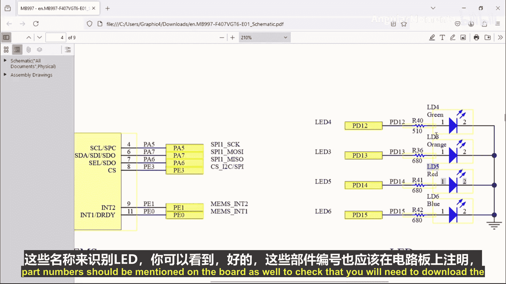

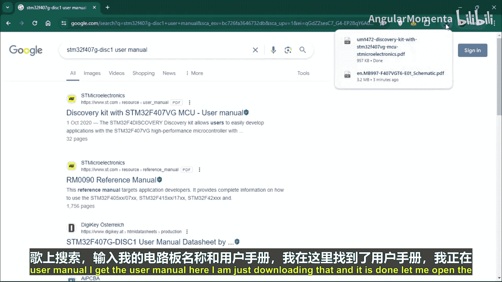

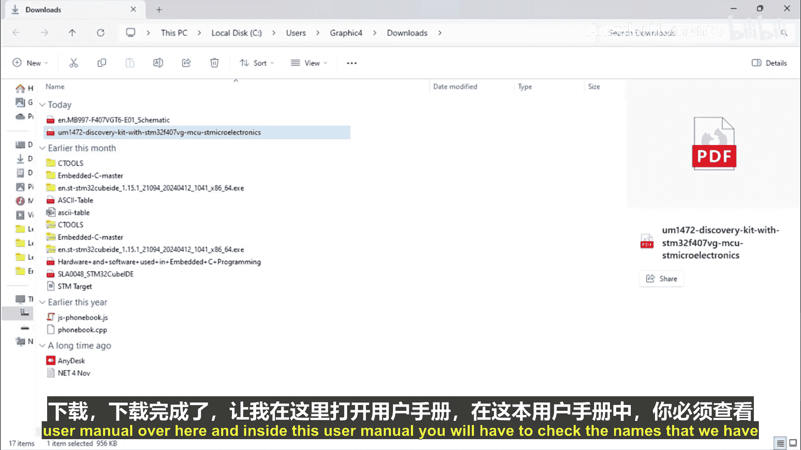

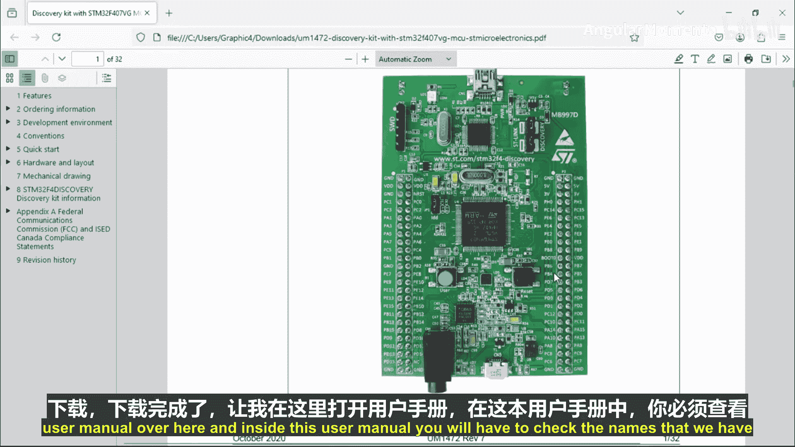

Names that we have already identified。 I am just zooming in a bit。

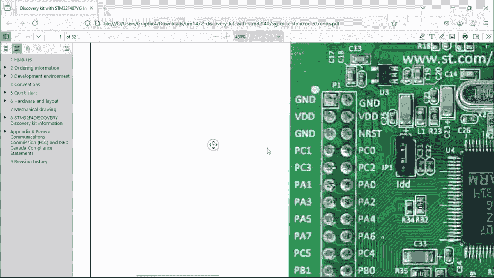

Yeah。What you can do is you can simply just scroll down okay a bit。

 they have explained the entire board you can see this over here。

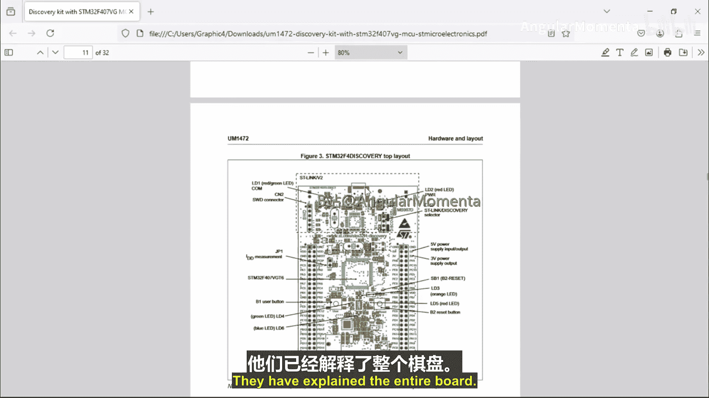

You can just zoom this part and see you have the。

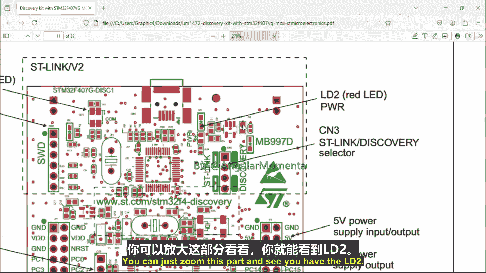

L L D2。LD1 is given here。

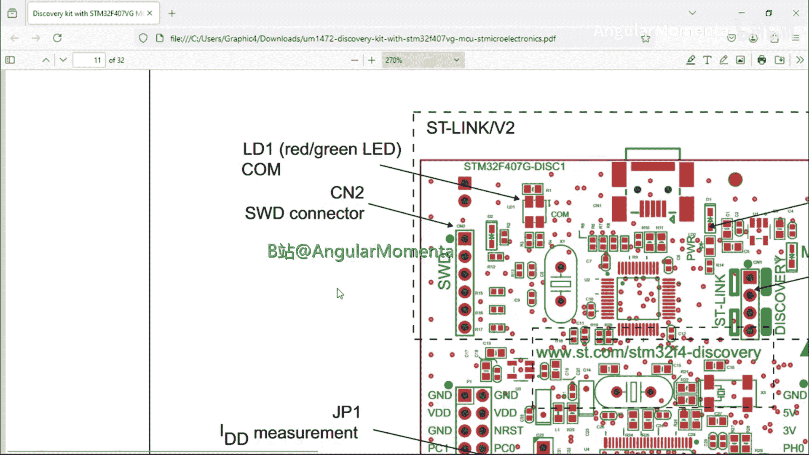

Similarly， you have L D2 given if you scroll down a bit， you have L D3， you have L D5。

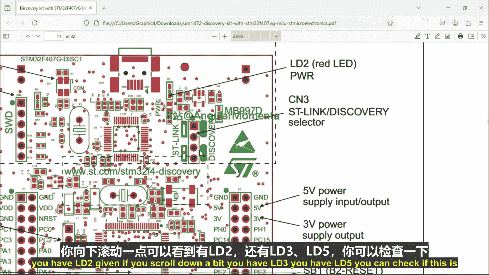

Yeah。Yeah。You can check if this is there on your board， as well。Just see to it carefully， okay。

They would be minorly written over here。 you can find those things here， see。

They have mentioned that carefully， but still， if you are unable， you will have to zoom in a bit。

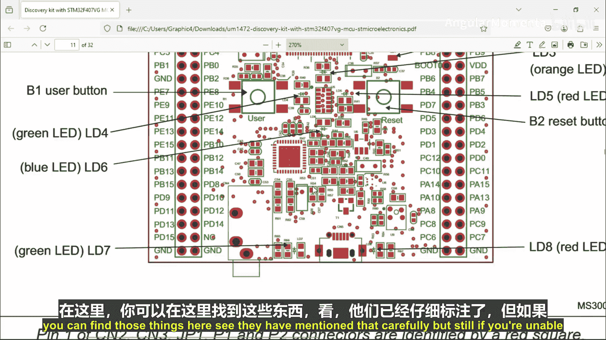

And then， you know， check those details。This was about you know how to check whether your board has LEDs where the LEDs are located and how can you check those the LED are basically connected with the macrocontroller pin the green LED is basically connected to the pin so you can just check that out here as well Ill open the schematic diagram as well and。

Yes this one So if you just check out this your green LED is connected to D pin。

 which is PDd12 PDd12 here means port D pin number 12 and the LED blue over here is connected to your PDd15 which is port D pin number 15 that basically leads to our next discussion that is what is a port now the macrocont has many ports as we have seen we can basically identify all these ports by going through the schematics again if you go to schematics just Im going to scroll。

Out a bit and go down here。 You have all the ports defined here。

So this is a picture of the macrocontroll which is used so this U4 a is a part number of the macrocontroll the macrocontroller is your STM 32 f407 and it has many pins but on this board all the pins are basically exp so in STM 32 Fx based MCUs each port will have 16 pins which you can connect external peripheralphis like it may be LED it may be display。

 it may be some Bluetooth transr it could be some external memory like EPROM or joystake or keypad etc。

If you want to do those external connections， then you will have to take help of these ports which are exposed on the board。

 If you take a look into the picture， all these pins can be segregated into different ports like you have here port a。

I am just zooming in a bit so you have port E similarly you have various other ports as well so this becomes your port a then you have port B here you have port E port D all are defined over here all these pins are actually belonging to port a the first pin is called as PA0 and that is your port a pin number 0 the last pin is PA 15 which is the port a 15 pin the pin number so basically that means you know your microcontroller has let's say this 15 pins is actually your PA0 which is a0 pin and this is your 15th pin。

Similarly， you scroll down， you have more other ports as well， it is port A， B， C， D and E。

Just scroll down a bit and check all the given put。 Now， let's move forward。 Now。

 let's consider the LED， which is for L 4。 I'll go back to my diagram here。

LD4 is connected to which port it is PDd12 PDd12 is you can find out that over here it is this one。

P D 12。Now the question is how do you access the 12th pin of the po D po D is called as GPIO port。

So GPIO basically stands for your general purpose input out these are general call your general purpose IO because it can be used for any purpose like they can be used for connecting some external ferfers or you can also use that pins to do some protocol communication be it the etthernet connection or your UA communication or your 2lC communication That way these pins are called as general purpose input outputs Now you have to think about controlling this spin if you wish if you control this particular pin it can control the LED also Now the question is how do you control the spin using or from a particular software Our goal is to control the input output pin which is speed12 you can make the state as you know either high or low through the software to make it turn the LED on or turn it off we are going to learn that and for this you have to understand how the spins are controlled。

The microcon and will understand that in the next video。 Stay tuned till then。 Have a nice day。

 Thank you。😊。

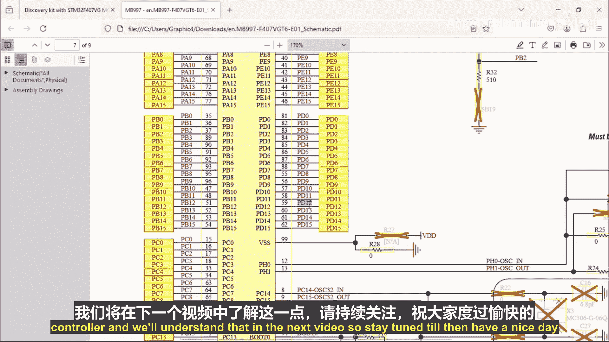