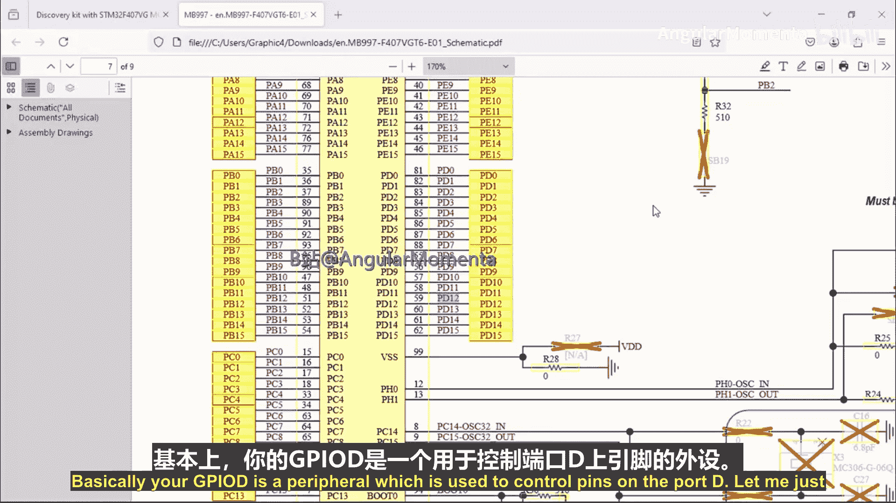
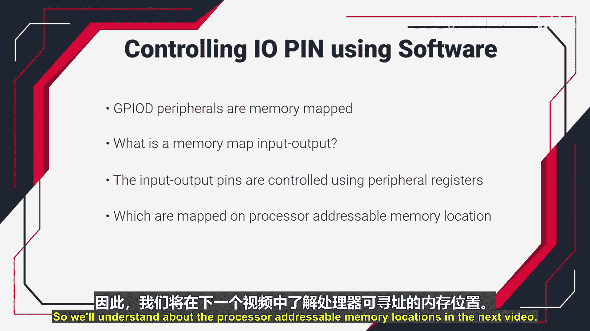

# 【EDUCBA】构建嵌入式系统 ｜ ARM Cortex (STM32) Fundamentals： Building Embedded Systems p44 03_03_02_通过软件控制IO引脚 -BV1KjcTzUEeY_p44-

Hey， Erers， welcome back。 Let's continue our discussion about how can we control these microcontroller pins or even the input output by using the software to control these pins。

 there is a fer ferl， which is called as God inside the microcontroll Basically your G is a fer feral which is used to control pins on the port D Let me just mention that here we have God to control your pins on port D。

 This fer ferrell has its own set of registers， which are used to control the pins mode state and other functionalities。

 This software has to write into that register。 So there can control the modes of the pins you can control what data you can transmit over the pens and you can write data to the port as well。

 you can even read data from the port。 So various activities you can do through the registers。

 Now the question is， how can you access these registers so you can。

Access these registers using the memory addresses。 Now。

 that means each register has its own memory address By using that memory address。

 you can access the registers and you can control the particular pin。

 Hence you can also say that fery fer registers of let's say G feriffer or memory mapped that leads to the next discussion that we would be doing。

 That is what exactly is a memory mapped input output Basically memory mapped input output means the input output pins are controlled using the ferif feral registers。

 which are mapped onto processor addressable memory locations。 Now。

 what are the processor addressable memory locations， So let's understand that。

 So we'll understand about the processor addressable memory locations in the next video till then have a nice day。

 Thank you。

