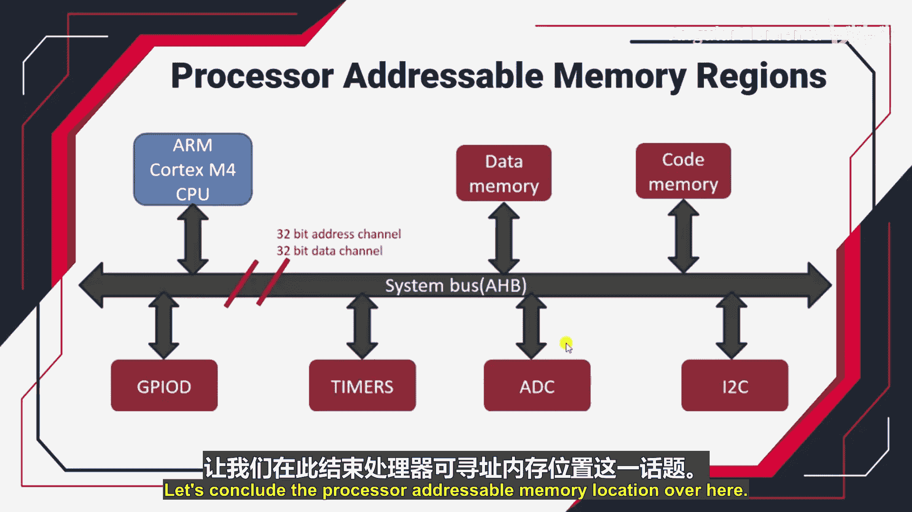
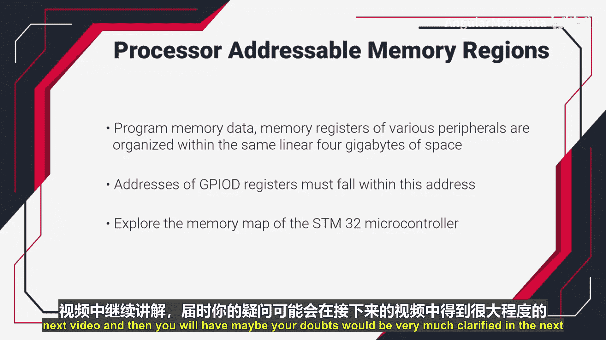

# 【EDUCBA】构建嵌入式系统 ｜ ARM Cortex (STM32) Fundamentals： Building Embedded Systems p45 03_03_03_处理器可寻址内存区域 -BV1KjcTzUEeY_p45-

Hey honor， welcome back。 Now in this lecture on this particular video。

 let us understand about what are processor addressable memory locations。

 So let's consider this particular diagram。 here there is system bus which connects the processor with the perifers and with the memory in the ARM cortex Mx M4 CPU based O macrocon。

 This is the central bus that connects the ferfers。

 It connects the processors and the memories and this bus is also called as system bus which is basically based on the AhB specification designed by the R and AhB。

 Now that is the AHB basically stands for advanced high performance bus。

 Okay so that's actually a specification So this bus comprises of two channels One is a 32 bit address channel then is you have 32 bit data channel That means this bus has 32。

Add bus so that means you can put to the power 32 different address on this bus in order to target different ferfers and different memories。

 For example， let's say you want to transmit data from this data memory to the G fers you will have to send data out to the external world over the port of G ferfers if this is your object。

 then what you have to do is you have to send data over this system bus and then you have to send that data to one of the registers of this fer。

 And if you place the data into that register of the ferfer。

 then data will be transmitted to the iio pins as well That's how it basically works。

 Now that means you have to find out which address you have to place this address bus to target this particular fer fer。

 that you have to find out you basically will know that details by going through the memory map of the processor You cannot put any random address of the address bus to a。

Get off a perifer， for example， in this case， if you want to target the ADC ferfer。

 let's say you want to read the data from ADC into your memory。😊，For that。

 you will have to place the appropriate address on the address bus， as I said。

 it comprises of an address channel whose width is 32 bit so that means you you can put2 to the power of 32 different memory locations here that is4 gig different memory locations。

😊，Put that onto the address pass in order to target the different periophils and different memories。

 You have to remember that the processor can produce four gig of different memory locations on the addresspa to target your different memories and to target different ferophils。

 Let's conclude the processor addressable memory location over here。😊。

I'll just go back here。 We have now understood the processor。

 address memory locations Since the address bus width is of 32 B。

 the processor put address ranging from let's say 0 x 0，0，0，0 underscore 00，0，02。

 let's say0 x F F FF underscore F F FF on the address bus。

 That means it is basically4 G B  different address can be put on your address bus。

 Now let's understand how these different address are arranged to address different memories and different perifers of the macrocont。

 When a processor put this memory location on the address bus。

 the address bus will be targeting to the code memory of the macrocont。

 So when the processor puts the processor means that the address generation unit of the processor。

 There is an address generation unit inside the processor。

That will get activated when an instruction is decoded。

 you can basically go into the details of processor architecture When I say processor that means the address generation unit of the processor when the processor puts an address which belongs to this particular region on the address bus then the address bus will be talking to data in the memory of memory location of the macrocontroll Similarlyly when a processor puts an address on address bus which falls in this particular region then address bus will be talking to the fer ferral of macrocontroller。

 So this arrangement is basically called as your memory map of the processor this is fixed by your ARM cortt Mx architecture and the macrocontroller designers who use the ARM cortex Mx processor in their design。

 they should follow this memory map this particular diagram is mentioned in your ARM cortex Mx technical reference manual you can explore that from the document as。

Just to conclude the memory map of the processor。 you just remember that your program memory data memory registers of various feriffers are organized within the same linear4 gig of address space。

 So our G is a ferif fer。 So G is a ferfer addresses of G registers must fall within this address。

 So later in the sessions， we will find out what is exact address of the G registers also when you have this particular address in your hand。

 then your job becomes very easy。 So you already know the pointers treat this as a particular pointer and you can start writing and reading data from the pointer variables。

 That's how you can control the ferfer。 Now let's do one thing。

 let's explore the real memory map of the STM 32 microcontroller and then I'll take up that in the next video and then you will have maybe your touts would be very much clarified in the next upcoming video。

 Stay tuned till then have a nice day。 Thank you。

