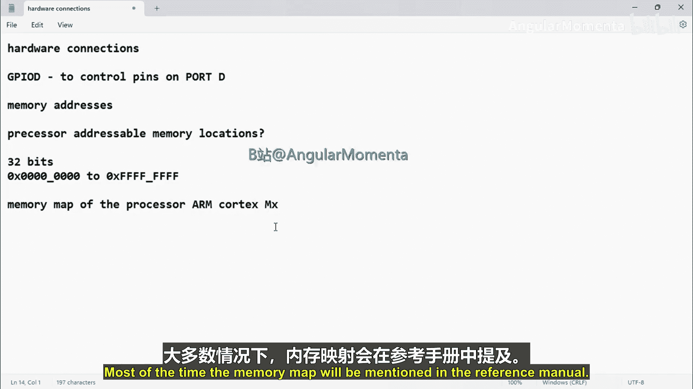
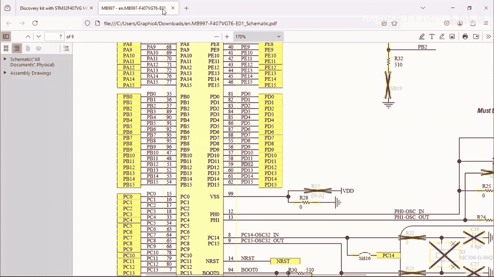
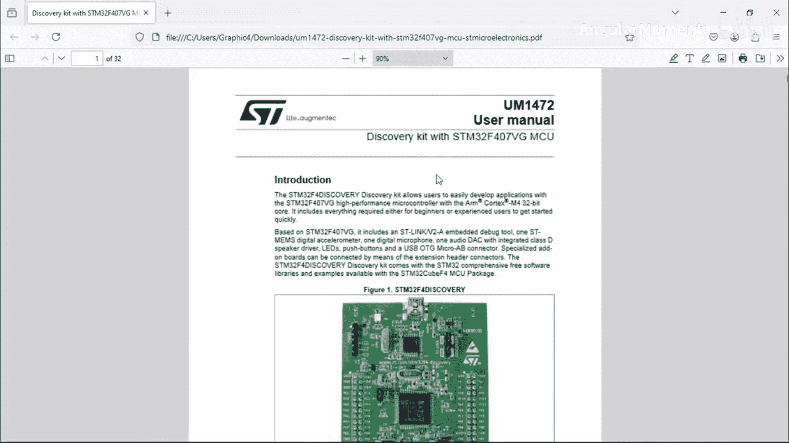
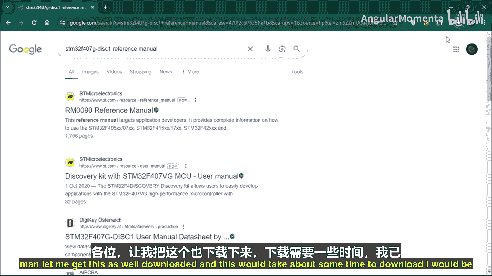
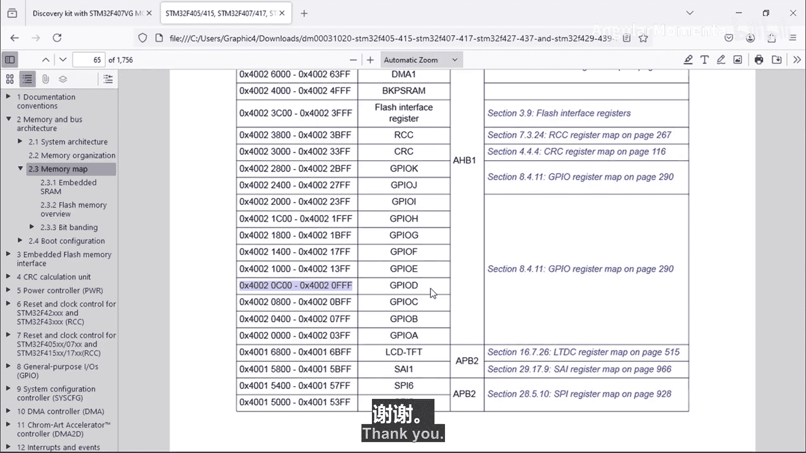

# 【EDUCBA】构建嵌入式系统 ｜ ARM Cortex (STM32) Fundamentals： Building Embedded Systems p46 03_03_04_STM32存储器映射 -BV1KjcTzUEeY_p46-

Hey Es， welcome back。 Now， in this particular video。

 we will understand about the memory map of STM 32 MC。 In this case。

 I am considering the macrocon STM 32 F 40，7， which is there on my discovery board and the memory map of the macrocont you can refer from the reference manual of the macrocontroll Also Most of the time the memory map will be mentioned in the reference manual。

 let me just go back and open my reference manual。😊。

Let me go back here。 And this is my reference manual。This is the user manual。 Actually fine。

 Let me go here and let me download the STM 32 F 407G disc1 reference man let me get this as well download it and this would take about some time to download I would be attaching this already in the reference section over here you can just expand to the memory and bus architecture and you can go here in memory map in the memory map before the programming you can just open this and before the programming the ferfer register of different ferfers you must refer to this particular table So you have to refer to this particular table。

 otherwise you will not have any idea of what are the addresses of the ferfer registers Let's take an example of a GP ferfer and we know that in order to control the L we have to configure the GP ferfer registers I can just browse below through the。

Particular document， and you will find your G I O D fery ferll， and this is it G I O D。

 The address of the fery ferll is 0 x 4，0，0，2，0， c，0，0。

 That is the address of the first register of the G O D fery ferll。

 What's that registry We explode later。 Okay， so you can say say that this is the base address of the G I O D fery feral re。

For example， if you want to know what base address of ADC register is you will have to scroll down a bit and find the ADC register。

And you have ADC 1， ADC2 ADC 3 registers are placed between these addresses。

Have the addresses given over here for microcont， it has three Acs。

 and these are times where it is mentioned like T M11 Tim 9 Tim 10。Similarly。

 you have the U art U 8 these are register space for can I C2 U the processor puts this address on the address bus。

 then the address bus will be talking to the can fer fer register or you also have the Ethernet register。

 Okay， you can just scroll down and you can check that you have the scan over here。

 So you have the ethernet Mac register。See this other timer registers。Okay。

So now the memory map of your microcontroller， which is designed。By the N X P。 Okay。

 so if you just scroll down over here。You have the memory usage， as well。Say this。

The memory mappings， the address， details。Okay。You can find that here， as well。

So the macroconter is also based on the arm cortt MX processor。

 so here you can see that there is a memory map table。You just scroll up。

 You have this memory map table given here。Like a mapping of different memories。Similarly。So。

 this address refers to your。Flash memory。Similarly。Bott remap in your embedded SRM。System memory。

And remapp and FMC， as well。Okay。So the Ram that is your data memory starts from this particular address。

Right。Similarly， you have the system memory。 You have a reserved memory。And you have thee。

Flash memory reserved over here。So it doesn't matter you know which macrocontroller you use。

 you just open up the user manual and you should be able to locate the memory map without the memory map you cannot program the feryfers Okay so now let's move forward Okay。

 so what is the address range of the GP IOD ferrifers we just found out right so I'm just going back here。

And for G P IodD， we had found out the address range is this。Right。

And if you are using a different MC， then please refer to the device reference manual to obtain the correct address range。

 Okay， so for this STM 32 F 40，7G macrocontroller if you use if you are using something else then doesn't matter。

 just refer to that user manual， find out the address range for your G because that we would be using it in the upcoming videos。

 so just crossche this numbers。 Okay， it may be different if you are using a different board。

 So you have to check in the reference manual， just don't code it blindly。

 Okay so in the next video will understand about the ferphers register So stay tuned for for the next video till then have a nice day。

 Thank you。

