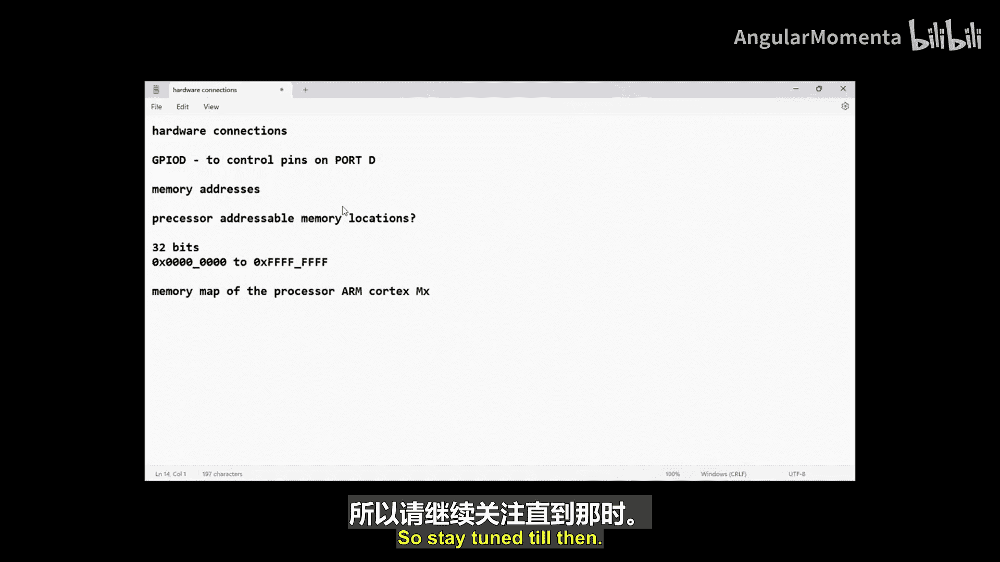

# 【EDUCBA】构建嵌入式系统 ｜ ARM Cortex (STM32) Fundamentals： Building Embedded Systems p47 03_03_05_内存映射外设寄存器与IO访问 -BV1KjcTzUEeY_p47-

Hey ons， welcome back。 So now in this lecture on this particular video。

 let us understand about what are processor addressable memory locations。

 So let's consider this particular diagram。 Okay so here there is a system bus which connects the processor with the perifers and with the memory。

 so in the ARM cortex Mx M4 CPU based a macrocont。 This is the central bus that you know connects。

The perifers， it connects the processors and the memories， and this bus is also called as system P。

 which is basically based on the AHB specification designed by the arm and AHB。

Now that is the the age we basically stands for advanced high performance bus so that' is actually a specification。

 so this bus comprises of two channels one is a 32 bit address channel then is you have 32 bit data channel。

😊，Okay that means this bus has 32 bit address bus so that means you can put to the power 32 a different address on this bus in order to target different ferfers and different memories so for example let's say you want to transmit data from this data memory to the GPod ferfers right so you will have to send data out to the external world over the port of GP ferfers so if this is your object then what you have to do is you have to send data over this system bus and then you have to send that data to one of the registers of this ferfer and if you place the data into that register of the ferfer then data will be transmitted to the iO pins as well so that's how it basically works so now that means you have to find out which address you have to place this address bus to target this particular fer fer so that you have to find out you know you basically will know that。

Details by going through the memory map of the processor okay so you cannot put any random address of the address bus to a target of a ferpher。

 for example in this case if you want to target the ADC ferpher。

 let's say you want to read the data from ADC into your memory okay。So for that。

 you will have to place the appropriate address on the address bus，As I said。

 it comprises of an address channel whose width is 32 bit so that means you can put2 to the power of 32 different memory locations here that is4 gig different memory locations。

 right？😊，Put that onto the address pass in order to target the different perifurs and different memories。

 so you have to remember that the processor can produce four gig of different memory locations on the address pass。

To target your different memories and and to target different peripheralys。

 So let's conclude the processor addressable memory location over here， Okay so。😊。

I'll just go back here。 So we have now understood thee。Processor。Adddresil。Memory。Locationations。

 okay。So since the address pass width is of 32 B， right， the processor put address ranging from。

 let's say 0 x 0，0，0，0， underscoreco 00，0，0，2。Let's say 0 x， FF， FF underscore。F F。

 F F on the addresspa。 So that means it is basically4 G B。

OkayDifferent addresses can be put on your address bus。

 So now let's understand how these different addresses are arranged to address different memories and different peripherals of the macrocontroller。

 So when a processor puts this memory location on the address bus the address bus will be targeting to the code memory of the macrocontroller So when the processor puts the processor means that the address generation unit of the processor。

 So there is an address generation unit inside the processor that will get activated when an instruction is decoded okay So you can basically go into the details of processor architecture okay so when I say processor that means the address generation unit of the processor。

 So when the processor puts an address which belongs to this particular region on the address bus so then the address bus will be talking to data in the memory of memory location right。

Of the macrocontroll。 So similarly， when a processor puts an address on address bus which falls or in this particular region。

 then address bus will be talking to the fery feral of macrocontroller。

 So this arrangement is basically called as your memory。Map， okay。Of the。Processom。Right。

 so this is fixed by your ARM。cortext， Mx architecture and the macroconter designers who use the ARM cortex Mx processor in their design。

 they should follow this memory map So this particular diagram is mentioned in your ARM cortex Mx technical reference manual you can explore that from the document as well。

 So just to conclude the memory map of the processor you just remember that program memory data memory registers of various feriffers are organized within the same linear 4 gig of address space So our GPodD is a fer fer。

 So GPO is a fer fer addresses of GPOD registers must fall within this address so later in the sessions。

 we will find out what is exact address of the GPO registers also So when you have this particular address in your hand。

 then your job becomes very easy So you already know the pointers。

 so treat this as a particular pointer and you can start writing and reading data。

From the point of variables。 So that's how you can control the ferfer。 Okay， now let's do one thing。

 Let's explore the real memory map of the SDM 32 microcont and then I'll take up that in the next video and then you will have maybe your doubts would be very much clarified in the next upcoming video So stay tuned till then have a nice day。

 Thank you。😊。

