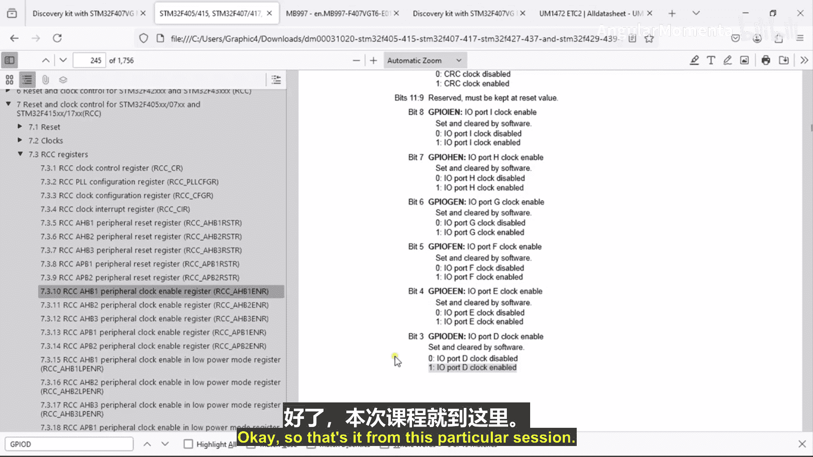

# 【EDUCBA】构建嵌入式系统 ｜ ARM Cortex (STM32) Fundamentals： Building Embedded Systems p49 03_04_02_使能外设时钟 -BV1KjcTzUEeY_p49-

Hey earners， welcome back now in this particular video we'll understand about the procedure to turn on the LED so actually as we have discussed earlier we will have to enable the peripheraleller clock right before configuring the peripheralpher otherwise the fereller will not take your configuration values so lets see how to enable the fereller clock in this particular video you can enable the peripheralpher clock using the controlled registers of the macrocon okay。

So I'll just mention the steps over here。Using the。Controled registers of the。Macro controller。

 and in your。STM 32。MC okay， the clock control registers are basically mapped at the address range in the memory map of macrocon from say 0 x 4002。

3，8，0，0，2，0 x，4，0，0，2。3， B， F， F。Okay， so over here we have seen the address range in the memory map of the macrocontroll。

 so there is an engine that is called as。RCC， where RCC basically stands for reset and clock control。

 Okay this reset and clock control engine takes care of the controlling clock of for various parts of macrocontroller like your processor different peripheralphers。

 different buses， memories etc。 So the RCC engine has its own set of addresses to control the clock and those registers are mapped at this address range that I have specified。

 So now you have to go to the R Rcc section， you have to explore what are the different registers which are available to activate the clock So in our case we'll have to do so by selecting the appropriate register in Rcc to enable the clock for a peripheralpher So our peripheral of interest God Okay so let's explore that Okay and again let's go to the reference manual Okay so I'll just open the reference manual over here。

And this is my reference manual right， so I am going to explore the Rcc here。😊。

Once you are in this particular section。Just explore this， and。You have over here。

Reset and clock control， right， So click here。Okay。Now， inside this。

You have various other registers whereas you have the Rcc registers in this so。You you have。

 you can just check out the various register names which are you know defined over here。

You can just scroll down a bit， and check。So here you have。The peripheralferal clock。Rgito。

Which is this one。Just click here。So， you have here。

A B A HB1 right AHB1 bus so in our case the GP Iod fer ferll is actually hanging on AhB1 bus。

 so if you are thinking how come you can basically just see the information over here okay。Okay。

 so over here you can just check I have opened the user manual。

 this is my GP Iod port D and you can check this it is on this AB HB1。

 so this also clarifies okay so we are referring to the data sheet of the macrocontroll okay and you will find the internal architecture this is known as the internal architecture of your。

Microcontroller okay， so if you just port just spot the processor over here。

 okay and check how are they communicating right which bus is it further connected to right So it is further connected to the processor via the bus matrix。

so that is why I can say that GPIOD is actually connected to AHB1 bus so take a look into the architecture diagram so you will understand this more clearly so if I want to understand where exactly is ADC is connected then ADC you will have to just check it down here。

Below。See this。You can find out that as well where it is connected to， right？Seeid this。

Try and locate where is the bridge through that bridge it is connected to the HB bus。

So here there is an AHB bus and the data exchange between the fer feral and memory happens over this bus。

 So now let's go back to our Rcc register discussion and RCC registers we should be looking at Rcc AHB1 fery fer。

 So if I go back here。 we have to look at RCC Ah1 Ferriferal clock register。

 which is this RCC AHB1 ferfer clock register。Right， this is where we are supposed to look into。

Because this restrar controls clock for all the ferfers which are hanging on the AHB1 bus。

 So now what is the address of this particular。A clock over here you can find out that from the address offset right so let's calculate that and here you can see the documentation says that your offset is 0 x30 that means you have to add this to the offset of the base address of Rcc ferfer。

 so what is the base address of the Rcc ferfer registers。The base address is。

 as we have discussed is 0 x 4，0，0，2380，0， right？So now let's open the memory map again， okay。

I'll just go back here。😔，Let us go to。Memory map， okay， and now find the Rcc。그。

And that is over here so this is the address that that I have already shown it to you。

 the base address。So you have to add the offset to the base address to get the address of registers and then here you have to active or set the third bit position。

 right。So if you go back here。Yeah。Okay， so I'll go back here to RCC。And registers。 And this one。

So over here， you just scroll down a bit。Yeah。嗯。You will find this。 See her。

Clock disable clock enable。 So this is bit 3， right， so。This particular bit， if you make it one。

 the clock would be enabled currently it would be disabled。

 so you will have to do change this bit position over here。

 So that's how you will enable a clock for the particular peripheral。

 So first you have to identify which register you have to use in the Rcc block to control the clock and then you have to program the appropriate bit field。

 So now。Let's see in the next video we'll start with the programming Okay。

 so that said from this particular session， Thank you so much。

