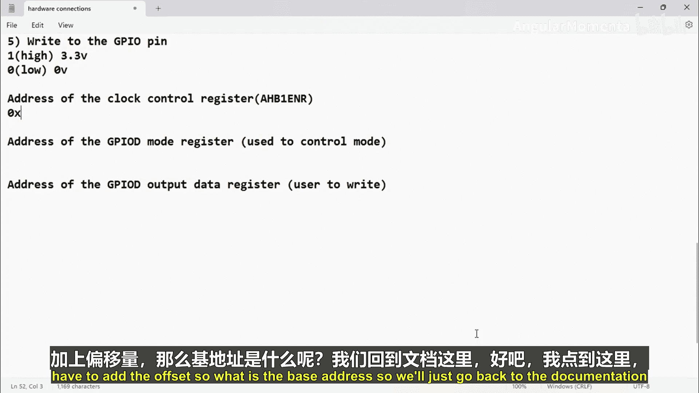
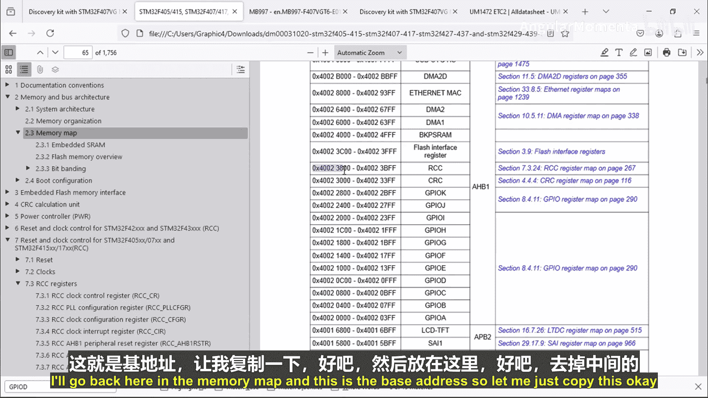
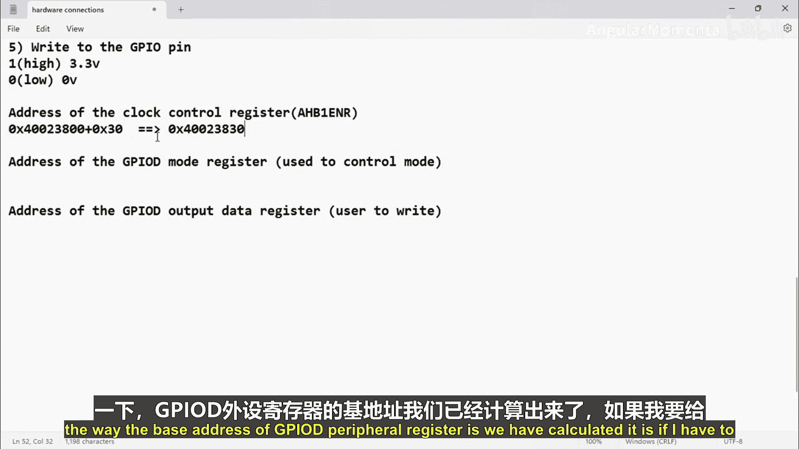
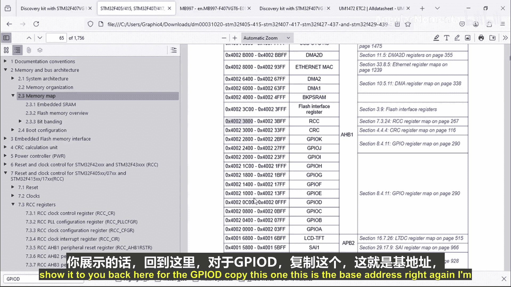
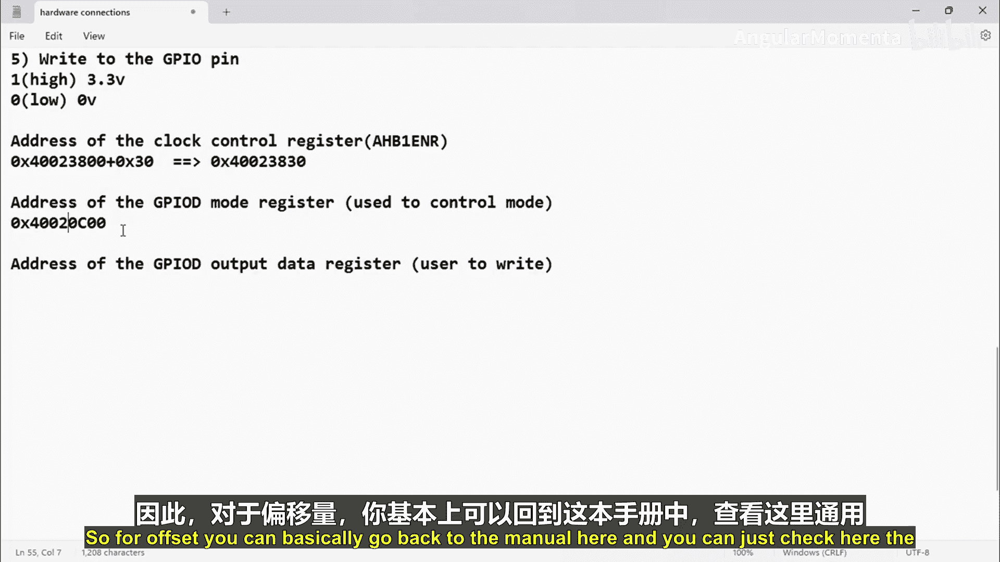
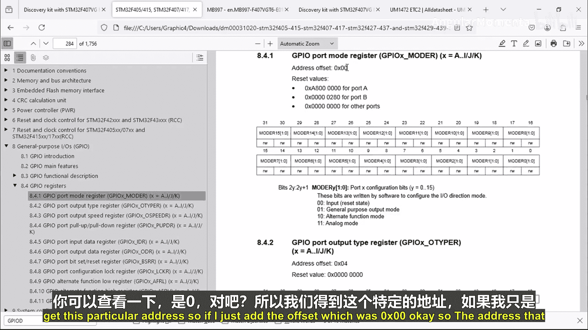
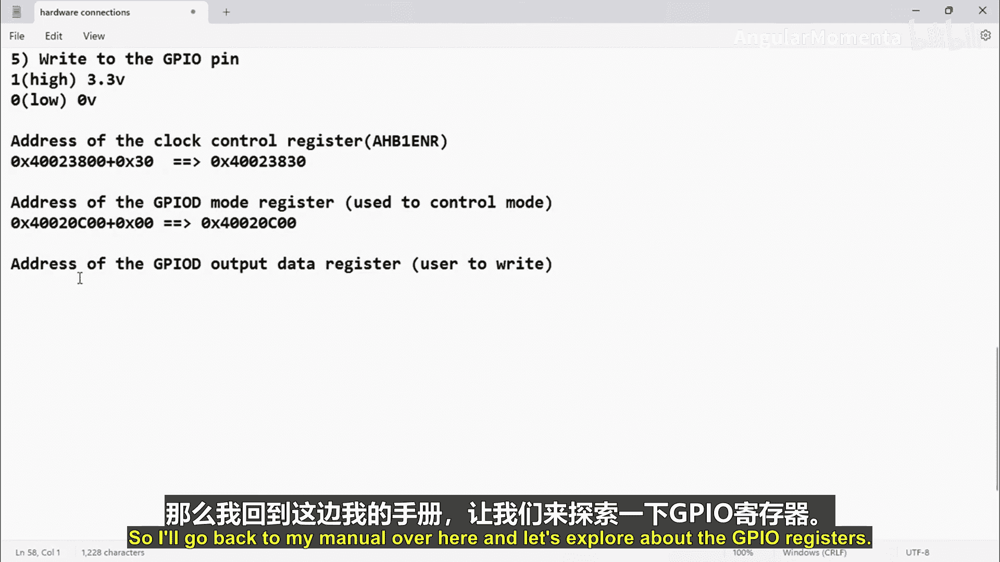
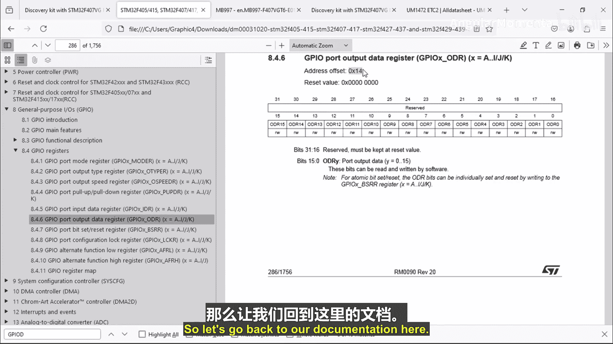
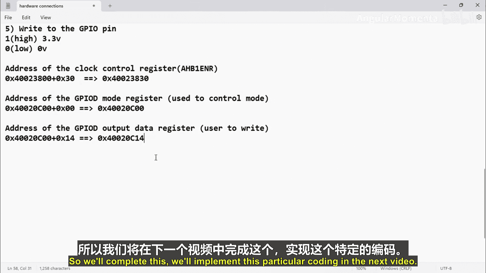

# 【EDUCBA】构建嵌入式系统 ｜ ARM Cortex (STM32) Fundamentals： Building Embedded Systems p50 03_04_03_计算外围寄存器地址 -BV1KjcTzUEeY_p50-

Hey Er， welcome back。 Now， in the previous video， we have understood about how to enable the fereller clock of the G or the feriffi。

 right， so we do that by using the Gcc register and the Gcc register in our case is in AH B1 ENR Okay。

 so now let's calculate the address of the H B1 ENR Okay， so this happens to be。0。It is 0 x。

 and first we have to take the base address。 Okay， then we have to add the offset。

 So what is the base address， So we'll just go back to the documentation here。

Okay， and。I'll go to。This here， O。So the base address， if you look at it in the memory map， Okay。

 so Ill。Remember the offset over here at 0 x30， okay。

 and I'll show you the base address Now Ill go back here in the memory map。

 and this is the base address so。Let me just copy this。

Okay， and put it here。Okay， remove the space in between In this， I have to add the offset。

 which was 0 x 30。Right。So we have just documented that okay。So we will get this particular number。

 as you know， something like。I'm putting at 0 x 400，2，3，8，3，0。Okay， because I am adding 30 to it。

 right？So address of the GPIOD mode register so we need to in order to control the mode right so we need this。

 so by the way the base address of GPIOD peripheralpher register is we have calculated it is if I have to show it to you back here for the GPIOD。

Copy this one。This is the base address。 Right， again， I'm going to remove the space in between。

So for that， you have to add the offset。 Okay， so for offset。

 you can basically go back to the manual here and you can just check here the gentle purpose。

IO GPIO section。Okay， just expand this section。 Here you have the GP IodD registers。

 Exp this as well。Okay。And go to the first register over here。Okay， you can see to reset。

This particular register， we have port D， so it is a non0 only for port A and B。Okay， but for port D。

 this register reset value is 0， and here in the register you can see that 32 bits are divided into 16 sections。

 you can just check out the 16 sections over here， right。😊。

And so every basically2 bit are used to configure the mode for one pin of the port。

 So each port has basically 16 pins。 So the mode of all those pins are basically controlled using this register right So in this register。

 every two bits is given to control the mode of a single pins。

 So why2 bits are dedicated because there are four different modes。

 So input general purpose output alternate function and analog mode。

 we can find that over here right So for this exercise you will be keeping the pin in output mode。

 So that's why what you need to have is you have to go to the appropriate section。 Okay。

 so for pin 12， we should be looking at these bit field over here which are available。

Okay which is 24 and 25 okay so you have to basically program the value 01 over here okay so if you do that the pin number 12 of the GP I like peripheralifier will be in output mode okay so let's calculate the address address offset over here it can just check it as 0 right so we get this particular address so if I just add the offset which was 0 x00。

😊。

Okay， so。The address that we basically get is again the same thing which is the base address itself。

 no need to do any calculations as such next we need to calculate the address of the GPIO output data register that is used to write the IO pins right so I'll go back to my manual over here and let's explore about the GPIO registers Okay so let me just go back here。

And inside the registers， okay。We'll check here the output。Register， output， data， register。Right。

So this is also a 32 bit register， right？From here， we have the 16。Do。31， right。

So only 16 bits are implemented in this not all， so these bits field are used to control the different pins of a particular port。

 so in this case the bit 0。😊，O controls the first pin， so this is for the second third。

 fourth like that up till the 15th pin， so here we willll be programming one into the Bifield 12。

 which is this one。😊，Okay， so let's calculate the address， so here the address offset is 0 x14。

 right？😊，So let's go back to our documentation here。

 and what we'll do is let us just copy this and this time it is here。

14， so。Over here， I will get 14。Right so now you have everything that you need to write down the program so what I want to do is I basically want to create pointer variable to store these addresses and then activate the appropriate bit fields so here to enable the clock we have to select the more and to the LED high and when you execute the program you should observe that the LED getting turned on right。

So。We complete this will implement this particular coding in the next video。

 so stay tuned till then have a nice day， Thank you。😊。

