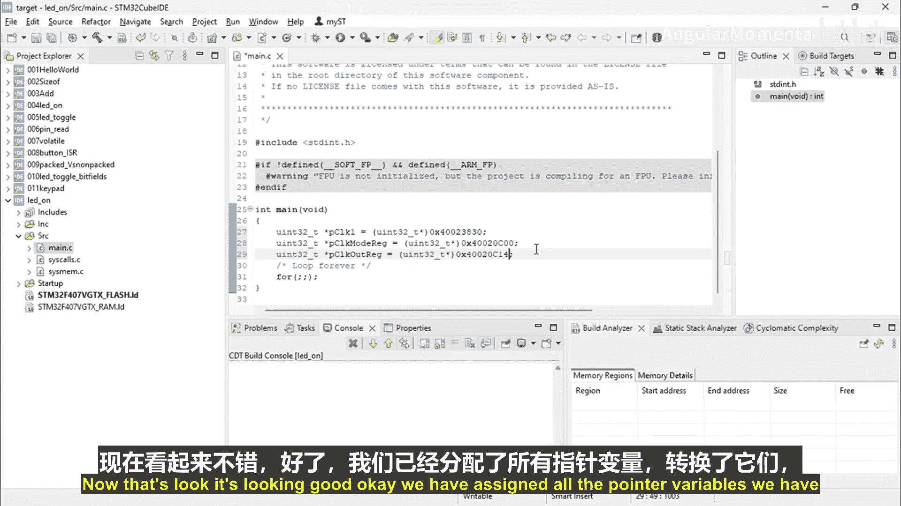

# 【EDUCBA】构建嵌入式系统 ｜ ARM Cortex (STM32) Fundamentals： Building Embedded Systems p51 03_04_04_LED 驱动程序设计编码部分 第1集 -BV1KjcTzUEeY_p51-

Hey Erest， welcome back。 So I hope you could be able to do the you have able to understand everything that we have discussed till now。

 so let me continue with the same exercise。 Okay， so first thing is we'll have to create a new project。

 Okay， so for that。😊，You will have to create an STM 32 project。 Okay。

 so let me go in into my IdeE and let me。Select a different workspace， okay。So I'll just switch it。

 I will go to。Program。Dottet。Let this get reopened again because now I have connected my microcont to my。

devicevic， okay to my PC， okay。So， over here。We will create file new。

Now this time we are going to select the STM 32 project right。

 so that this would just take about some time。Now again。

 you will have to select here once this is completed。

 select your board that you are using in my case it is STM 32。F 4，0，7 g。Which is this one board， O。

So if you are using some different board， you will have to select the appropriate name there。

 okay so let it just complete a task and once the task is complete it will initialize my target selector。

Okay， so I'll just go here。😔，And I have already。Star marked it。 So this is my board。 Okay。

 so I have clicked on this。 I'll click on next。And here well have to give a project name。

 So let me give her a name as LED underscore score on you can give any name that you wish to that's totally up to you。

 Just select here empty rest everything would be same Okay， and click on finish。

This would just take some moment to create your project， and once the project is created。

 we will go to the SRC folder and main folder here。Okay， and this is what your file is。

Now you are getting this particular error。 So what you will do is go back here in the properties。So。

Go here in this go to settings and here you will have to select none and software implementation apply and close and the warning would be disappeared okay。

So。That is how we have created our project and now will start writing into our main， okay。So。

What we need to basically do is we need to start the particular programs so first we need to create three point of variables to store the addresses so lets start doing that first okay so Ill be using U int。

To地2。And score t。And since you are going to create a pointer variable， I will use asterisk， lets say。

I'm giving here the name as。Sa P。1。You can give any name， just remember by default。

 it will include the STD IN if it is not doing it， you will need to do it manually there。

Okay so all the peripheralpher registers are 32 bits so that's why I have selected U in 32 and As code T。

 hence this was important for you to understand how to select your core data types as well now let's initialize the point of variable okay so over here we I have documented this value here we need to initialize this variable to this particular value so let me give this value here okay。

Because it like this is a number， the compiler。It， it will。

It can't accept this because it's a number for the compiler right。

 but this is actually a pointer variable。 so what well do we can basically。😊。

Convert this saying Uent 32 underscore P。Pointer and then we can assign the value there。Right。

 because this is a pointer entity Okay， so we have converted it to point。 so similar to this。

 let us create。😊，More three pointer variables。 Okay， so let us name this as。More register。O。

You can give some meaningful names or if you want to give just you can give even 1，2，3。

4 that's also absolutely fine。 It's totally up to you， okay。Then。So for this。

 we will need a value which is this for more register。

So I will just copy paste that value here and then I need an output variable so I am giving here PCLK I am giving here an out。

Register， I'm changing the name to it。 Okay， and the address of this also we have already defined。

 So let me go back here。 Let me copy this address and paste it down over here。

Now that it's looking good okay we have assigned all the pointer variables we have converted them and we have done this okay。

