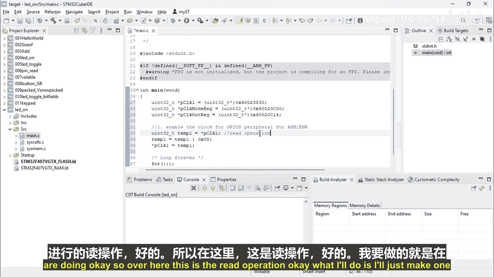
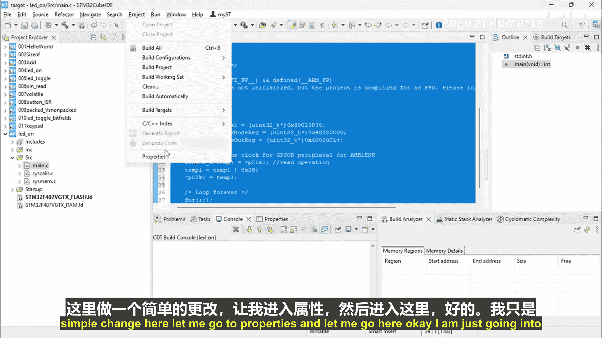
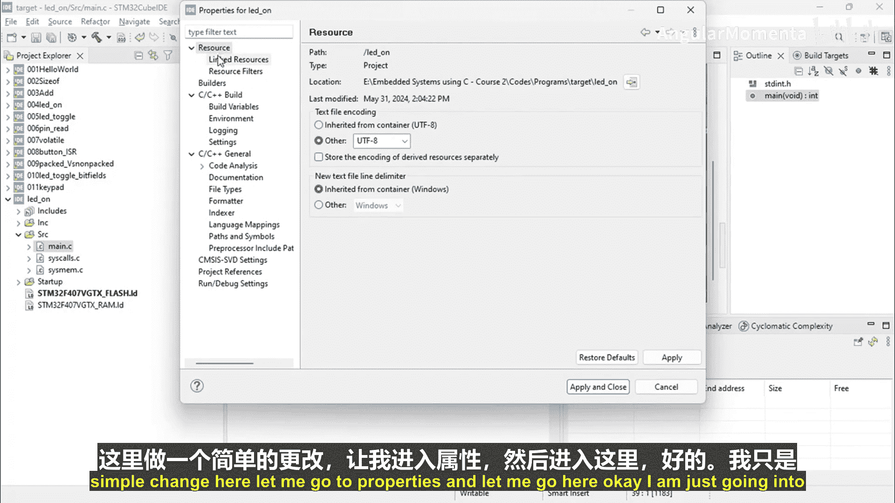
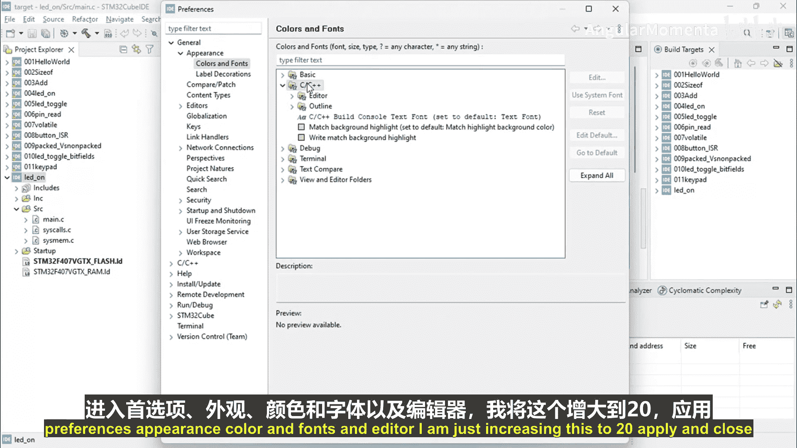
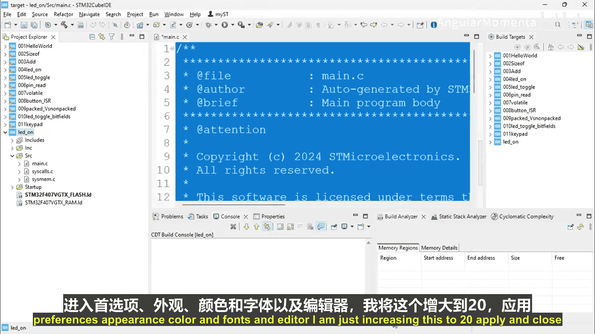
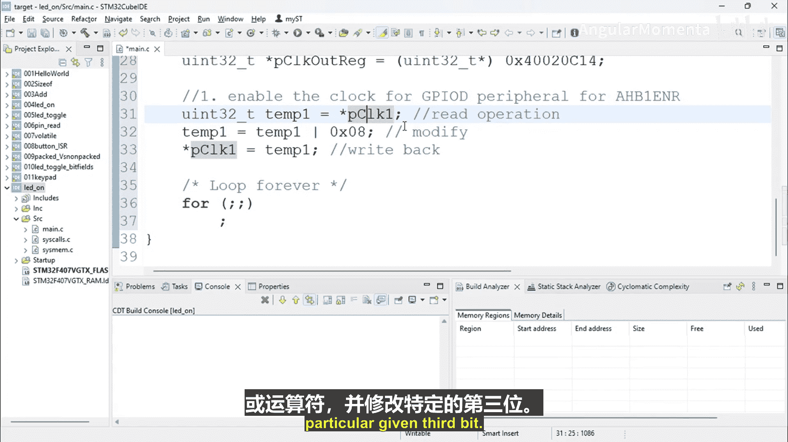

# 【EDUCBA】构建嵌入式系统 ｜ ARM Cortex (STM32) Fundamentals： Building Embedded Systems p52 03_04_05_LED运动编码第二部分 -BV1KjcTzUEeY_p52-

So now our fourth step would be2。Enability。Clock for your。GPod。Very， fer， right。

And this was for hour。A H， B1， ENR。Right， registerstr。

 And we have to basically make the third bit position， right。

 So you will have to be careful while you are making changes to the bit positions。 remember。

 you should not affect the other bits of the registergistr， right， you if you change other bits。

 then that would lead to some lot of problems。 So for this application， it may be okay。

 but let's say if you code apart for， you know， some larger project then some other code may you know。

 using this ferfurs， it may cause some major problems。 Okay， so there are various other fer fers。

 okay， which are involved。So that's why you should only make effects to what a bit we have。

Or discuss this in the earlier videos， okay。So to use a bitwise operation to set the third bit of the register。

 and we know how to set the bit， right， we have seen this in the earlier videos of bitwise operation。

 That is the bitwise or。Right isn't it so we should be using the bitwise or here right and we also know how to use the mask values of first what you need to have is first you need to read the register content and then do a bitwise or with the mask value and then write the result back into the registry right so mask value it can be decided like let's say we want to make it one so let's keep one here and let's say all these are 000 so I am just changing it to1 so actually I' am writing the mask value all these any0 values okay I can transfer them into the mask values so upper 16 bits will be let's say 00 and the lower bits would be let's say 0008 right and the mask value we can program in the particular registry so let's go back to the project over here and let's write down the clock so to enable this here。

We'll have to。OrRead the content of this address right into a temporary variable。 Okay。

 and we just created a temporary variable。 let's say we created as。😊，U in 32 underscore score T。

 we created it as temp1。And that is equal to I am creating here asterisk and copying this point of variable name I am giving initializing it to this particular value。

😊，Okay， so basically I am dereferencing the pointer and storing the value into temp right after that we can modify temp and we can。

😊，Make their use of the bitwiseice or operator。 So here I can use。

Temp 1 is equal to whatever is the initial value bitwise I want to do 0 x0，8。Okay。

 so I am setting the third bit of temp after that we will have to write back to the particular address。

 so just copy。This variable。Okay， using here as strict mark， and that will be equal to your temp 1。

So this is the read operation that we are doing。 Okay， so over here this is the。😊，Read operation。

 Okay， what I'll do is I'll just make one simple change here。 Let me go to properties and。

Let me go here。

Okay， I am just going into preferences， appearance， color and fonts。

And editor， I am just increasing this to 20。

Apply and close just for a clear visibility， Okay and。Yeah。Fine， so now let's proceed further。

 So this was our read operation。 Okay， over here。We are doing this。 We are modifying this basically。

 and over here we are。Writing it back。Right， so this way you will ensure that only the third bit is modified here。

 so other bits are retained as it is right， So if you do this。If you， you know。

 just substitute this value without mentioning this， then it would be wrong。

Then you will basically have some bug in your program right so instead you will have to write this entire thing as it is create a variable。

Initialize a point of value to that。 and then。Use a bit operator， bit of Xr operator。And。

Modify the particular given third bit，😊。

