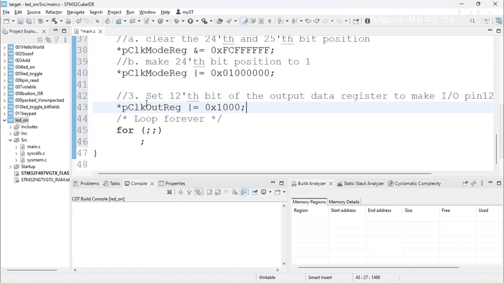

# 【EDUCBA】构建嵌入式系统 ｜ ARM Cortex (STM32) Fundamentals： Building Embedded Systems p53 03_04_06_练习编码第三部分：LED控制 -BV1KjcTzUEeY_p53-

So now again， this particular pointer variable over here。Okay。

We can basically make it equal to the pointer variable。Bit or。0，8。Okay。

 so all the three lines can be replaced it by only one line like this， even this is possible Okay。

 so if you want to replace all the three lines， you can do that directly over here like this Okay so as of now I am just putting this in the comment part Okay so you can just check that out at a。

Laterter stage。We can implement this like this also。

No need to create any temporary variable and do that right so you can also write the C shorthand notation okay which we have already seen it is question mark and colon and complete this particular task so now our first task is completed right so that is enable the clock for the GPID peripheralifier for AHB1 okay now what we need to do is the next task is to configure the mode of Iop as output right so this was our first task。

I am mentioning your second task。Confire thee。Mord of thee。Are you been as。Output。

So this is going to be our second task or second step rather that we need to do So to do this we have to explore the GP mode register right as I said previously each pin consumes 2 bits so for 0 pin okay for first pin again you will have two bits for second authority you will have again two bits so if you count the section will be 2 pin that we need to modify right bit position we have to put the value 01 there to make it as the pin as output right so you have to write 0 here and1。

😊，Besides that， because it consists of2 bits， right。

 So you have to ensure that 24th bit is set and you should ensure that 25th bit is clear。 Okay。

 now what can we do first here is first， let's clear the we'll have to clear both the bits position。

 So let's first make sure that both the bits position as 0 and 0 and then only we'll modify that again after we program the bit positions with value 0。

1。 so。For clearing， we'll have to use the ampers sent Okay and this is this setting setting only 24th bit so we can use bitwise or also over here。

 So first we'll have to clear the bits Cl means we have to make it as0 right first thing use the long method and then the short method actually by using a bitwise shift operator but we haven't explored about bitwise shift as of now we'll see that later。

😊，So you can basically use this two kinds of bits and you can create a mask value where all the other bits are basically。

😊，Sted there and 2 bits are0 there， right So how could we create a mask value over here so we can basically have 0 to 15。

F F， okay， so the first 16 bits are actually F F and the next 8 bits can also be F F F right after that。

 you have the next 8 bits created。 Okay， so calculating a mask value would be a very tedious process。

 Okay so mask value if you wonder how can I arrive at a particular value you can just work it out on a paper and then it would be easy for you to understand。

 so since now we have got the mask value。 Okay， well have to basically make it it has to be one value has to be one。

 the other bit has to be 0 anyways， because we have to clear it out right。So。Let's code this now。

 okay， lets go back to the IDE okay and over here for configuring this well have to write down a code。

And。A part in this is we have to clear thee。25th， and。25th。B position okay。

 so for that we have to use the mode register， which is a pointer variable。So。

I am using here point Im using m percent is equal to we have calculated this as Fc。F， F， F， F， F， F。

 okay。This is the Me。Now， the next B part in this is we have to make the。24th bit position。2，1。

 so we have to set this。 So again I' am going to use the mode register itself。

 use this time or operator， and I have to set this 0，1。And rest。0， I have to set this to1。Right， now。

 coming to our third step。In this， which is we have to said thee。12。B of thee。Output data register。

Do make thee。Input output。Ven。12 as high。Okay， so we need to explore this and complete this right。

So over here， our output register。Okay。Use the same point of variable。

 Use bitwise or and this has to be。Making it one over here。Okay。

 so we have set it to the pin as high， right？😊，So， now。

The next thing that we need to do is well basically need to test this。

