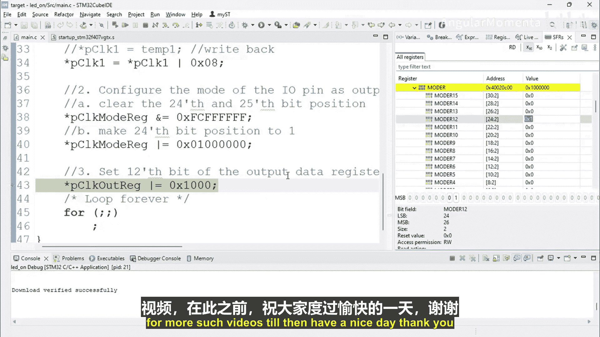

# 【EDUCBA】构建嵌入式系统 ｜ ARM Cortex (STM32) Fundamentals： Building Embedded Systems p54 03_04_07_LED 运动编码部分四 -BV1KjcTzUEeY_p54-

So now let's compile the project。 Okay， so I'll go here。 I'll first all。Buildil the project。

Okay so we can also observe the various register content of the macrocontroller this ID is enabled you to know monitor some real time activities of various registers of microcontrolls so for that I would suggest you can go to the window over here in that go to。

Show view。 O， and you have here。Okay， this is not available here。 I can go to other。

 and I can just check here。 I can type in。Registers， O， I have added that。 And， yes。

 I can get the window here for registers。Okay， when I click there。So， this is my register window。And。

You can just click this。So see， now， once I have。Debuak the application。

 I have this registers over here。Okay， these are the actual specific registers which are there the the general registers。

 okay， similarly， if you want to see some the peripheral specific registers。

 you have one more window which you can go here and that is here you can just go for SRfs okay。

And these are see。 you can see this。 These are fer fer related registers。 Okay。

 so you can just expand the。GP IodD here。Okay， so first let's reset the chip。I am just going here。

Saying this resume。Like， we need to。Just stop this。 And again。Go in debuuck。Okay。

 and we'll have to go in step by step into this。So。Remember my decision。 Okay， and。So for resetting。

 you have this option here to reset everything， okay。

So we have reset the chip and now after resetting， we can see that the mode register has value 0。

Right。And almost all registers， they have value 0。 That's the reset value。

 So now let's start executing this。 Okay， now to execute this， you have to have this option here。

 which is available。You can just click on the step over， which is F6 as well。This one。Okay。

 so this goes one step ahead。 Ex C statement line by line。

So actually we are programming the HHB1 ENR register。For the RCC block， right？

 So you can just check in for your。Rcc， now， let me just minimize this。 Go here and check my。

Aret C C register here。Yeah， this one。See this。Okay。So you can find the RCB register in that。

 you can find the AHB 1 INR。Iard， this one。It has some default value。Which is this one。O。

So this is not enabled。 so we are going to enable it。 so let's do again one step over。Okay。

 so we just enabled it。You can check the value here。So let me just go into one more step ahead。Okay。

 it is over here。 Now， let me go in for the second one。And you can see。

 see this has now changed2 one。Right， so we have enabled the clock for GPID fer fer。

So the first step is successful Okay， so if this step is not successful over here。

 this would have been the same value it wouldnt have been changed。

Right hence the tracking is really important when you have to see what are you trying to do in the macro controllert。

So if you have not enabled the clock， okay the very first thing you have to do is you have to enable the clock which we have right now done over here。

 you can just check the register where you are really enabling the clock or after that we have to observe the mode registers okay so。

😊，I'll just go back here。Go back here， going to GIodD。😔，Okay in the GP IodD。

 you have the mode register over here， So now keep a track of the mode register。 Okay。

 check out all the values。 Now I am doing another step over。Okay， so just check the position of。

24th and this， both are0。Okay。I do it another step over。 And you can see 24th is now one。Right。

 and the other is 0。 So we are successfully able to do this as well， right， so。

This LED should be turned on over here。Right， you can check that out。If you click here。

 you can see this。You can it will show you a diagram below， as well。Okay， say this。

 It should be 0 and1， so。LSB 24 and this becomes 0 and1。 so our program is executing in a proper way。

 so you can apply this trick to any macrocontroller if you have any registers which are memory mapped and you can follow the same method with the help of pointers you can touch and configure any fer ferrel registers right so with this particular note we are going to end this particular video and we have successfully seen how the macrocontroller bits can be enabled Okay with the help of your pointer variables okay。

So that's it from this particular video， stay tuned for more such videos till then have a nice day you。

😊。

