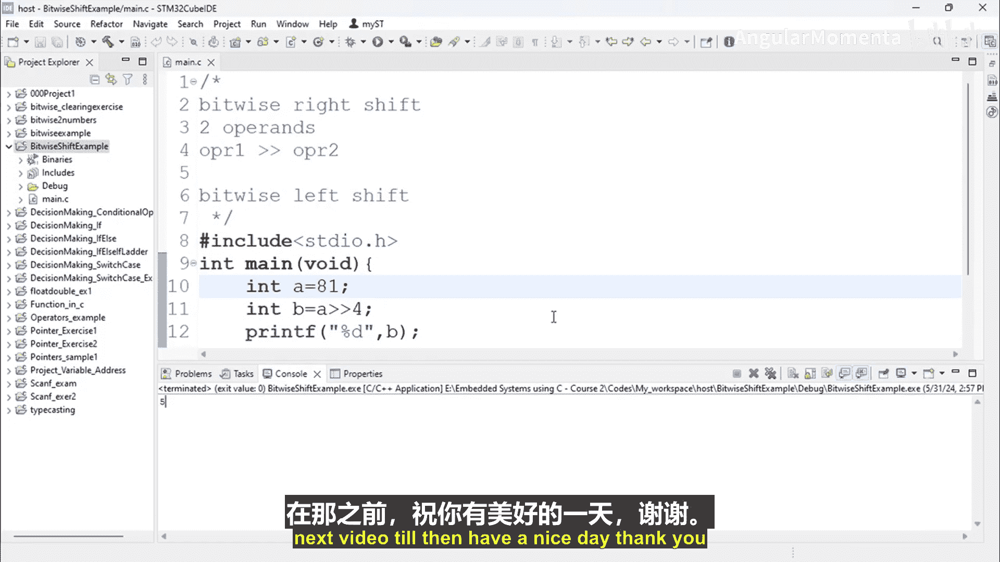

# 【EDUCBA】构建嵌入式系统 ｜ ARM Cortex (STM32) Fundamentals： Building Embedded Systems p55 04_01_01_按位右移运算符 -BV1KjcTzUEeY_p55-

Hey， honors， welcome back。 Now， in this particular video。

 we'll explore about the remaining bitwe operators。

 That is the bitwise right shift operator and the bitwise left shift operator。 Okay。

 so I'll do one thing。 I'll just create a CC++ project here and let me name this as bitwise shift。

Example。And let me create your new source file。Main dot C， okay。Could， so。We would be looking at。

As discussed。But wise。Right shift， and。Be wise left shift operators。Okay。

 so let's get started with the bitvis right shift operator first。Dride shift operator。

 take two opera。Okay， bit of the first opera will be rightshift by the amount decided by the second opera。

 right synaxes you have， let's say， opera 1， you use bitwise right shift and you have the opera 2 over here。

Okay， so lets see one example for the same。😊，So， over here。If you have to shift a particular opera。

 okay， let's say you have a character variable。 But before that， let me use SDD I O dot H。

 Let me have end main。And。Let me return。And now， let me take here a character variable。

I have given here a particular value。 I have another character variable Here。

 I am seeing a right shift by 4。Okay， so what would be the value in B we can just give directly in printf I want to print the value of B here。

 So I am using a printf and just simply executing this， building this and。Run as I plus plus。

 So see here， as the value over here， it must be shifted four times to the right， right， so。

Basically， we have shifted4 bits of a。Right。So the binary format of 1，1，1 would be encoded to 8 bits。

 okay。And once we shift it。You will get the particular value。O。So instead of care。

 let us take here an in variable and let me print it in。And okay， so let me build the project and。

Let me run this。 See。 what was the value of y initially，1，1，1， right？

 This would be transferred into a bit。Right into 8 Bs。 Then I shifted 4 B。 Okay。

 so once we shifted 4 bits， I basically given the value 0 there。 and then whatever the new8 B。

8 B were there， those is something what what a bit value of 6 Cters。Right， so once you shift it。

 write， shift it， you basically shift it by 0 by default。 Okay。

 so you basically go on adding 0 that particular bit position。 Okay。

 so when the position becomes emptied， it would be filled up with zeros and you will get a new value。

 which will be the value over here in this case 6。 supposeuppose you have a number， which is。

 let's say 81。 and now you try to shift this， then the value would be obviously different because the bit position for 81 is different。

 So now you are getting a value， which is the bit position of 5 number 5 right。

 So that is how you can use here， the bit wise right operator。Correct， so now， let's see。

Another way in which we can use the bitwise left also。😊。

So we'll discuss about that in the next video till then。 have a nice day。 Thank you。

