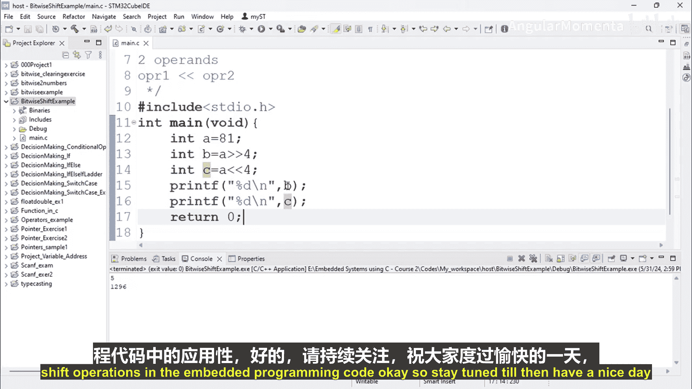

# 【EDUCBA】构建嵌入式系统 ｜ ARM Cortex (STM32) Fundamentals： Building Embedded Systems p56 04_01_02_位左移运算符 -BV1KjcTzUEeY_p56-

Heil earns， welcome back。 So now let us understand the bitwise left shift operator over here。

 We have seen the right shift in the earlier video。 Okay， so if I go on with the left shift again。

 this takes two opera。 that remains same。 The syntax is first opera left shift。Opernt2。

 so bit of the first opera would be left shifted by the amount decided by the second operate。 Okay。

 so let's quickly take a look at an example。 Okay， so we have seen one particular value。 Okay。

 so now let's check out an example for the same。Let's understand how the bits are basically moved Okay so what I'll do is I will take the same earlier example that we were doing I would just take another variable int C and here I will do。

E。Left， shift4， okay， and。I will print here the value of C as well。

 So let me just build a project again and run this。Look it once ago。Let me。Give it like this。

Built it。So once you left shift the value in C comes to 12896， which will be the value for your bit。

 so once your bit positions are changed obviously the value also would be changed okay in initial bit positions would be changed again in left shift also the bit positions become empty and then they are substituted by the zero values and thats how you get the new value of bit。

That is executing。So now in the next video， we will take a look at applicability of bitwise shift operations in the embedded programming code okay。

 so stay tuned till then have a nice day， Thank you。

