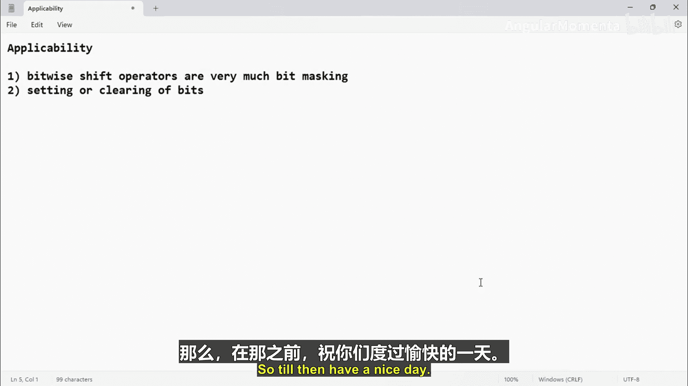

# 【EDUCBA】构建嵌入式系统 ｜ ARM Cortex (STM32) Fundamentals： Building Embedded Systems p57 04_01_03_位运算移位运算符的适用性 -BV1KjcTzUEeY_p57-

Hey Los， welcome back。So now in this particular video。

Well understand the applicability of the bitway shift operators in the embedded systems。So。

For is your。Bitwise， shift operators。They are very much。Helpful in bit masking。

Okay of data along with the other bitwiseice operators。Now， predominantly。

 they are used while setting or。Clearing of bits。Okay。

So let's consider the problem statement we have to set the fourth bit of the given data right now how do you do this using the bitwise operators so the set of the bit the fourth bit of the given data now there are two methods which you can do one way is you will have to use as we have done in the previous video we have given a particular data in order to set the fourth bit we have to find out the mask value and then the mask value here you have to do it in a bitwise using bitwise or and the mask value here happens to be some value let's say0 into 10 so you have to do basically data is equal to data bitwise or0 into 10 as we have done for the LED example earlier okay。

Now the problem in this method is you will have to create a mask value right So for this exercise creating a mask value is very much easier because here the width of data is just8 bits。

 but if you have a particular program where you have a larger amount of bit data masking value let's say you have 32 data or you have 64 bit data then creating a mask value is very tedious process So that's why there is one shortcut method which you can basically follow so the shortcut method is involving the shift operators over here So if you use the shift operators as we have seen the bitwise right shift and the bitwise left shift we can basically recommend you to use this method instead of using the earlier one So basically what you can do is you can take the number one and you can take the binary value of that So binary value of number one let's say somewhere around 0000001 so we have to hold set the fourth bit。

That's why shift number one， four times to the left side。

 That's it right So this is basically shifting by one。 Similarlyly， you can shift it by 2，3，4。

 So like by how many bits， it is required。 So basically just check the mask value finding out the mask value is difficult but shifting of bit is really easy So now let's explore clearing using the shift operator。

 Okay so if you have to clear four bits of the given data。 Okay in the traditional method。

 you basically have to create a mask value， mask the bit position for the corresponding for a bit and then you have to calculate that again and then you have to shift。

 but over here， you have to only use that operator and use the bit twice shift operator and just give how many bits you want to shift。

 So this method is really easy in case you have a shorter data or even if you have a longer data right So now what we'll do is the earlier LED on exercise that we have use instead of。

Using the mask value， well use the shift operator and will fix our code in the next video。

 So till then have a nice day。 Thank you。😊。

