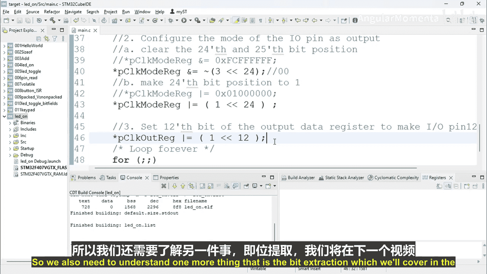

# 【EDUCBA】构建嵌入式系统 ｜ ARM Cortex (STM32) Fundamentals： Building Embedded Systems p58 04_01_04_使用位运算移位操作符修改LED灯运动 -BV1KjcTzUEeY_p58-

Hello Erus， welcome back。 So now we'll modify our core using the bitwise shift operator over here。

We are actually enabling the clock over here。The step。Right。For our GPIOD fer field right。

 so the A H B1 ENR we actually modifying the third bit position here right so what can we do is we can rewrite this particular statement Okay so I am just putting a comment here。

 let me copy this let me put a comment and let me just modify this okay， so what I am going to do is。

Use this。 I'm going to use bit twice or is equal to in bracket。 I'm using one。Shift，3 B。Right。

 so we have to set the third position， so I would do it one。

Then the bitwise operator and three right So second step。 Okay。

 so here we have to clear the 24th and 25th bit position， which is this particular statement right。

 so we can also do this using something like instead of this using the masking value here， Okay。

 let me comment out this and again copy out this and let me remove this and using the ampers is equal to I can use one。

The 24th position has to be removed， right， so I can just give here the negation symbol。

 Negating is very much important because you are making it negation。

 which means you are making it blank， right， So basically making it 0， right？ And again。

 for the 25th1， you can do it。Just copy this。Down here， and。Do it here for 25th。 But this time。Now。

 instead of using two lines of code， this can be also done in one line。

 okay basically what you can do is you can use over here something like this you can say here。

3 and then use the bit shift operator and 24。 Okay， so instead of using one， I'm using3。

 So binary value of 3 is 1，1。 So it's like you know pushing 11 to 24th and 25th bit position。

 So in the mode registry you have to basically clear 24th and 25th right So what you do is you take a number 3 and left shift this by 24 right when you do that what happens。

3 will come and settle over here on 24th and 25th position So what is 3，3 in binary is 1。

1 and then you are negating this， which means it is becoming what 0。

0 again right and all other becomes11。 So that's why you are using3 here。 Okay now next。

Well make the 24th position bid as one。Right， so let's come to this particular line。 Okay。

 so again here also I'm going to comment this， I am going to copy this line。

 put it here and instead of using this well use the bitwise operator。

 So now what I am going to do use here1。Left shift，24。Okay， Anne。Similarly。

 the2th position over here。The 12th bit position it can be replaced over here。

 so I don't want to use the mask value。 I want to use1。Shift thee。2 the 12th bit over here。

So after modification， just recheck the code， whether it's working or not。

 let me compile this code okay if everything is proper this will properly compile there is no error which means it's working fine okay you can also check the particular windows as I have told you earlier if you want to check initial windows check and see the values which are changing there okay。

😊，So this was very much easy instead of using the masking value。

 Hence we have replaced this code over here。 So I have kept the earlier code as well。

 and I have added the bitwise code over here。 All right， so now in the next video。

 let's consider another bit extraction example。 Okay。

 so that was about applicability of bitwise shift operators in the embedded systems。

 So we also need to understand one more thing that is the bit extraction。

 which we'll cover in the next video So till theyll have a nice day。 Thank you。😊。

