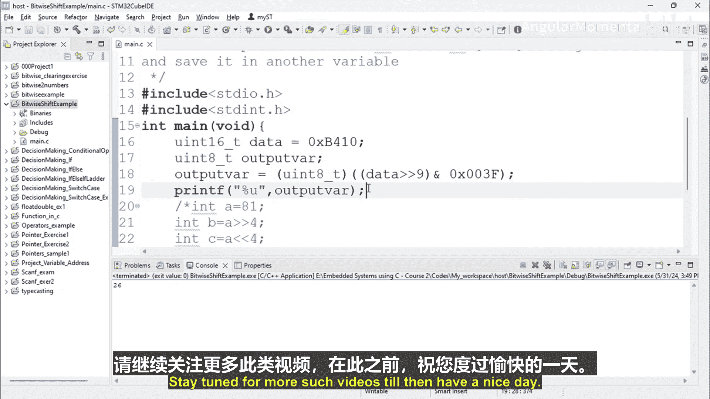

# 【EDUCBA】构建嵌入式系统 ｜ ARM Cortex (STM32) Fundamentals： Building Embedded Systems p59 04_01_05_位提取 -BV1KjcTzUEeY_p59-

Hey owners， welcome back。 Now， in this particular video we will understand about the bit extraction。

 So let's consider a problem statement in this case。 Okay。

 so I'll continue in the same bitwise operator bit bitwise shift example itself。 Okay。

 we have to basically extract the。Bit。Position from， say， 9 to。14th， that is 14， colon，9 in a。

Given data。 And we have to save it in。Another variable。So let me just put this in multiple。

Line so that it is easy for you to。Check out Okay， so this is what we are supposed to do。

 We are supposed to extract this， and we are supposed to put it。 So over here。

We have donated it something like 14 colon 9。 Okay now let's understand how can we do this。

 We'll consider a particular example。 let's say we have a data which is 16 bit value okay which is written in a particular binary format and we have to extract only a portion from bit 14 to 9 to 14 right this can be done using the method described here that is we can shift the identified portion to right hand side until it touches the least significant bit and we can mask the value to extract only 6 bits and then save it into another variable okay this could be one that means you have to just move the portion extreme right until it touches the LSB right and after that you can mask it So let's let's see how can we do this first step that is shifting so the original data have to be shifted to this particular right position okay。

😊，So if you do that， okay， the ninth bit position will come and it will touch the0th bit position right so by shifting 0。

1，2，34il 9， you have shifted by 9 positions or 9 bit positions there。

 So here when we see that6 bits actually came to extreme right right now here only this is useful portion is the right hand side thing that is there。

 right， So that's why you can now just。😊，You can just zero out this particular portion and keep it aside right for that you have to do it mask。

 right， So the second step is mark the value to the to extract only 6 bit from 0 to 5 and save it into another variable。

 So here we can。 We don't want and want this portion of the mask that is there with zeros。

 We only want the portion。 We have to mask that with one。😊。

So we can select the mask value and just extract that mask value。And rewrite it to another code。

 right， So let's see how can we do this by writing a particular quote to it， Okay。

 so let us first create a variable。 Okay， what Ill do is I will just comment out this thing for now。

😊，Okay， it would be there in the。Particular program， okay， Ill take， let's say。You end。 But for that。

 I have to。Include the。S TD into dot edge file。Let me take you in 16。Under score t。

 and let me take the value data is equal to something like 0 x， let's say B。4，1，0。

This is the value that I have stored then I have U and8 and Q T。

 which is my output variable in which I want the data extracted data to be stored into it right。So。

This variable is a 16 bit data。 I want to extract from 9 till 14th from this binary data and put it into the output variable。

 which is output where variable， which is of 8 B。 Okay。

 so basically I will have to do a shifting over here， okay。So。To do that。

 you will have to use here the same output where。Use your or。Forat 4。Giving that is you int。

8 underscore T converted into this format data， write shift 9。

 use and bitvis and operator and give your a masking。Okay。

 and then simply you can use a printf printed in percentage U the value of。Output where。So。

 after shifting。From 92。The particular value I am just looking at。It's coming here to 26， right。

So in this way， successfully， we have done this particular。

A example of shifting using the bitwise and transferring that value into another variable。

 So I have used your bitwise right shift， and we have used here the bitwise and operator as well okay。

So that's it from this particular bit extraction video。 Stay tuned for most such videos still there。

 and have a nice day。 Thank you。😊。

