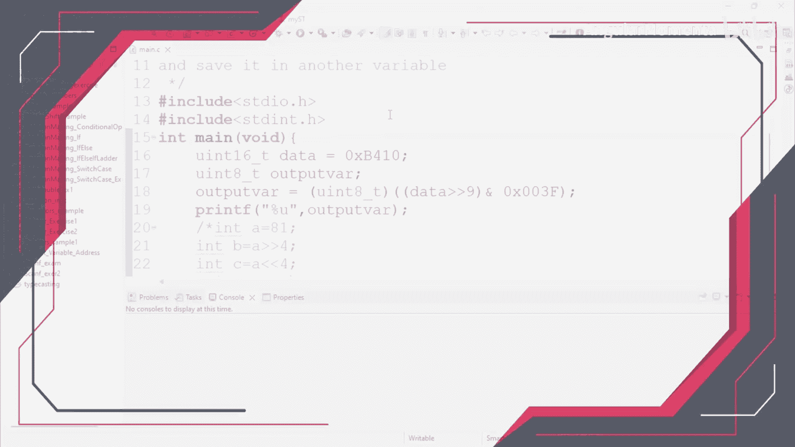
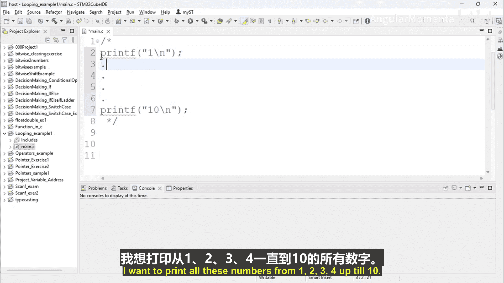
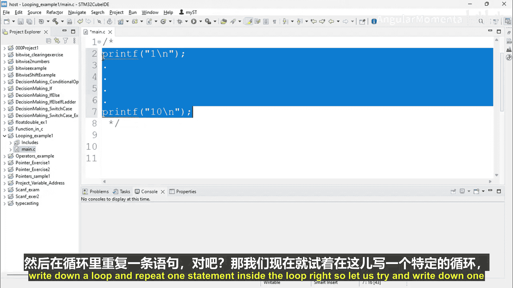
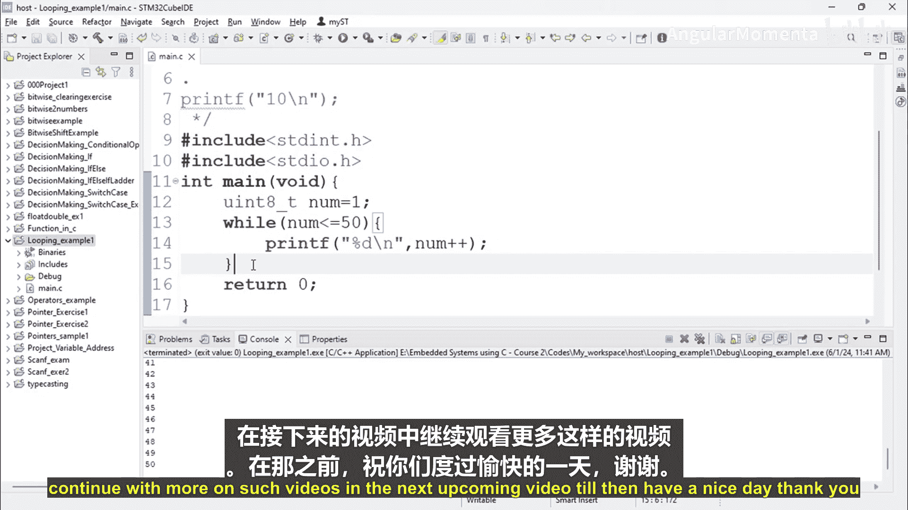

# 【EDUCBA】构建嵌入式系统 ｜ ARM Cortex (STM32) Fundamentals： Building Embedded Systems p60 04_02_01_C语言中的循环结构 -BV1KjcTzUEeY_p60-

Hey Erers， welcome back。Now， from this video onwards， we will start learning about looping in。 Okay。

 so let me just create a new CC plus plus project here， and I would name this as。Looping。Example 1。

And。Let me also create here a new source file。😔，Okay。Fine。

 now let's first understand why exactly we need a loop， right， So let us take into consideration。

 Okay， one particular program where I want to print。Let's see。From one。Till。10， I want to print。

All these numbers， Okay， from 1，2，3，4 up till 10。 Now one way is you have to write down 10 different statements。

 Okay， and then create it， but that would be too tedious job right。

 so instead of what instead of this what we can do is we can just write down a loop and repeat one statement inside the loop。

 right so let us try and write down one particular loop over here。 Okay。

 so what I'll do is I'll start here， let's say SD I O dot。

And we'll use your end main。And。It。Returns，0。Now， in this， I am going to create。Using Uent。

 so I'm going to use the SDD int as well。 So Uent， let's say8 and score T I'm creating a number。

 Im initializing it with one value。 I want to print it till 10。

 So I'm going to basically use a loop known as while loop in while I'm going to open the parenthsesis。

 I'm going to write down nu is less than equal to 10。Inside this。

 I am going to print in percentage D， give a new line the value of num and then increment the value of nu。

So what is going to happen over here is while num is less than 10。

 This is a expression that I have given。 initial value of nu is 1， which means for the first time。

 this will return the value  true。 when it comes to true。

 the statements given under the loop will execute。 So it' is going to print here。

 the value of nu since I have used post increment first。

 the value of nu would be printed and then it would be incremented。 So it will print here 1， okay。

 and then make it 2， then again， it will go here， check if 2 is less than equal to 10。

 if it comes to true， it will print 2 and make it， the value of nu from 22，3。

 this will continue till。The value of nu is less than or equal to 10。

 which means as soon as this value here when after incrementing， it reaches 11。

 and now it checks is 11 less than equal to 10。 the output comes to false。

 which means the loop will end and the statement will come over here and my program will execute completely。

 So instead of writing 10 different print statement。

 I can just write one statement and put those inside a loop。

 that will save a lot of coding time and it will make my job very easy as well right that is the real importance of using loop in C programming。

 So let me just save this。 Let me build the project and let me run this and show you to output see it's printing from 1 to 10 Similarlyly I can use in similar manner I want to print it till 50。

 Let's say so I have incremented it by 50。 So for me there is only one print statement in three lines of code I am getting an output。

😊，Which is 50 lines of statements which are executed。 So now you see it is printing until 50。Right。

 so there are three types of loops available okay one is4 loop， one is do while loop。

 one is while loop so we have seen an example of while loop over here。

 all loops are basically doing the same thing。 the only differences you have syntax differences in all the three loops。

 so we'll see one by one okay so in this particular session we have understood about while loop so let's continue with more on such videos in the next upcoming video till then have a nice day Thank you。

😊。

