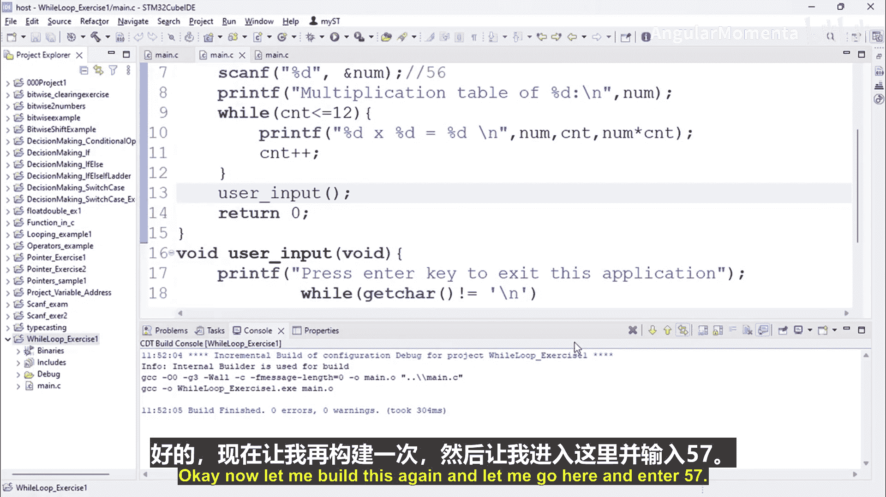
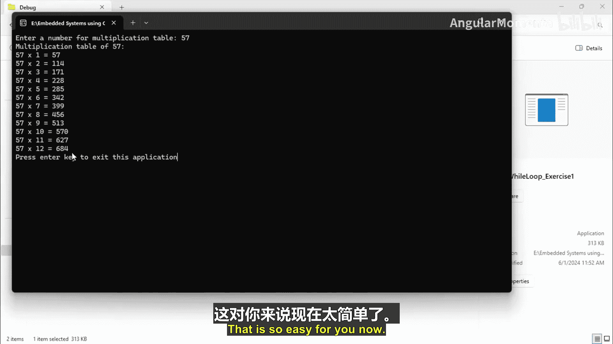
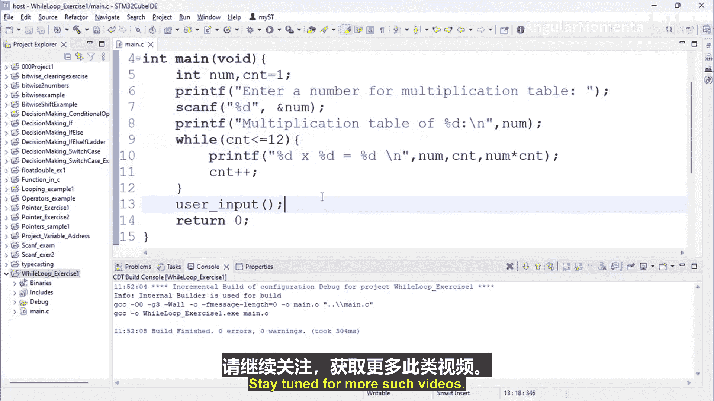

# 【EDUCBA】构建嵌入式系统 ｜ ARM Cortex (STM32) Fundamentals： Building Embedded Systems p61 04_02_02_while循环练习第一部分 -BV1KjcTzUEeY_p61-

。Hay Ho， welcome back。 Now， in this particular session， we'll understand about a while loop exercise。

 Now this was a simple example that we did。 Okay， so let me create a new C plus plus project and let me name this as while。

Loop。Exercise 1。And let me add a source file also in this。 So new source file。Okay， and。Let's start。

With the creation， O， now before that。Let's understand the programme， what are we supposed to do？

We want to write down a program， okay2。Brenend thee。

Multiplication table using vi loop okay so basically we have to accept a number from the user and we have to print the multiplication table for that number using the loop Okay so we can print the multiplication table till 12 okay if you want we can exceed that you can make it 152025 anything。

 Okay， so let's start by first including the STDio dot H we would be only taking here the normal integer variables Im not including the SDD int dot h okay。

Let me return 0 here， and。Soir。Yeah。Let us start with creating the number first I'm going to create a number and I am going to create another number which will be the counter variable because I have to multiply it so this variable will start from one and whatever the number user enters I'm going to save it in nu variable okay so let me give a printed statement to the user I am saying enter a。

Number。4。Mulipplication。Table， okay。And let me。Use a scan if your use。

Percent D and save it inside the variable nu。Then I am going to first print a statement to the user saying。

Mulipplication table of print here， Per D， colon， then give a new line and print here the value of nu。

 Then I will start a while loop。 I will start from I less than equal to。12， we will take it。 Okay。

 so this loop will continue for 12 times because the value of sorry not I the here it is C N T because the value of C N T is equal to 1 initially and it will go on 12。

 right？ So inside this， I am going to print。I want to print the value of the number First print here an asterisk sign。

Again， print the value of this C N T。And is equal to the result。 So I am。

 I have not taken any different variable for result。

 What Ill do is I'll print first the value of num， then the value of C， N T。

 And then here only I will do num in into C， N T。That is a multiplication of it。

 So initially C n is equal to 1。 suppose I enter here a number that is， let's say 56。

 So it will do 56 into 1 and print 56 x1 is equal to 56 right then。On the next statement。

 I am doing CNT plus plus。Okay which means I am incrementing the value of CT over here。

 so once the printer is done CT would be incremented from1 the next time it will become 2 again2 is less than equal to 12 the statement will execute this will become 3 this will continue till the value of CT reaches 13 because 13 is not less than equal to 12 this will come to false and then the loop will come out over here right so let me save this and let me build this first and now I'll open this on a command prompt since I'm accepting a number from the user so let me open the application file and let us enter 57 okay。

One more mistake that we did over here。 we have not stopped it。 so let me just copy the user input。

Method over here。 and let me also give here the function prototype。

 and let me also call the function over here so that the loop keeps on in the same order。Okay。

 now let me build this again and let me go here and enter 57。

 I get the multiplication table for 57 from1 till 12。

That is so easy for you now you don't have to write down multiple statement just inside the loop。

 we have written two statements and this is making it execute for 12 times。

 Now that is the beauty of using your loops right so we have done another example of while loop over here。

 So if you want to change this you want to find out the multiplication table till 20 make this while loop go on till 20 times and then go on executing it so it absolutely depends on you how many times you want this table to be displayed。

 Okay so whatever number you enter， you are supposed to get the multiplication table auto generated over here and you can view that。

So that said from this particular session， stay tuned for more such videos still then have a nice day。

 Thank you。

