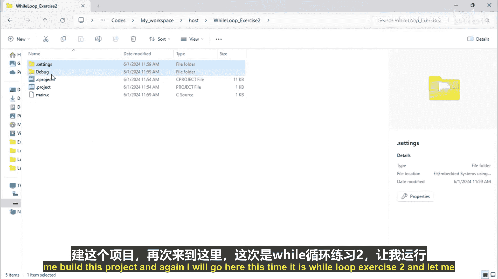
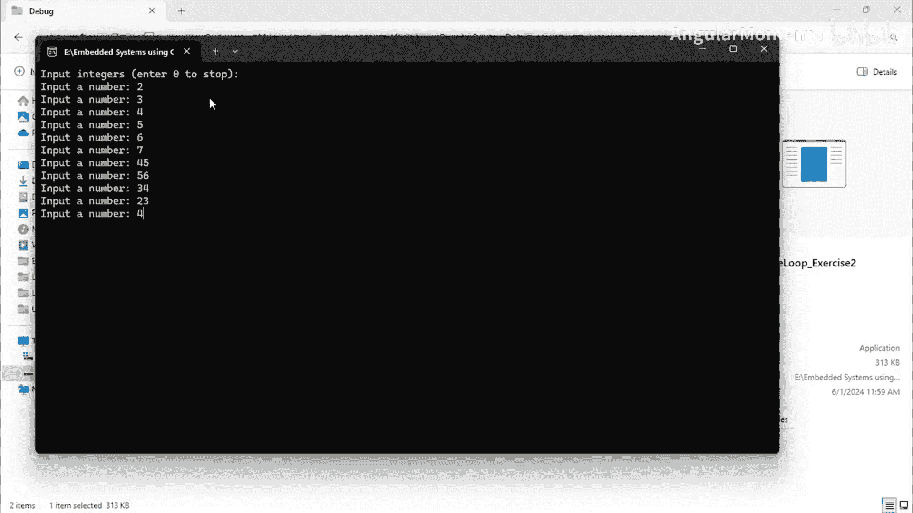
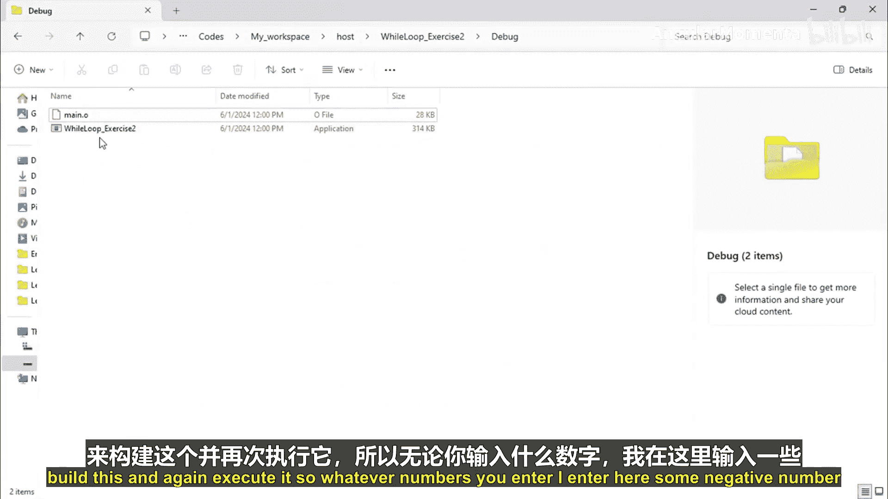
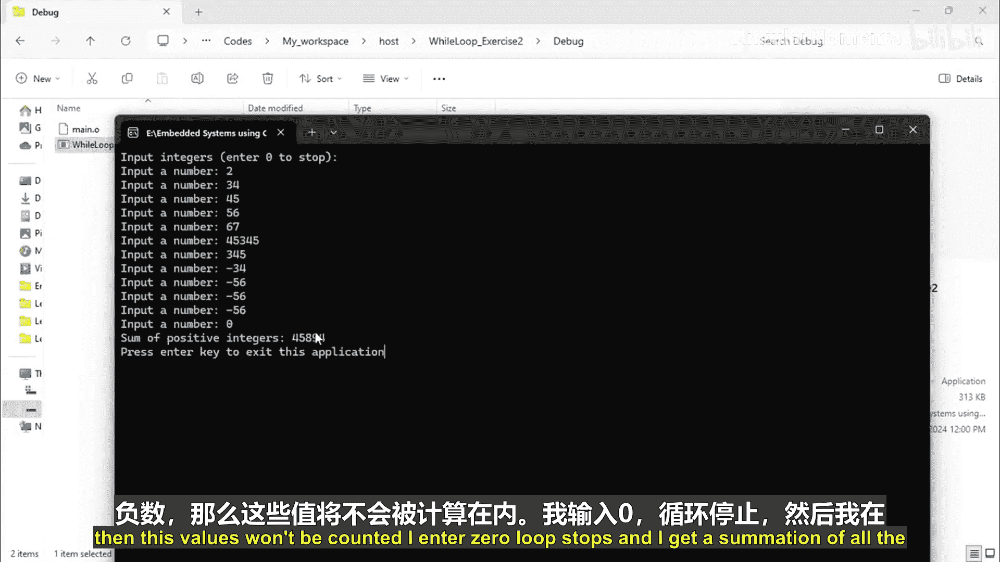
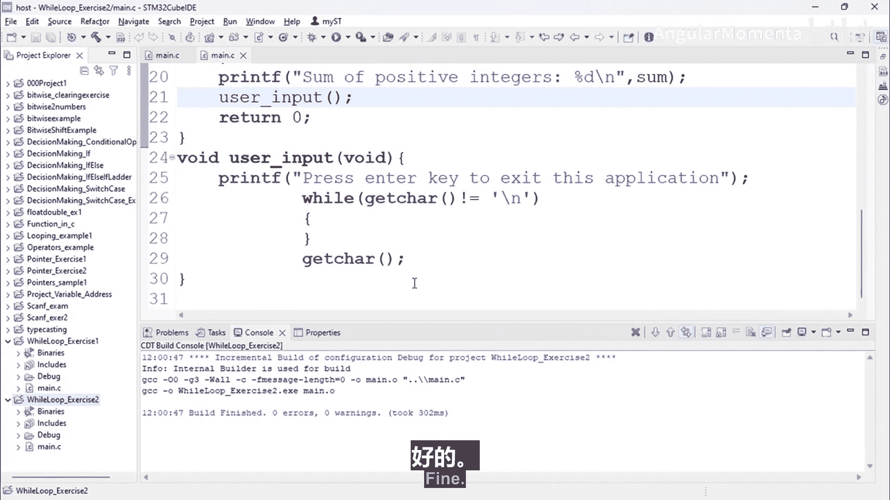

# 【EDUCBA】构建嵌入式系统 ｜ ARM Cortex (STM32) Fundamentals： Building Embedded Systems p62 04_02_03_while循环练习 第二部分 -BV1KjcTzUEeY_p62-

Hey Erers， welcome back。 So now let us create another project here。

 and we will be creating another vilobe exercise here。

 So I'm going to name this as vi loop and score。Exercise 2， this is Min G W and finish。

 And let me also add here a new source file。Okay， now let us first understand what are we supposed to do。

 So we are supposed to write a program that will。Prompt the user。To input。A series of integers， okay。

Until the。User stops。Entering。0， using a。Vi loop， which means as soon as I enter 0。

 the loop should stop， right， then I have to。Calculate， and。Print the。Some of all。

Positive intes that were entered。Okay， so if the user enters， let's say 10 different inte。

 152000 till enters0 the loop will basically go on continuing okay so let's see how can we do this first of all we will need to include STDIio dot edge then I am going to create here main method and inside this we will start with writing the return statement and first of all we'll create a variable nu in which we will store the user input we'll create another variable which is sum and we'll initialize this initially to0 okay。

😊，Okay， so first thing is we will have to give a print command to the user Okay so before that I am giving a normal print saying。

You have to input the。In Tea and I'm going to give you a command， enter02。Stop。😡。

So that the user knows what he has to enter if he has to stop the particular loop。

 then I won I will basically start a while loop to continue until the user enters0。

 So for this I am just going to put while1 now when I say while 1 which means always the loop is going to continue okay it will。

Only stop once I enter 0 okay but that I will do a check inside the loop itself。

 Okay so here I am going to give a printer saying。😊，Input a number， okay。

And I am going to use a scan if do a percentage D， save it inside the variable nu。

 Then I am going to check if the value of nu is double is equal to 0。

 which means if the user have entered 0， then I want to break the loop。

 Now this break the loop will basically exit your。🤢。

While loop and you will come out of the loop if the user enters 0。

 so if you want the user should end the loop using say 9K。

 you can give that message over here and check if the value of nu is equal to 9。

 then you can break the particular loop okay。😡，Then next。

 if condition I am giving that if the value of nu is more than0。

 I want to have a sum of all positive numbers right so I am going to give this particular statement here and after this I am going to say use the value sum。

 say plus is equal to the value nu， which means whatever the value of sum is this statement basically evaluates as sum is equal to sum plus nu。

 So instead of writing entire this statement I have made a short statement using the operator plus is equal to okay so after the statement have been written okay and the number the sum of the values are there in the variable sum。

After my loop， after the loop ends， Okay， here I would be printing you statement saying， say some of。

Positive。In teachers。Print here， percentage D slash n and the value of some variable。

So this statement will come out of the vi loop， okay I have not given the open close bracket for if because there is only one statement that is going to execute if this returns true okay。

 so if nu is equal to 0 the loop is going to end come out here if the value of nu is more than 0。

 then it is going to add up the values and print and give me the sum of results okay。😡，So。

Let me build this project。 And again， I will go here。This time， it is vilo exercise， too。

And let me run this。 Okay， I input a number。2，3，4，5，6，45，56， whatever numbers I can just。

 you can see the loop is going in an infinite position。 I enter 0。 The loop stops。 Okay。

 one more thing we forgot here。 We will have to。

Copy down。This statement， the method over here， as well。Similarly。Gaive here and call this method。

Over here to keep the screen， hold it。 Okay， so let us build this and again execute it。

So whatever numbers you enter， I enter here some negative number， then this values won't be counted。

 I enter zero loop stops and I get a summation of all the numbers over here。

 which are all the positive numbers。

Are you getting it， Okay， so that's how your programme is getting executed。 fine。

 so stay tuned for more such videos。 till then have a nice team。 Thank you。

