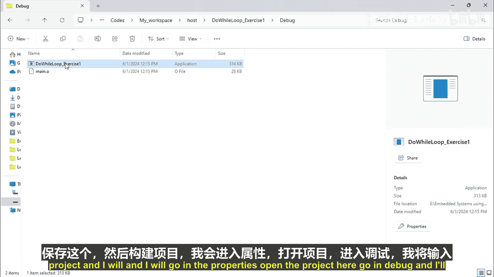
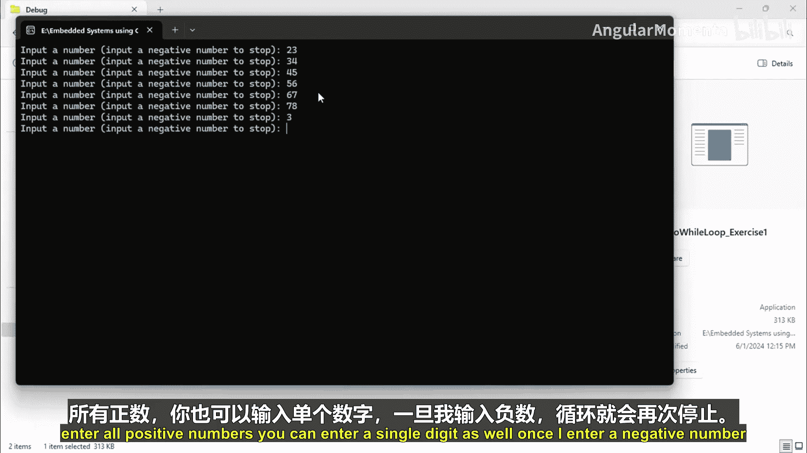
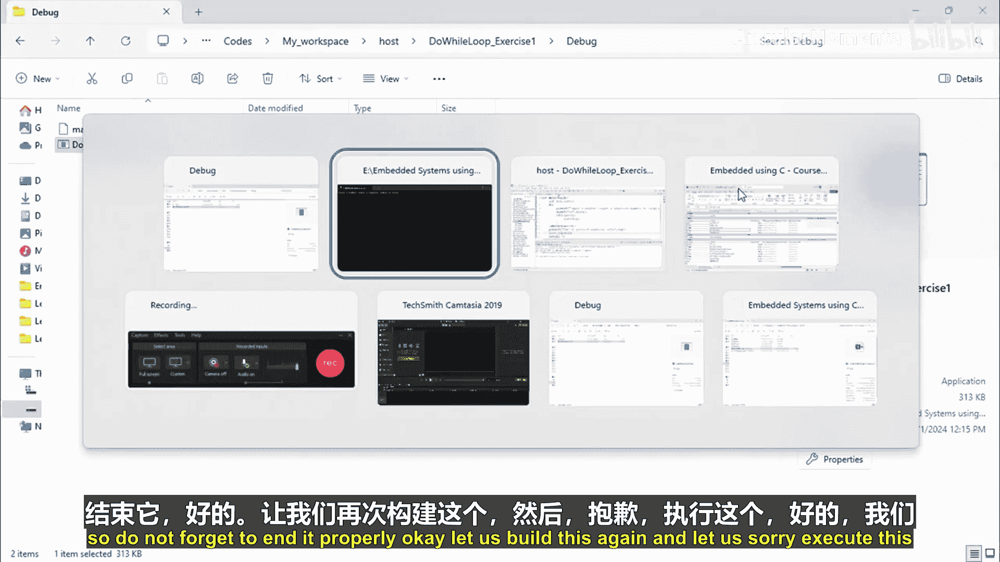
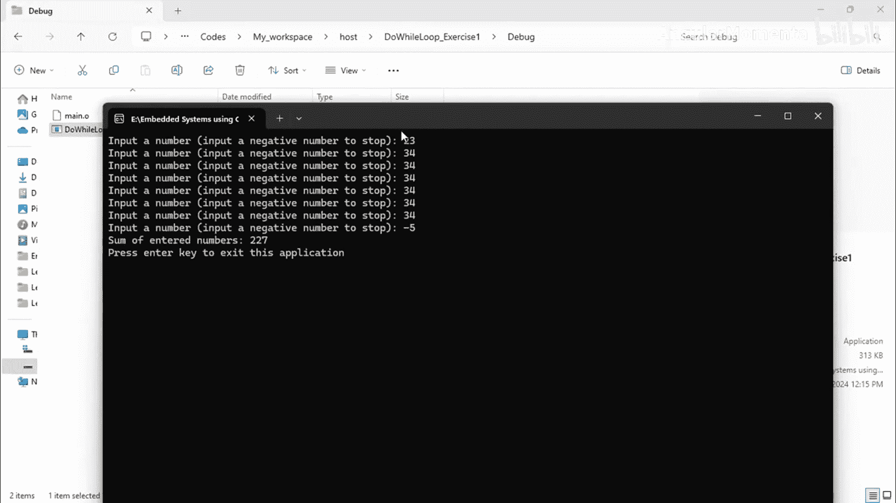
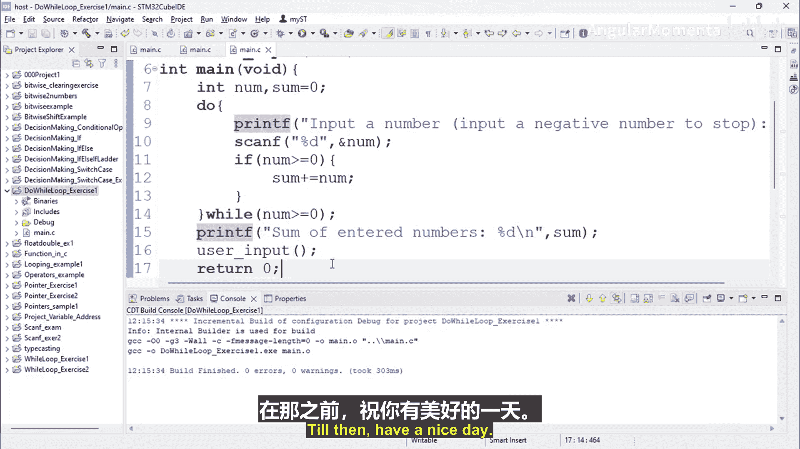

# 【EDUCBA】构建嵌入式系统 ｜ ARM Cortex (STM32) Fundamentals： Building Embedded Systems p63 04_02_04_do while 循环 -BV1KjcTzUEeY_p63-

Hey learners， welcome back。 Now， let us proceed with understanding the next loop。

 which is the do by loop with the help of exercise。 Okay， so let me create a new project。

 And this time I'm going to name it as。Do while lope。Exercise 1。And。Let me add in this。😔。

New source file。Okay， and again， let me copy this here。😔，Similarly。Let me take。This as well。Okay。And。

We'll start with。Inside mean Now， before I start， let us understand what are we supposed to do。

 So we are supposed to write a program that will prompt the user。To enter a。Cies of numbers。Until。

They input a negative number。Okay。Then， we are supposed to。Calculate and print the。Some of。

All the entered。Numbers using。Do I loop， okay。So let's start creating this okay。

 so we are supposed to get the number from the user。

 so I'm going to create a variable for that and also for some。I am initializing some with0。

Then I want to another syntax for dual while loop is a bit different if we compare it with while okay so first is I will start the dualval loop by saying do I'll open the curly braces and here I will give my while statement so I have to continue the loop while the value of nu is more than or equal to0 So once this value of nu becomes negative it will stop so till this is more than or equal to0 my loop will continue until a user enters a negative number okay now what I' am supposed to do inside this dual while loop I will first print F I will say。

Input a。Number in bracket I am giving， say input a。Negative number 2。Stop， okay。And。After the printf。

 I am going to use a scanf because I want to store the value entered in the variable nu here。

Then I will check if the value of num is more than equal to 0。What are we supposed to do。

 sum plus is equal to nu。Okay， now I have given here this bracket。 If you don't want。

 you can just remove since we just have one statement in the if condition。 Okay。

 now after my loop ends here， I am going to print okay， the sum of。Enter。

Numbers and let me print your percentage D slash and the value of sum。Okay。

So let us save this and let us build the project， and I will。And I'll go in the properties。

 open the project here， go in debug。And I'll enter。

All positive numbers。You can enter single digit as well。 Once I enter a negative number。

 the loop stops。 Again， we made a silly mistake。 We have created the method。

 but we have not called it so。

Do not forget to end it properly。 Okay， let us build this again and let us sorry。

Execute this。And。Okay， we made a mistake here while entering。 So it was our mistake。Okay。

 so some of entered number is 227。

Alright， so this is getting executed properly。 That's the way you user your do while loop。

 So yes syntax changes in the file it the statement comes over here and then if the condition is true my loop executes。

 whereas in the do while loop first， at least once my loop gets executed and then the condition is checked over here if it is true or false okay。

So that's it from this particular session。 Stay tuned for more such videos。

 till then Have a nice day。 Thank you。

