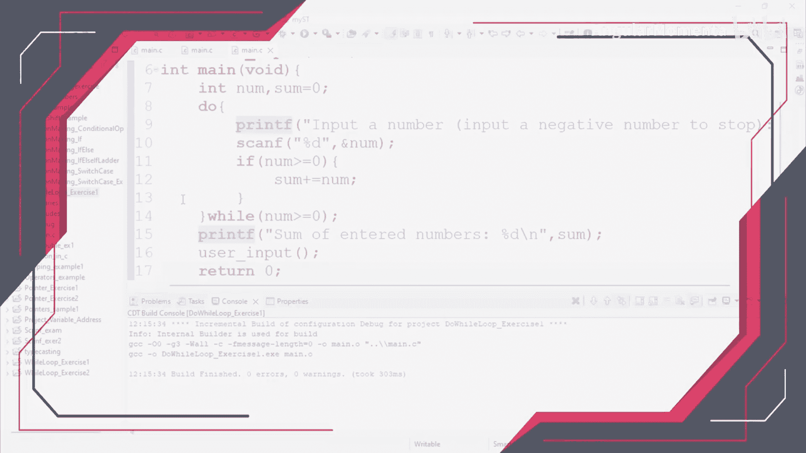
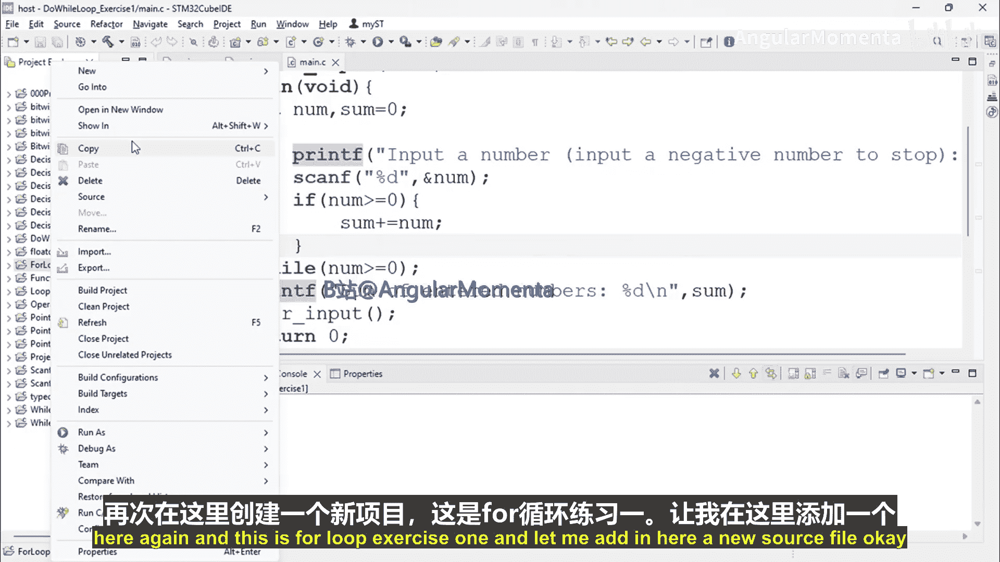
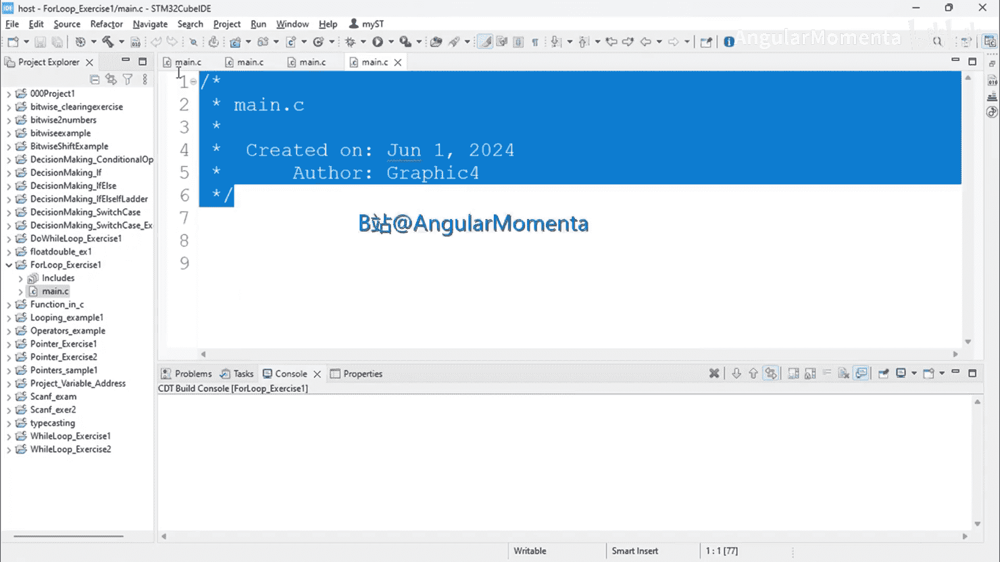
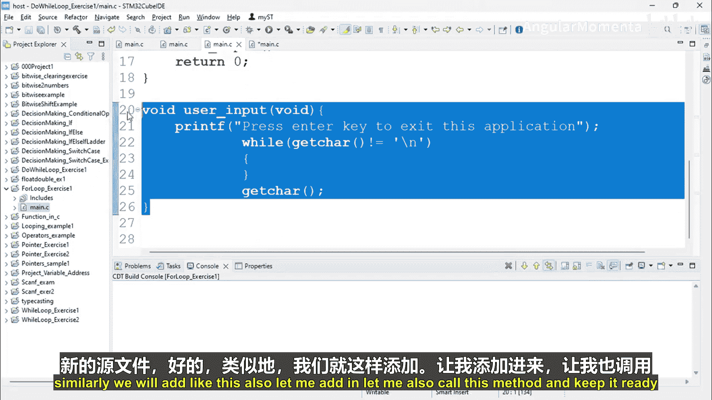
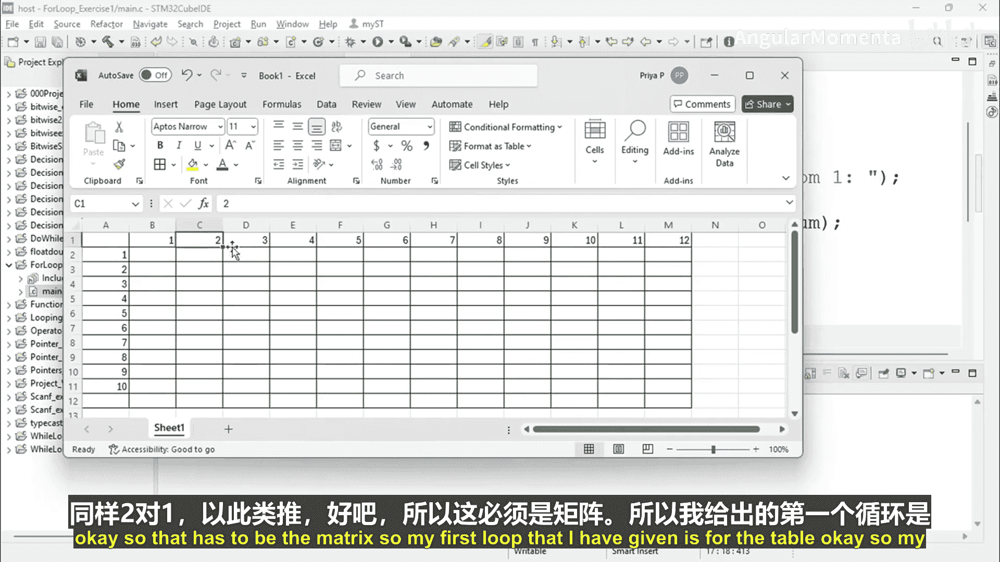
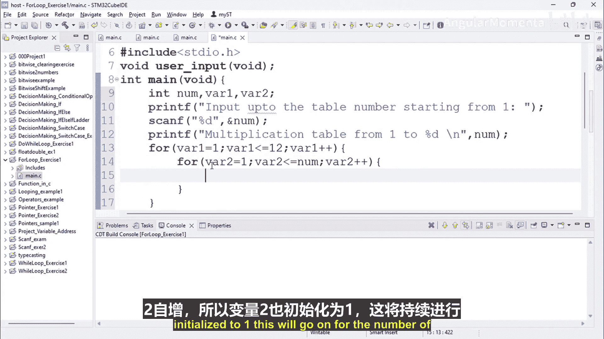

# 【EDUCBA】构建嵌入式系统 ｜ ARM Cortex (STM32) Fundamentals： Building Embedded Systems p64 04_03_01_for循环练习 第1部分 -BV1KjcTzUEeY_p64-

Hey earn， welcome back。 Now， let us do an exercise with for loop。

 So let me create a new project here again。 And this is for。Loop。😔，Exercise1。And。

Let me add in here a new source file。

Okay。

Similarly。

We will。Id like this。Also， let me add in。Let me also call this method and keep it ready。

 otherwise we then tend to forget and return0。Now， let us understand what is the exercise first。

 okay。So we are supposed to write down a program using。For loop， okay。

 which will print a multiplication table from one up till number that user enters， which will。

Prireny。Mulipplication table from one。Until。Number。Entered by user， and the table。Would be till。

Let's say，12。Okay， so starting from1 that is1 is to 1，1 is2 up to 1 is to 12。

 and suppose I enter a number that is 50。 So till 1 to 50。

 I will get a table created automatically and printer Okay so for this what we first need is we will need to create here say a variable and in which I will accept the value from the user then I will take here another variable where one and where to so I have taken here in all three variables。

 Ill use a first printer I will say input。Up도。Table number。Starting from one， let's say。

So let's say user enters over here something like 30。

 okay so I will scan if the statement and I will store that in the variable nu。

So I will give a message to the user saying thee。Mulipplication table from。1。2。

 the value which user have entered。 okay， let us print here the value of num。Now。

 for printing the table， I will run a for loop。My for loop starts with the value of where one is equal to one because my table has to start from1。

 Then I am saying where one is less than equal to the number that user have entered。

 and I am saying sorry， less than equal to。12， because my multiplication table has to go for 12 times。

 right， Then I am giving here。Where one。Plus， plus。Okay， now this is my first loop that will execute。

Why am I saying first loop because basically I want something like a matrix okay so Ill just open an Excel file and I' will show it to you there what is the expected output。

Okay， so that you know， it makes your concepts clear。Okay， so I have this Excel file。

 I am just going to put 1，2，3，4，5，6，7，8，9，11112。I'm just going to。Give here， let's say a border。

 how I want is I basically want here。 it should start from one。😔，2，3，4，5，6，7，8，9。1011。

 And let's take one more。Value here。12。 And here， let's say I enter a number 10。 So this should go4。

10 different。Values， and I should get here a multiplication of this。 So one is to1，1 is to 2。

1 is to3 like that。 Similarlyly，2 is to one like that。 Okay， so that has to be the metric。

 So my first loop that I have given is for the table Okay。

 so my table has to go from1 till12 I want to go until 12。 Okay。

 and then inside this I will create another for loop。

 Okay wherein I am going to give where to is equal to 1 Okay， then I am giving。

Where2 should be less than equal to the value of。Noumb。And。Where to plus plus。So， variable 2。

Is also initialized to one。 This will go on for the number of。

