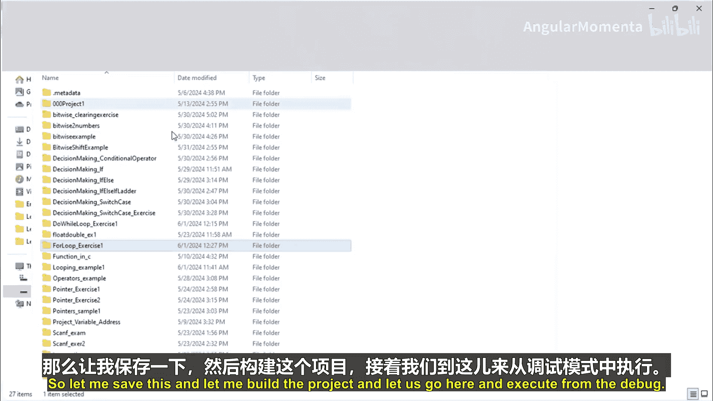
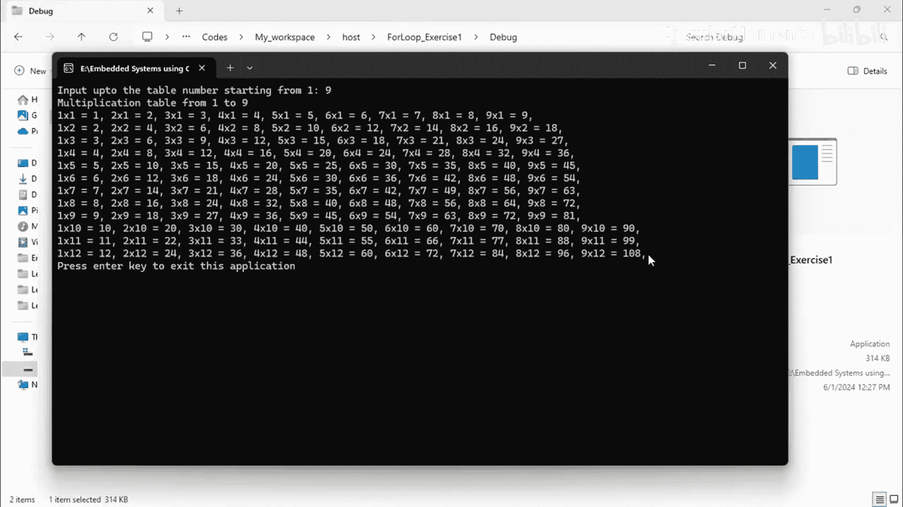
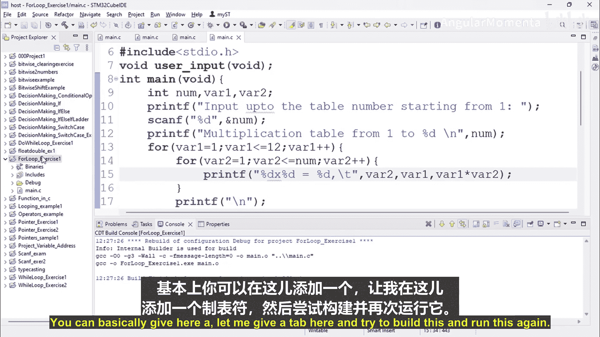
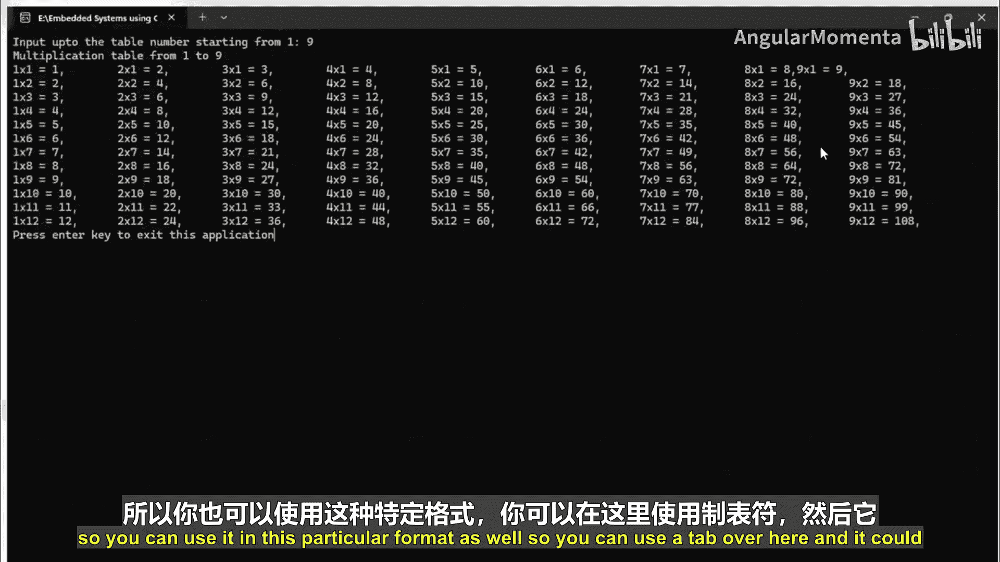
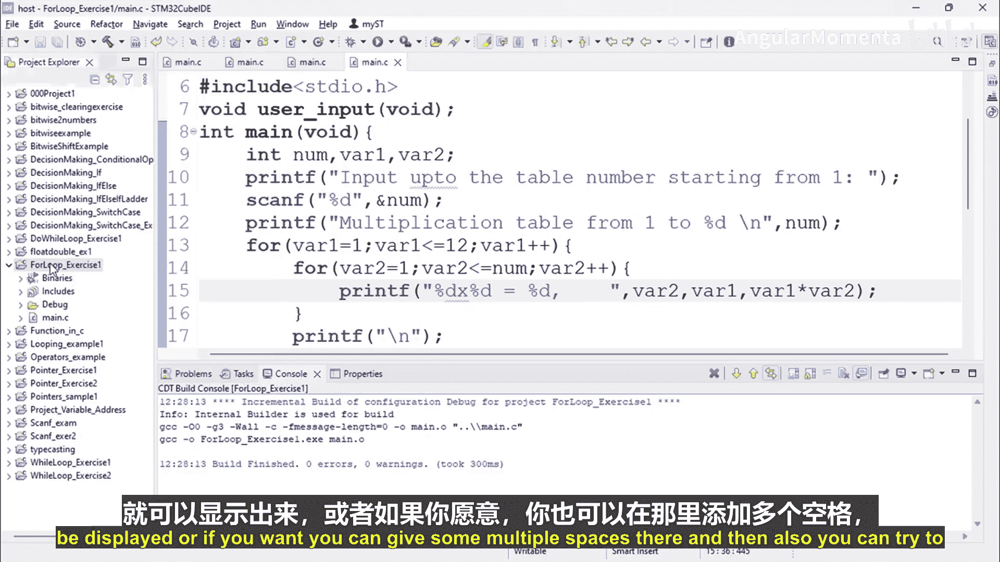
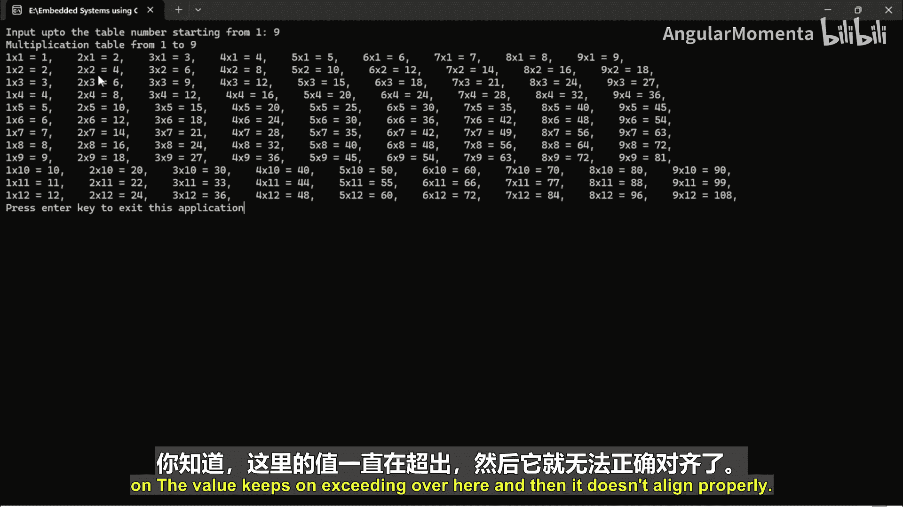
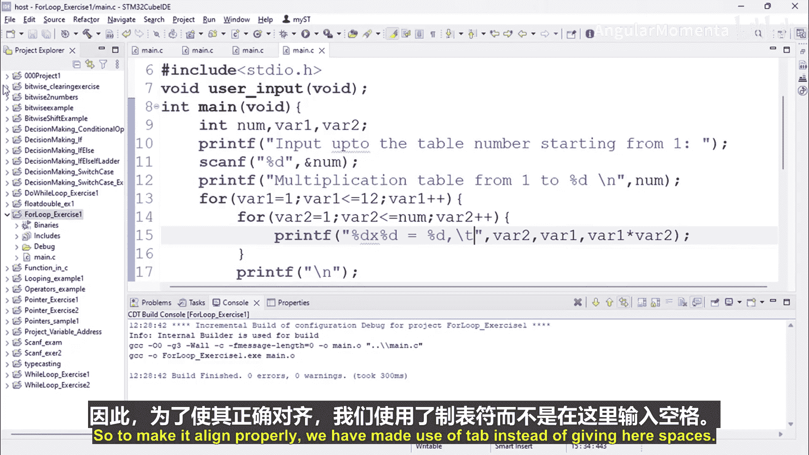
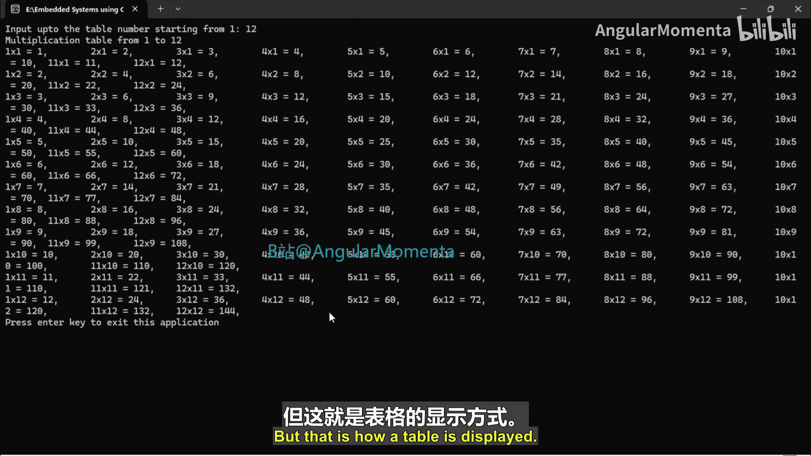
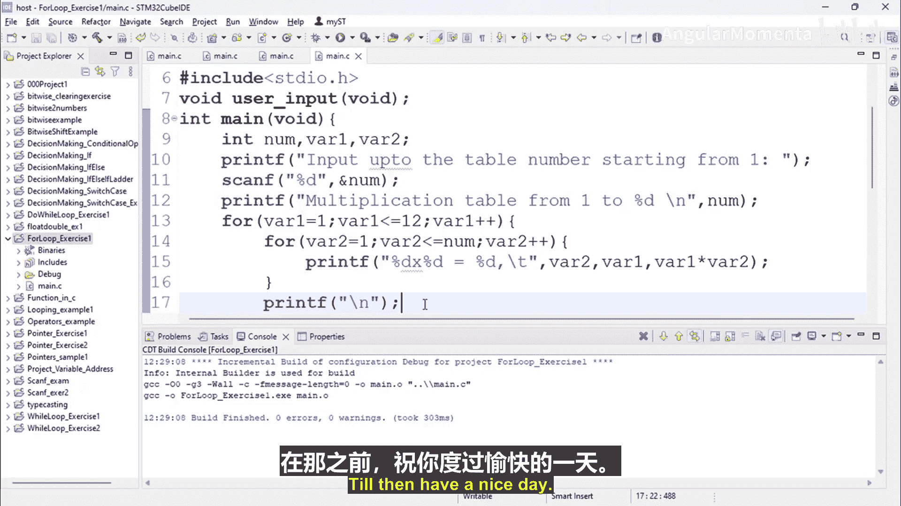

# 【EDUCBA】构建嵌入式系统 ｜ ARM Cortex (STM32) Fundamentals： Building Embedded Systems p65 04_03_02_for循环练习 第二部分 -BV1KjcTzUEeY_p65-

Rose， right， because if I enter here a 30， this slope will go for 30 times and inside this。

 what I am going to do is I am going to print here first is percentage D。 I use an x。😡。

Will not give us space， okay。Percentage D is equal to percentage D。 Let's give a space here。Okay。

 and then。After this， I give a comma， give a space。 and here I first print the value of where to。

Then I print the value of where1， and then I print。Where one multiplied by ver2。

 which is multiplication Then after this here for the next row， I am just giving here a new line。

 So once first row is printed， I give here a new line and the next row gets printed on a new line there okay。

So let me save this and let me build the project Okay， and let us go here。🤢，And。

Execute from the debug。 Let's say I want to go until 9。 So you see multiplication table from 1 to 9。

 The first table comes over here。O， from one is to 1，1，2，12， then 2 into 1。

2 into 2 up till 2 into 12， then 3， then 4，5，6，7，8，9 and 10。

Right， so that is how I am basically displaying this。 Okay。

 now what you can do is you can do one more thing over here。 You can basically give here a。

Let me give a tab here and try to build this， and。

Run this again。Yes， this is also coming in a proper format。

 this gives you a look in a proper way because the entire table gets displayed properly right so you can use it in this particular format as well。

So you can use a tab over here and it could be displayed or if you want you can give some multiple spaces there and then also you can try to execute it。

 let me print it19 but still this is not aligned properly because you know it goes on the value keeps on exceeding over here and then it doesn't align properly so to make it align properly we have made use of tab instead of giving here。

Spaces， okay。So if you open this and if you make it。Expanded already， it comes in the proper auto。

Okay， so if next time you enter， you know， some bigger number。Let's say I entert till 12。

 so then it will go on in a new line because automatically。The values would be shifted， okay。

But that is how a table is displayed， right。

So thats it from this for loopbe exercise here we have combined everything we initialize the variable。

 we check the condition and then we reinitialize the variable in the for loopbe okay。

So let's see another exercise in the next video till then have a nice day， Thank you。😊。

