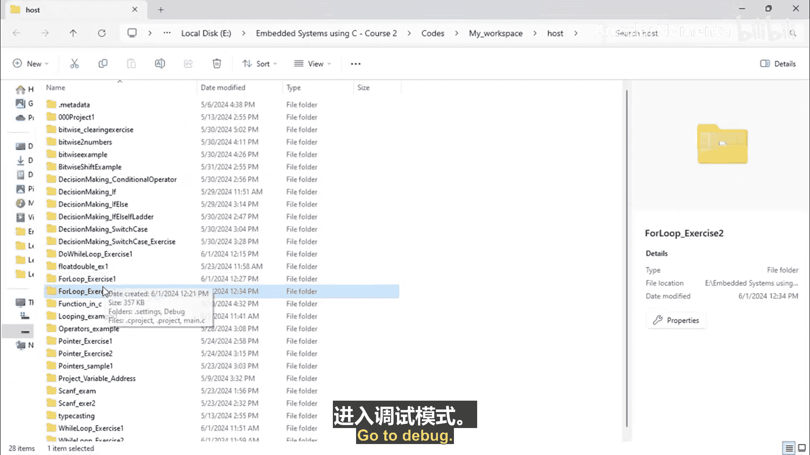
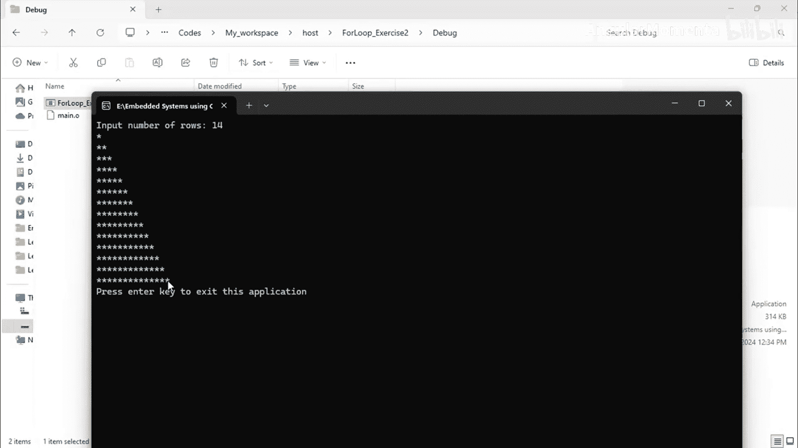
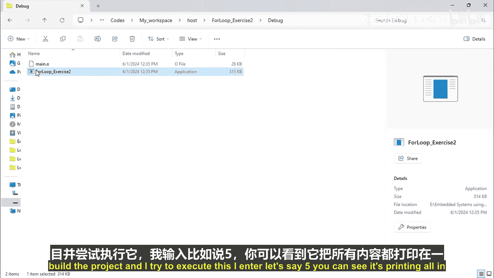
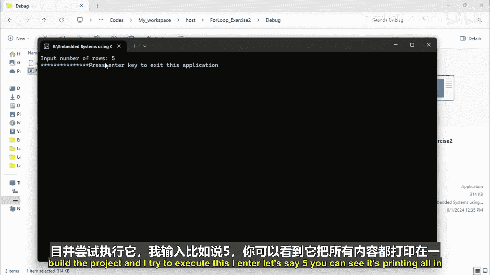
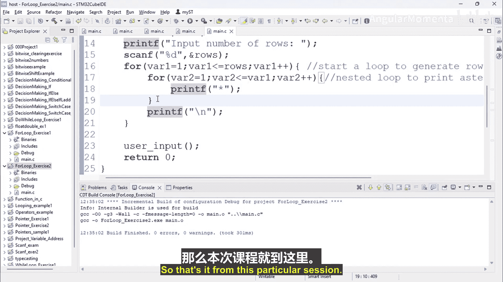

# 【EDUCBA】构建嵌入式系统 ｜ ARM Cortex (STM32) Fundamentals： Building Embedded Systems p66 04_03_03_for循环练习2 -BV1KjcTzUEeY_p66-

Hey earners， welcome back。 Now， let's quickly create another for loop exercise。 Okay。

 so I'll create another CC plus plus project， and I'm going to give you a name for loop and score。

Exercise，2。Min GW， okay。And。Let me just copy the entire thing， which we just now created。

 and let me add a source file。And let me paste it here。

Now in this there is a slight change that we want to do in this particular exercise what I want to do is write a program。

To display。D。Following。Format， so let's say I have to print it like this。

OkayI want to print an asterisk like this， but the number of rows of asterisk I want to input it by the user。

 so if the user enters5 it will print 5 rows， if the user enters 10 it will print 10 rows but it will print in a right angle asterisk。

This all will remain same here Also I will require where one where to。

 lets take this nu variable as row variable。 Okay， here we have to give the user to enter。😊。

Will say input。Number of rows。Okay， and then save that inside the variable rows here。

 Then we are supposed to run a for loop。 So the first for loop will go from。

Starting with where is equal to 1 and goes till the value of rows that user have entered。😡，Sorry。

 where one is less than equal to。Rose， and we say where one plus plus now this。Starts a loop。读。

Genrate the row of。Ass okay， then we have another loop wherein we have where2 is equal to 1 this time where2 value will be less than the value of where1。

And we are saying where to plus plus。 Now， this is our。Nested loop。Which is used to print thee。

Astriix。Based on your。Current rule， because if you have row number one。

 you have to print one asterisk。 If you have row number  two。

 you are supposed to print two asterisks， right， So here we are just supposed to give。

Print asterisk here okay and once this is done which means suppose in a row you have five asterisks printed。

 then when you come on a new row you are supposed to give here a print a print L statement right so this will come over here and rest everything remains same so I have saved this I will build this and let me open up this go to debug。

😡。

And start， let's say I want asterisks for 14 rows， so I inputted 14。

 so my loop continued for 14 in the first row， the value of where one was one and the value of where two also was1 so it printed one asterisk。

 Then we incremented the value of where1 we made it2。

 Then the value of where1 again started from one went on for two times。

 So this printed one asterisk this printed two similarly printed multiple asterisk till it reached the value of rows。

 which was 14。Once it becomes 15， my loop has stopped right so here in this particular loop。

 this print the new statement is very much important because if you don't give this new statement the it will print all in one single。

😊。

Line itself。 Okay， for example， I commend this。 Okay， and I again build the project。

 and I try to execute this。 I enter， let's say，5。

You can see it's printing all in one line， So in this loop。

 the printf after the inner loop is very much important because this keeps a track of your column。

 this keeps a track of your row so once your one row ends you should come on a new line and start a new row there。

 remember this okay。😡。

So thats said from this particular session， thank you so much。😊。

