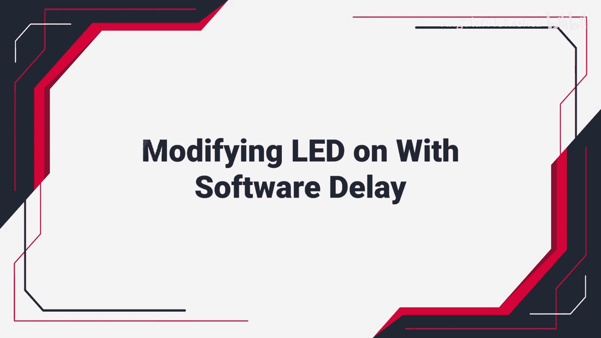
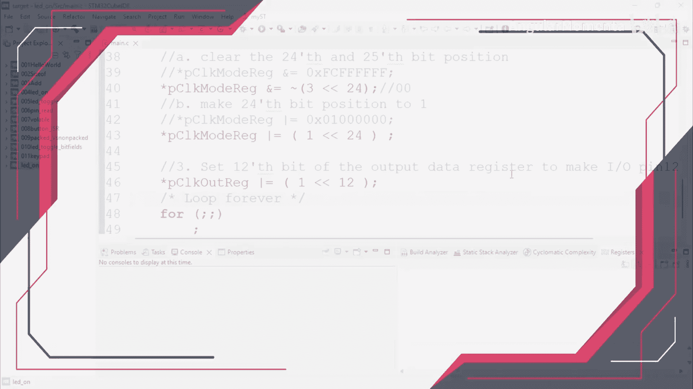
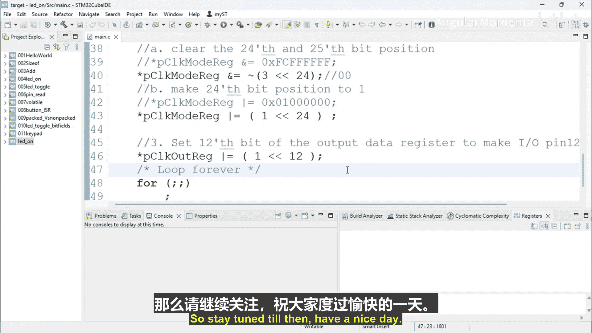

# 【EDUCBA】构建嵌入式系统 ｜ ARM Cortex (STM32) Fundamentals： Building Embedded Systems p67 04_03_04_通过软件延时修改LED为开启状态 -BV1KjcTzUEeY_p67-

Hy onus， welcome back。Now， in the earlier videos we have implemented the four loops and we have also done one LED on exercise okay now let's implement another exercise on this this is very much simple will modify the same LED on program into the LED toggle program by creating a software delay between the LED on an L so L should basically continuously toggle within a certain time delay forever right so now we'll basically introduce time delay in a program so let's understand how to introduce that so either you can basically use a software delay or hardware delay software delay means using a time delay using some loop statements and hardware delay you can introduce the delay using the hardware peripheralphers like timemos or something so for this exercise will be using the software delay so to introduce the software delay you should make the processor busy in a。

loop doing nothing。 Okay so this method is not an accurate method to obtain the desired time delay。

 Okay accurate method actually is using some hardware fer fers like you know timers but we don't want that accuracy in this application as of now so we just want certain amount of delay between LED on and LED of human observable delay。

 let's say so like precision is not required。 Okay so just random delay。

 which can be know perceived by human eyes in order to distinguish between that this is an LED on this is an LED off so basically the processor will keep the keep wasting the execution cycles until certain delay is met Okay so we will implement this exercise so well create a new project and try to modify the LED on program into the LED toggle program Okay and we'll use like for the loop implementation you can either use a while loop also or a for loop and you can try to attempt。

😊，The exercise， okay I will show you the solution in the next video。

 so stay tuned till then have a nice day。😊。

