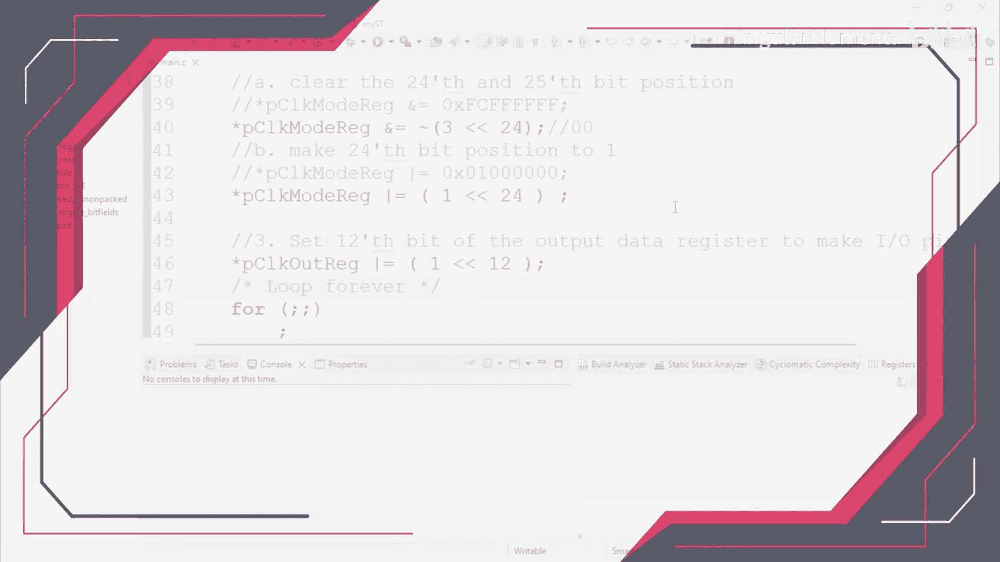
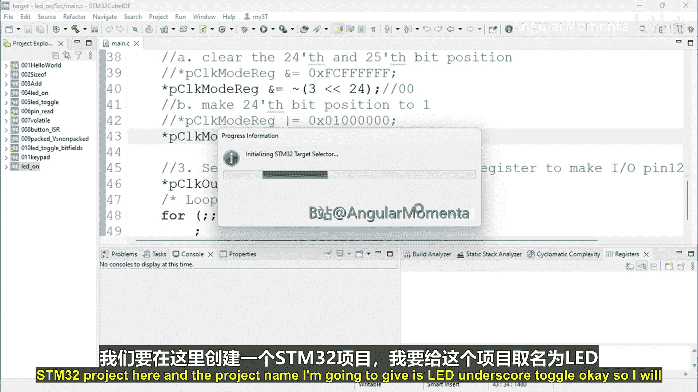
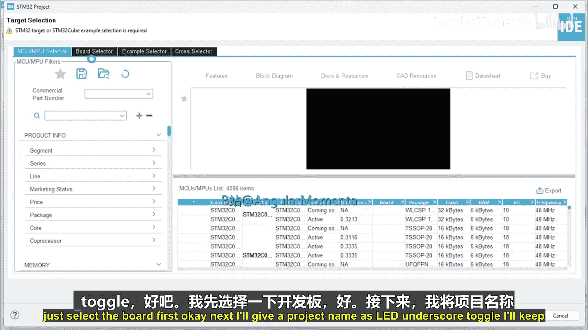
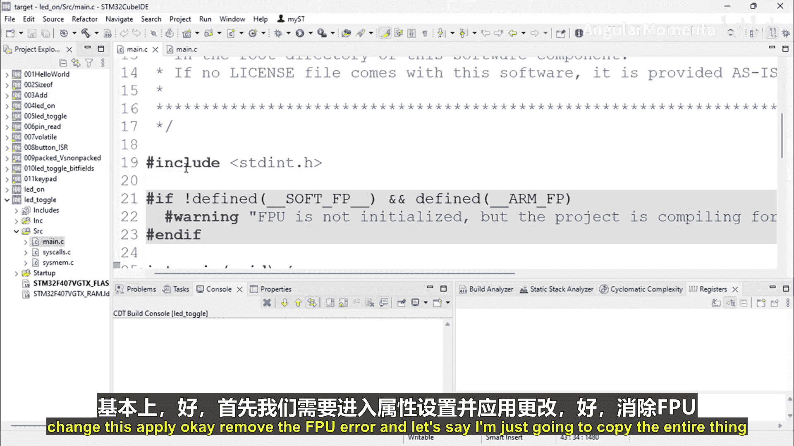
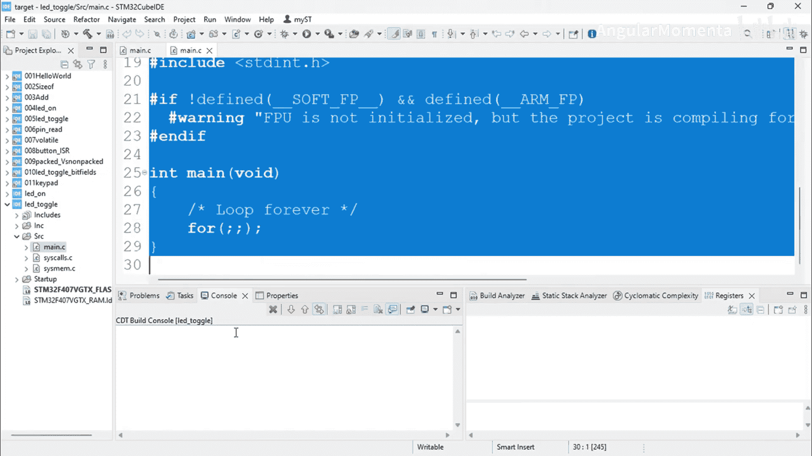
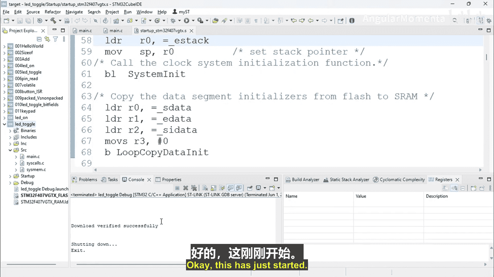

# 【EDUCBA】构建嵌入式系统 ｜ ARM Cortex (STM32) Fundamentals： Building Embedded Systems p68 04_03_05_软件延迟控制的LED切换 第1部分 -BV1KjcTzUEeY_p68-

Hey earn， welcome back now let's implement the exercise so first we are going to create an STM32 project here and the project name I am going to give is LED underscore toggle。

I will just select the board first。😔。

Okay， next。I'll give a project name as L underscoreco。Toggil。I'll keep it empty， next。

This would just take about some time to create。 And once this is done， O， I'll go here in mail。

 and from this。Okay。I will， basically。Okay， first， well need to。Go to properties。😔，And。Change this。

Apply okay， remove the FPU error。 and let's say Im just going to copy the entire thing。😔。

From earlier one over here。Okay， so I just don't want to make any mistakes there。

 So I have just copied it and now we'll just make the changes， okay so。

We have placed the entire code here。Now， inside this， okay。Let me put it here， okay。😔。

We'll introduce a small human observable delay， Okay so what I'll do is。

I will just after this statement， I will add here another line。Will introduce。Small。Human observable。

Dely here。Okay。Okay so after that we are going to create a delay by using a loop statement right so as earlier we have discussed we can use here either a while loop or a for loop so it doesn't actually matter which loop you are going to use okay so let's use here a for loop to create a delay okay basically we have to trap the processor of a certain amount of delay inside the loop so that's all we need to do it Okay so let us write down here a for loop okay so for Im just giving here double colon。

😊，I am opening the bracket here and just putting here a semicolon okay now this is an empty body given over here。

 okay now lets create inside this one variable and let's keep it incrementing that variable until it increases to certain number okay so let's create a local variable over here。

Okay， so local variables you can basically create outside the loop or you can also create it inside okay so let us create here。

 say U8。😊，Or lets take U in 321 does score t variable as I is equal to 0， we give here I。

 which is less than lets say 10000。And we say I plus plus。

 so this loop basically executes for 10000 times， okay it is doing nothing but just executing and this is the empty body of the loop okay。

Now we are not sure whether 10k times of loop will result in some human observable delay or not okay we basically will have to fix that to you know using some trial and error methods okay so instead of creating an empty body here what can we do is we can basically code this identical into a code okay or we can also do it like this just remove this part and just end it over here this will also work okay so after the delay we can turn off the LED okay so after a delay over here we are basically going to write down a code for。

Turn off thee。LED so well do here a pointer say。This is our out register， so I'll take that。

We are using here amp Biwise operator。We are。Using a negation。Okay。

 and negation we are giving here again， one。Shifting 12。Right。

 and then again well have to toggle the L， but the L should toggle forever。

 so that's why we have to keep all the instructions inside and in finite loop。 Okay。

 so what we'll do is we will just create an in finite loop over here。Okay。Let's say， from。

The third position here， okay， let's use vi 1。Well open the bracket。

Or you can also use for loop over here， okay or vi loop， whatever and。

All these statements will go over here， and。Im going to end this here。

 but here also we will have a for loop。Which will again go in for 10000 times。

 So this is going to go into an in loop。 So I just created an LED toggling application so。

Let me connect my board and then we will build this， okay。Okay， so I am going to build the project。

Okay， building is successful， right？Okay， so now what I'm going to do is I am going to debug the application here。

😔，And we will check it in the。This assembly window， okay， so。I'll first go here。Okay。

 this has just started。😔。

