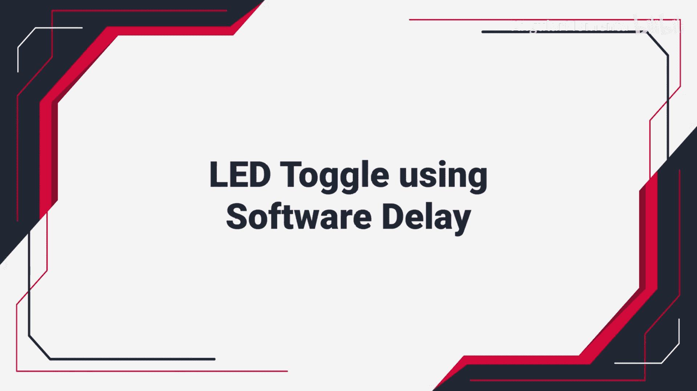
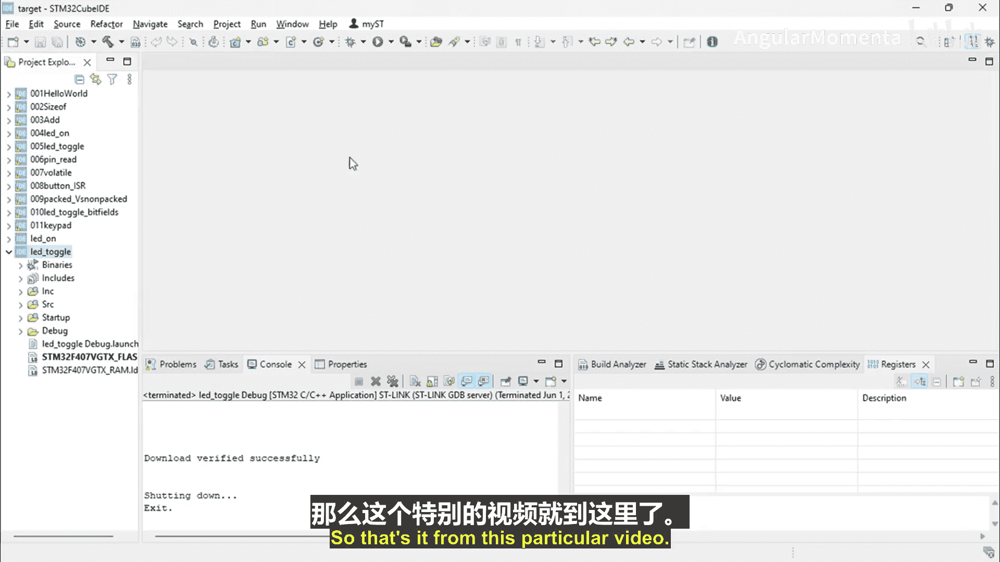

# 【EDUCBA】构建嵌入式系统 ｜ ARM Cortex (STM32) Fundamentals： Building Embedded Systems p69 04_03_06_软件延时控制的LED开关 第二部分 -BV1KjcTzUEeY_p69-

。Yes， it has started。 I' amm going into my disassembler window over here， and let me use a step over。

 go inside the vi loop。And now here basically you would be finding here a bit of delay in execution Okay。

 now we'll have to increase the you know number of times the loop executes okay。

 because you know we have given it a very shorter number let's make it 30000 here and here as well I'll save this and I'll again build my project and let me。

Debug this again。Okay， so let us make this。3 La， okay。And。Now， we will again。Resume this。

And we'll check our。Dassembler window， again。Okay， and let me go in。😔，With a loop over here。And now。

 here you can， basically。Clearly， check out the。Loop， that is happening。I go here inside this。

And then you will find a delay happening there。Okay， so if you increase the number of count。

 it is easy for you to， you know， identify the delay。 Okay。

 what you can do is you can also put over here。Okay， and let me resume this。😔，And。Let's。

Check out it again。 I'll start。Over again， okay， I have added your remark。And now in this。Okay。

 let me。Yes， you can see that。And now here you will find a small delay。Happening。Then。

 this will proceed further。Okay， so now。I proceed with this， and。My application completes okay。

 so then you can observe your delay you just have to。😊，Mark this for loop。 And then。

Debug this again and check the output， O。So it basically takes a couple of know clock cycles and then。

The application proceeds further。 So in this way， we have completed the LED toggling exercise also。

 so that's it from this particular video。 Thank you so much。

